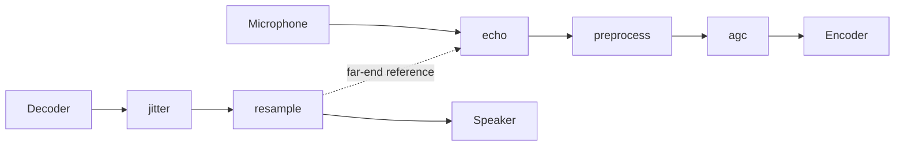

# Architecture

This document describes how the packages fit together. Components add their
own sections as they land; status is in [status.md](status.md).

## Packages

| Package | Role | Parity |
|---|---|---|
| `resample` | Streaming sample-rate conversion | Bit-exact with `resample.c` |
| `buffer` | Ring buffers, including a lock-free SPSC hand-off | Own design |
| `echo` | Acoustic echo cancellation (MDF) | Bit-exact with `mdf.c` |
| `preprocess` | Noise suppression and VAD | Bit-exact with `preprocess.c`, `filterbank.c` |
| `agc` | Automatic gain control | Own design (behavioural) |
| `internal/fixed` | Fixed-point arithmetic shared by the ports | Bit-exact with the SpeexDSP macros |
| `internal/fft` | Fixed-point real FFT | Bit-exact with KISS FFT via `fftwrap.c` |
| `internal/testutil` | Test signals, metrics, fixture loader | Test-only |
| `internal/kernels` | Architecture-specific kernels (stretch) | Bit-exact with the portable code |

The public packages do not import each other. Shared arithmetic lives in
`internal/fixed` and `internal/fft`. The one cross-package data flow, the
residual echo spectrum from `echo` to `preprocess`, is a slice the caller
passes on ([contracts.md](contracts.md) section 12).

## Typical VoIP pipeline

The send path cleans the microphone signal before encoding; the receive path
reorders and resamples decoded audio for the device.

1. `echo` needs the far-end signal exactly as it was played, aligned with
   the capture; the dotted line is that reference.
2. `preprocess` runs on the echo canceller's output and takes its residual
   echo spectrum.
3. `agc` runs last on the send path, so it sees speech with noise and echo
   already reduced, and can take the VAD decision from `preprocess`.
4. On the receive path, `jitter` (stretch) turns packets into a steady frame
   stream and `resample` converts to the device rate.

## Five timing problems that look alike

| Problem | Cause | Handled by |
|---|---|---|
| Rate conversion | Codec and device run at different nominal rates | `resample` with a fixed ratio |
| Clock drift | Two clocks with the same nominal rate differ by a few ppm | Drift controller (stretch S2), adjusting the resampler ratio slowly |
| Network jitter | Packets arrive unevenly or out of order | `jitter` (stretch S1) |
| Latency | Buffering in every stage adds delay | Each package documents its own latency |
| Echo alignment | The echo path delay must fall inside the canceller's filter length | The caller's buffering; `echo` documents the window it covers and does not estimate delay |

## Dispatch and the portable path

Every component has a portable Go implementation, which is the correctness
reference on every architecture. Optimised kernels (stretch S3) live in
`internal/kernels`, are selected at run time with `golang.org/x/sys/cpu`,
and must be bit-exact with the portable code. The `purego` build tag, or
`GOVOIP_DSP_PUREGO=1`, forces the portable path ([contracts.md](contracts.md)
section 11). Today every path is portable.

## Threading model

Every stateful type is single-owner: one instance per stream, used from one
goroutine at a time, with no locks. The only type designed for two
goroutines is the SPSC ring buffer in `buffer`, which hands audio between the
audio path and a device or network goroutine without blocking either side
(requirements §16).
