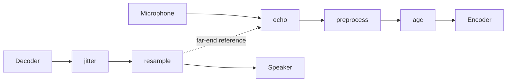

# Architecture

This document describes how the packages fit together. Components add their
own sections as they land. Component status is in the
[README](../README.md#component-status); the work packages that build them
are listed [at the end](#work-packages).

## Packages

| Package | Role | Parity |
|---|---|---|
| `resample` | Streaming sample-rate conversion | Bit-exact with `resample.c` |
| `buffer` | Ring buffers, including a lock-free SPSC hand-off | Own design |
| `echo` | Acoustic echo cancellation (MDF) | Bit-exact with `mdf.c` |
| `preprocess` | Noise suppression and VAD | Bit-exact with `preprocess.c`, `filterbank.c` |
| `agc` | Automatic gain control | Own design (behavioural) |
| `internal/fixed` | Fixed-point arithmetic shared by the ports | Bit-exact with the SpeexDSP macros |
| `internal/fft` | Fixed-point real FFT | Bit-exact with KISS FFT via `fftwrap.c` |
| `internal/testutil` | Test signals, metrics, fixture loader | Test-only |
| `internal/kernels` (planned, WP9) | Architecture-specific kernels | Must be bit-exact with the portable code |

The public packages do not import each other. Shared arithmetic lives in
`internal/fixed` and `internal/fft`. The one cross-package data flow, the
residual echo spectrum from `echo` to `preprocess`, is a slice the caller
passes on ([contracts.md](contracts.md) section 12).

## Typical VoIP pipeline

The send path cleans the microphone signal before encoding; the receive path
reorders and resamples decoded audio for the device.

1. `echo` needs the far-end signal exactly as it was played, aligned with
   the capture; the dotted line is that reference.
2. `preprocess` runs on the echo canceller's output and takes its residual
   echo spectrum.
3. `agc` runs last on the send path, so it sees speech with noise and echo
   already reduced, and can take the VAD decision from `preprocess`.
4. On the receive path, `jitter` (stretch) turns packets into a steady frame
   stream and `resample` converts to the device rate.

## Five timing problems that look alike

| Problem | Cause | Handled by |
|---|---|---|
| Rate conversion | Codec and device run at different nominal rates | `resample` with a fixed ratio |
| Clock drift | Two clocks with the same nominal rate differ by a few ppm | Drift controller (stretch S2), adjusting the resampler ratio slowly |
| Network jitter | Packets arrive unevenly or out of order | `jitter` (stretch S1) |
| Latency | Buffering in every stage adds delay | Each package documents its own latency |
| Echo alignment | The echo path delay must fall inside the canceller's filter length | The caller's buffering; `echo` documents the window it covers and does not estimate delay |

## Dispatch and the portable path

Every component has a portable Go implementation, which is the correctness
reference on every architecture. Optimised kernels are planned for WP9 in
`internal/kernels`. They will be selected at run time with
`golang.org/x/sys/cpu` and must be bit-exact with the portable code. The
`purego` build tag, or `GOVOIP_DSP_PUREGO=1`, forces the portable path
([contracts.md](contracts.md) section 11). Today every path is portable.

## Threading model

Every stateful type is single-owner: one instance per stream, used from one
goroutine at a time, with no locks. The only type designed for two
goroutines is the SPSC ring buffer in `buffer`, which hands audio between the
audio path and a device or network goroutine without blocking either side
(requirements §16).

## Work packages

The library is built in numbered work packages (WP). Commit messages,
acceptance criteria and ADR names cite them, for example
`docs/decisions/wp0-harness.md`. A suffix letter (WP1b) marks a follow-up
to the same component. S1 to S5 are stretch items, which start after WP9.

| WP | Scope | Paths | Depends on | Parity | Status |
|---|---|---|---|---|---|
| WP0 | Foundation: fixed-point arithmetic, test support, reference harness, CI, docs skeleton | `internal/fixed`, `internal/testutil`, `reference/`, repository root | none | bit-exact (`internal/fixed`) | `internal/fixed` Validated, `internal/testutil` Implemented |
| WP0b | `internal/fixed` documentation: stated approximation errors | `internal/fixed` | WP0 | n/a | Validated |
| WP1 | Resampler | `resample` | WP0 | bit-exact | Validated |
| WP1b | Resampler resource-cap test | `resample` | WP1 | bit-exact | Validated |
| WP1c | Resampler output bound, `OutLen` | `resample` | WP1 | extension | Validated |
| WP2 | Ring buffers | `buffer` | WP0 | none (own design) | Validated |
| WP2b | SPSC backlog drop, `Consume` | `buffer` | WP2 | none (own design) | Validated |
| WP3 | FFT | `internal/fft` | WP0 | bit-exact | Validated |
| WP4 | AGC | `agc` | WP0 | behavioural | Validated (design v2) |
| WP5 | Noise suppression and VAD | `preprocess` | WP3 | bit-exact | Validated |
| WP5b | Preprocess frame-size check, `SupportedFrameSize` | `preprocess` | WP5 | bit-exact | Validated |
| WP6 | Echo canceller (MDF) | `echo` | WP3 | bit-exact | Validated |
| WP6b | Parallel reference subtests | `echo`, `preprocess` tests | WP5, WP6 | bit-exact | Validated |
| WP7 | Integration and validation of the whole chain | `integration`, docs | WP1 to WP6 | n/a | In progress |
| WP8 | Developer documentation | package docs, examples, root package `govoipdsp`, `docs/` | WP7 | n/a | Planned |
| WP9 | Performance | `internal/kernels`, hot paths | WP8 | bit-exact with the portable code | Planned |
| S1 | Jitter buffer | `jitter` | WP9 | to be decided | Planned |
| S2 | Clock-drift controller | `resample` extension | WP9 | behavioural | Planned |
| S3 | SIMD kernels | `internal/kernels` | WP7 | bit-exact with the portable code | Replaced by WP9 |
| S4 | Multichannel echo cancellation | `echo` | WP9 | bit-exact | Planned |
| S5 | Dereverberation (extension) | `preprocess` or a new package | WP9 | behavioural | Planned |

Status levels are defined in
[requirements §14](requirements.md#14-status-levels).

## Future work

Recorded so it is not lost; none of it is scheduled.

1. **`FrameLen(rate, d)` helper.** Samples per frame for a rate and a
   frame duration. Still to decide: whether several packages need it, and
   where a shared helper belongs. Until then callers write
   `rate * ms / 1000`.
2. **slin byte conversion.** Little-endian `[]byte` to `[]int16` and back
   belongs in the planned codec repository
   ([ADR `codecs-separate-repo`](decisions/codecs-separate-repo.md)).
3. **AGC noise input.** If WP7 shows residual noise above the AGC gate after
   `preprocess`, the preprocess noise estimate could be fed to `agc`, which
   changes the `agc` API
   ([ADR `wp4-noise-protection`](decisions/wp4-noise-protection.md)).
4. **Faster reference tests.** The `echo` and `preprocess` reference tests
   run in parallel. Further cuts that change test names or test content
   are separate decisions, taken after a CPU profile
   ([ADR `wp6b-parallel-tests`](decisions/wp6b-parallel-tests.md)). CI
   keeps `-timeout 20m` until its run times show it can go
   ([testing.md](testing.md#race-detector-and-short-mode)).
