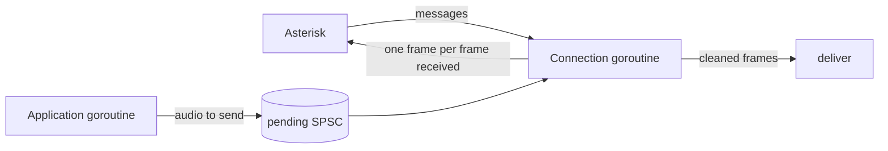

# AudioSocket quick start

This page is a short path for a Go service that takes calls from Asterisk
over AudioSocket and cleans the caller's audio: echo cancellation, noise
suppression with voice activity detection (VAD), and automatic gain
control. It gives the protocol facts the code needs, the processors to make
for each connection, and the calls for each frame. The
[developer guide](guide.md) explains each package, and [usage.md](usage.md)
has the full recipes, their caveats and their measurements.

Every Go code block on this page is copied from
`integration/audiosocket_test.go`, and `TestAudioSocketCodeIsTested` fails
if one is not. `TestAudioSocketQuickStart` runs the code against a fake
Asterisk over a loopback TCP connection, at 8 and 16 kHz, with and without
audio sent back, and ends each session with a hangup message or a closed
connection. `TestNoAllocsAudioSocket` checks that handling an audio message
allocates nothing.

## Near end, far end and echo

The packages name the two streams of a call after a device, but the roles
are the same on a server:

- **Near-end signal.** The audio that Asterisk sends to your service: the
  caller's voice. The docs also call it the microphone signal, and the code
  calls it `mic`.
- **Far-end reference.** The audio that your service sends back to
  Asterisk, such as a prompt, text-to-speech or a bridged leg. The code
  calls it `far`.
- **Echo.** What your service sends comes back in what it receives. On a
  device the microphone hears the loudspeaker; here the caller's side does
  the same: a speakerphone caller's microphone picks up your audio from
  their loudspeaker, or an acoustic or line echo on their side returns it.
  `echo` removes it, with the frames you sent as the reference.

Leave out `echo` where nothing can come back:

- **Your service sends nothing back**, for example speech recognition or
  recording. There is no far end, so there is no echo. Make only
  `preprocess` and `agc`.
- **The caller's side returns no echo**, for example a caller on a headset.
  Use `Run` then `Process`, as the code below does without audio sent
  back ([A call without echo cancellation](guide.md#a-call-without-echo-cancellation)).

## The protocol

These facts come from the
[AudioSocket protocol page](https://docs.asterisk.org/Configuration/Channel-Drivers/AudioSocket/)
and from the Asterisk sources at commit
[`266378a1`](https://github.com/asterisk/asterisk/tree/266378a125bf8b0c72b066503b66ff3796aae175)
(the file and line references below).

1. AudioSocket runs over TCP (`res/res_audiosocket.c:137`). Asterisk
   connects to your service: one connection for each run of the
   `AudioSocket()` application (`apps/app_audiosocket.c:107`) and for
   each `AudioSocket` channel (`channels/chan_audiosocket.c:265`).
2. Each message is a 3-byte header and a payload. The header is one byte
   of kind and two bytes of payload length, big-endian (protocol page;
   `res/res_audiosocket.c:226-256`).
3. Asterisk's first message is the call's UUID: kind `0x01`, 16 bytes
   (`res/res_audiosocket.c:189-215`).
4. Audio payloads are 16-bit signed linear mono PCM, little-endian
   (protocol page). Two bytes make one `int16` sample:
   `int16(binary.LittleEndian.Uint16(b))`.
5. The rate is in the kind: `0x10` is 8 kHz and `0x12` is 16 kHz; `0x11`
   and `0x13` to `0x18` are 12, 24, 32, 44.1, 48, 96 and 192 kHz (protocol
   page). The dialplan application `AudioSocket()` sets the channel to
   8 kHz linear audio, so it sends and takes kind `0x10`
   (`apps/app_audiosocket.c:117-127`). The `AudioSocket` channel driver
   uses the codec named in its `c` option, for example
   `Dial(AudioSocket/host:port/uuid/c(slin16))`, or else the first codec
   the channel offers (`channels/chan_audiosocket.c:194-251`); `slin16`
   gives kind `0x12` (`res/res_audiosocket.c:237-238`).
6. The protocol does not fix how much audio one message holds: Asterisk
   forwards each frame it reads from the channel
   (`apps/app_audiosocket.c:181-196`). So the code collects the samples
   into 20 ms frames, 160 samples at 8 kHz and 320 at 16 kHz.
7. A DTMF digit is kind `0x03` with one ASCII byte (protocol page;
   `res/res_audiosocket.c:258-262`).
8. Asterisk writes the audio your service sends to the call as it
   arrives, without re-timing it or adding silence
   (`apps/app_audiosocket.c:198-216`). So with `echo`, your service paces
   what it sends: one frame back for each frame received, silence when it
   has nothing to send. Then the canceller gets the frame that was sent
   with each received frame. This is recipe A of
   [usage.md](usage.md#recipe-a-sending-paced-by-the-received-frames).
9. Asterisk accepts only hangup and audio messages from your service. Any
   other kind, or a payload length of 0, ends the session as an error
   (`res/res_audiosocket.c:330-376`, `apps/app_audiosocket.c:200-209`).
   Never send an empty audio message.
10. When the session ends on the Asterisk side, for example because the
    caller hangs up, Asterisk closes the connection, and your service
    reads end of file (`apps/app_audiosocket.c:146`,
    `channels/chan_audiosocket.c:152-160`). Your service ends the session
    with the hangup message `0x00 0x00 0x00` or by closing the connection
    (protocol page; `res/res_audiosocket.c:330-336`).
11. The protocol page also lists kind `0xff`, an error with an optional
    error code. The Asterisk sources at this commit do not send it.

The message kinds and errors the code uses:

```go
// Message kinds of the AudioSocket protocol.
const (
	kindHangup = 0x00 // end the session; no payload
	kindUUID   = 0x01 // the call's UUID, 16 bytes: Asterisk's first message
	kindDTMF   = 0x03 // one DTMF digit, 1 ASCII byte
	kindSlin   = 0x10 // audio: 16-bit signed mono PCM, little-endian, 8 kHz
	kindSlin16 = 0x12 // the same at 16 kHz
	kindError  = 0xff // an error; the payload is an optional error code
)

var (
	errAudioSocket = errors.New("audiosocket: error message from Asterisk")
	errOtherRate   = errors.New("audiosocket: audio at another rate")
	errOddPayload  = errors.New("audiosocket: audio payload of an odd number of bytes")
)
```

## One connection, one goroutine

Make the processors for each connection when it arrives, and serve the
connection on its own goroutine. Each connection is one call, and every
processor is single-owner: it keeps the state of its call and is used from
one goroutine only. With audio sent back, `newAudioSocketCall` makes
`echo`, `preprocess` and `agc` with `newPacedCall` of
[recipe A, step 1](usage.md#recipe-a-step-1-make-the-processors-and-the-hand-offs);
without, it makes `preprocess` and `agc` only.

```go
// audioSocketCall is the send path of one AudioSocket connection. Use it
// from the connection's goroutine only.
type audioSocketCall struct {
	kind  byte // the audio kind of this connection, received and sent
	frame int  // samples in one 20 ms frame

	paced *pacedCall // echo, preprocess and agc, when audio is sent back
	pre   *preprocess.Preprocessor
	gc    *agc.AGC

	in            *buffer.Ring // received samples, until a whole frame is there
	hdr           [3]byte
	payload       []byte
	pcm           []int16
	mic, far, out []int16
	reply         []byte // one audio message: header and one frame
}

func newAudioSocketCall(rate int, sendsAudio bool) (*audioSocketCall, error) {
	a := &audioSocketCall{frame: rate * 20 / 1000}
	switch rate {
	case 8000:
		a.kind = kindSlin
	case 16000:
		a.kind = kindSlin16
	default:
		// echo supports 8 and 16 kHz only; see docs/usage.md for resampling.
		return nil, fmt.Errorf("audiosocket: %d Hz; this code takes 8 or 16 kHz", rate)
	}
	var err error
	if sendsAudio {
		// What is sent back can return as echo: make echo, preprocess and agc
		// as recipe A of docs/usage.md does, with a 200 ms echo filter.
		if a.paced, err = newPacedCall(rate, 20, 200); err != nil {
			return nil, err
		}
	} else {
		// Nothing is sent back, so there is no far end and no echo to cancel.
		if a.pre, err = preprocess.New(preprocess.Config{SampleRate: rate, FrameSize: a.frame}); err != nil {
			return nil, err
		}
		a.pre.SetVAD(true) // the VAD decision tells the AGC which frames are speech
		if a.gc, err = agc.New(agc.DefaultConfig(rate)); err != nil {
			return nil, err
		}
	}
	// A payload has at most 65535 bytes (32767 samples); less than one frame
	// can wait from the payload before it, so a whole payload always fits.
	if a.in, err = buffer.New(buffer.Config{Capacity: 32767 + a.frame, Overflow: buffer.Reject}); err != nil {
		return nil, err
	}
	a.payload = make([]byte, 65535)
	a.pcm = make([]int16, 32767)
	a.mic, a.far, a.out = make([]int16, a.frame), make([]int16, a.frame), make([]int16, a.frame)
	a.reply = make([]byte, 3+2*a.frame)
	return a, nil
}
```



The connection goroutine reads each message, processes the whole frames it
completes, and writes one frame back for each. The application, for
example a text-to-speech engine, runs on its own goroutine and writes the
audio to send into `pending`, a `buffer.SPSC`, whole frames at a time with
`onPacket` of [usage.md](usage.md#recipe-a-step-1-make-the-processors-and-the-hand-offs).
A service that sends nothing back passes `pending` as nil.

```go
// serveAudioSocket serves one connection until it ends. pending holds
// the audio to send, written by another goroutine; nil sends nothing back.
func serveAudioSocket(conn net.Conn, rate int, pending *buffer.SPSC, deliver func([]int16)) error {
	defer conn.Close()
	a, err := newAudioSocketCall(rate, pending != nil)
	if err != nil {
		return err
	}
	for {
		done, err := a.next(conn, pending, deliver)
		if done || err != nil {
			return err
		}
	}
}

// next reads one message and handles it; done reports the end of the session.
func (a *audioSocketCall) next(conn io.ReadWriter, pending *buffer.SPSC, deliver func([]int16)) (done bool, err error) {
	if _, err := io.ReadFull(conn, a.hdr[:]); err != nil {
		if err == io.EOF {
			return true, nil // Asterisk closed the connection
		}
		return true, err
	}
	// The header is the kind and the payload length, big-endian.
	payload := a.payload[:binary.BigEndian.Uint16(a.hdr[1:])]
	if _, err := io.ReadFull(conn, payload); err != nil {
		return true, err
	}
	switch a.hdr[0] {
	case a.kind:
		return false, a.audio(conn, payload, pending, deliver)
	case kindHangup:
		return true, nil
	case kindError:
		return true, errAudioSocket
	case kindSlin, kindSlin16:
		return true, errOtherRate
	default:
		return false, nil // kindUUID, kindDTMF (payload[0] is the digit), others
	}
}
```

## Each frame

```go
// audio cuts the received samples into 20 ms frames and processes each.
func (a *audioSocketCall) audio(w io.Writer, payload []byte, pending *buffer.SPSC, deliver func([]int16)) error {
	if len(payload)%2 != 0 {
		return errOddPayload
	}
	pcm := a.pcm[:len(payload)/2]
	for i := range pcm {
		pcm[i] = int16(binary.LittleEndian.Uint16(payload[2*i:]))
	}
	a.in.Write(pcm) // always fits: see newAudioSocketCall
	for a.in.Len() >= a.frame {
		a.in.Read(a.mic)
		if err := a.step(w, pending, deliver); err != nil {
			return err
		}
	}
	return nil
}

// step processes one received frame and, when audio is sent back, sends
// one frame first.
func (a *audioSocketCall) step(w io.Writer, pending *buffer.SPSC, deliver func([]int16)) error {
	if a.paced == nil {
		speech, err := a.pre.Run(a.mic) // rewrites mic in place
		if err != nil {
			return err
		}
		if err := a.gc.Process(a.mic, a.out, speech); err != nil {
			return err
		}
		deliver(a.out)
		return nil
	}
	// One frame back per frame received: the oldest pending frame, or
	// silence. Asterisk plays what it gets as it arrives, so this paces it.
	if pending.Len() >= a.frame {
		pending.Read(a.far)
	} else {
		clear(a.far)
	}
	a.reply[0] = a.kind
	binary.BigEndian.PutUint16(a.reply[1:], uint16(2*a.frame))
	for i, s := range a.far {
		binary.LittleEndian.PutUint16(a.reply[3+2*i:], uint16(s))
	}
	if _, err := w.Write(a.reply); err != nil {
		return err
	}
	// Cancel the echo of what was sent, this frame included, then denoise
	// and set the level (recipe A's received in docs/usage.md).
	if err := a.paced.received(a.mic, a.far, a.out); err != nil {
		return err
	}
	deliver(a.out)
	return nil
}
```

For each message, `next` and `audio` do this:

1. `next` reads the header and the payload. A hangup message, a closed
   connection or an error message ends the session; a UUID, a DTMF digit or
   another kind is skipped.
2. `audio` converts the payload to `int16` samples and adds them to the
   `buffer.Ring` `in`.
3. For each whole 20 ms frame in `in`, `step` takes the oldest pending
   frame, or silence, and sends it to Asterisk.
4. `received` (recipe A) cancels the echo of what was sent, this frame
   included, then suppresses noise and the residual echo, and applies the
   gain on speech. Without audio sent back, `step` calls `Run` and
   `Process` instead.
5. `deliver` gets the cleaned frame. It must not keep the slice: the next
   frame overwrites it.

## Is one goroutine enough?

Yes, for reading, processing and writing, as above. Asterisk's messages
arrive at the pace of the call, so the received frames drive the loop. The
processing calls never block or allocate; only the network reads and
writes wait. A write that waits holds up the loop: TCP keeps the received
bytes meanwhile, so the frames are processed late, not lost.

A second goroutine, joined by a `buffer.SPSC`, is needed in these cases:

- **The audio to send comes from elsewhere**, such as text-to-speech or a
  bridged leg. It goes through `pending`, because the processors and `in`
  are single-owner, and the loop never waits for it.
- **`deliver` can wait**, for example on a network call to a speech
  recognizer. Copy the frame into another SPSC and do the slow work on
  another goroutine.
- **Processing must never wait for the network.** Recipe A of
  [usage.md](usage.md#recipe-a-sending-paced-by-the-received-frames) runs
  the network reader, the network writer and the processing on separate
  goroutines, with SPSCs between them. When its writer falls behind, the
  processing sends nothing for that frame instead of waiting ("A full
  writer" in its caveats).

## Added delay

With 20 ms frames, the processing delays the cleaned audio by about 22 ms:
`echo` adds none, `preprocess` one frame (20 ms) and `agc` 2 ms
([the send path](guide.md#the-send-path-frame-by-frame), "Latency"). The
first samples of a frame also wait until the frame is complete. The audio
your service sends back passes through no processor, so the library adds
no delay to it.

## Hold, transfer and Reset

Each connection is one call. Make its processors when it connects, as
`serveAudioSocket` does. To reuse them for the next connection instead,
call `Reset` on each first: it starts a new stream without allocating.

No method needs `Reset` within a call. After a hold or a transfer, the
echo path can change, and the canceller adapts by itself: in the
synthetic scenarios of the `echo` package doc it cancelled 10 dB again
within 1 s of a sudden path change, and in the recipes of usage.md 2.5 to
3.5 s after the echo delay stepped from 100 to 140 ms. `Reset` clears what
a processor has learned: `echo` its filter (it keeps some learned state,
listed in its package doc), `preprocess` its noise estimate and other
adaptive state, and `agc` its gain. Whether a `Reset` after a hold makes
the canceller cancel again sooner has not been measured.

## Next steps

- [usage.md](usage.md#caveats): the echo delays recipe A cancelled in
  simulated calls, how to choose the filter length, and what happens after
  a stall.
- [The send path](guide.md#the-send-path-frame-by-frame), "Gate above the
  noise": set `agc.Config.GateLevel` above the noise of the line, or the
  AGC raises the noise.
- [Sources that deliver the pairing](usage.md#sources-that-deliver-the-pairing):
  `newCall` resamples a rate other than 8 or 16 kHz for `echo`.
