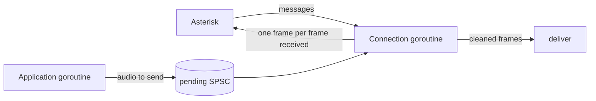

# AudioSocket quick start

## Which audio is which

The packages name the two [streams](glossary.md#stream) of a call after
a device. On this page:

- **[Near end](glossary.md#near-end).** The audio that Asterisk sends to
  your service: the caller's voice. The docs also call it the microphone
  signal, and the code calls it `mic`.
- **[Far-end reference](glossary.md#far-end).** The audio that your
  service sends back to Asterisk, such as a prompt, text-to-speech or a
  bridged leg. The code calls it `far`.
- **[Send path](glossary.md#send-path-and-receive-path).** The
  processing that cleans the near end. Here it cleans the audio your
  service receives, not the audio it sends.

The names come from the device case, where the near end is the person at
the microphone, not from where your code runs. So on a server the caller
is the near end, even though they are far away, and your service is the
far end.

This page is a short path for a Go service that takes calls from Asterisk
over AudioSocket and cleans the caller's audio: echo cancellation, noise
suppression with voice activity detection ([VAD](glossary.md#vad)), and
automatic gain control ([AGC](glossary.md#agc)). The tutorial comes
first: the dialplan; a whole program, walked through, that accepts the
connections, makes the [processors](glossary.md#processor) for each
connection and calls them for each [frame](glossary.md#frame); what to
change for your application; and how to check that it works. The
[reference](#reference) after it gives the protocol facts with their
Asterisk sources, what to expect from echo cancellation, the cost, and
hold and `Reset`. The [developer guide](guide.md) explains each package,
and [usage.md](usage.md) has the full recipes, their caveats and their
measurements.

## Connect a call from the dialplan

Asterisk connects to your service in one of two ways, both set in
`extensions.conf`. The context name `audiosocket-demo` and the
extensions 100 and 101 are examples. Each way passes the call's UUID,
which your service receives first (item 3 of
[the protocol](#the-protocol)), and the address where the program below
listens.

```text
[audiosocket-demo]
exten => 100,1,Answer()
exten => 100,2,AudioSocket(40325ec2-5efd-4bd3-805f-53576e581d13,127.0.0.1:9092)
exten => 100,3,Hangup()

exten => 101,1,Dial(AudioSocket/127.0.0.1:9092/40325ec2-5efd-4bd3-805f-53576e581d13/c(slin))
exten => 101,2,Hangup()
```

- **Extension 100: the `AudioSocket()` dialplan application.** Its
  arguments are the UUID and the service as `host:port`, separated by a
  comma
  ([application documentation](https://docs.asterisk.org/Latest_API/API_Documentation/Dialplan_Applications/AudioSocket/);
  `apps/app_audiosocket.c:58-64`, `apps/app_audiosocket.c:97-107`). The
  application does not answer the call, and on a channel that is not
  answered it ends at once with an error, so `Answer()` comes first
  (`apps/app_audiosocket.c:69`, `apps/app_audiosocket.c:160-163`). Its
  documentation also names `Progress()`, but the check at line 160
  accepts only an answered channel. It
  always sends and takes 8 kHz audio, the rate the program below uses.
- **Extension 101: the `AudioSocket` channel driver, through `Dial()`.**
  The dial string is `AudioSocket/host:port/UUID/options`, split at each
  `/` (`channels/chan_audiosocket.c:206-234`). The channel driver answers
  its own channel when `Dial()` calls it
  (`channels/chan_audiosocket.c:142-147`). The option `c` names the
  Asterisk format to use (`channels/chan_audiosocket.c:178`,
  `channels/chan_audiosocket.c:236-238`): `slin` is 8 kHz signed linear
  audio and `slin16` is 16 kHz (`main/codec_builtin.c:287-291`,
  `main/codec_builtin.c:968-970`). Always give `c(slin)` or `c(slin16)`
  (item 5 of [the protocol](#the-protocol)). With `c(slin16)`, change
  `rate` in `main` to `16000`.

The example passes the same UUID for every call, so your service cannot
tell the calls apart by it. Each call's recording replaces the one
before, and two calls at the same time write into the same file
([Write the cleaned audio to a file](#write-the-cleaned-audio-to-a-file)).
The `AudioSocket()` lines are checked against the application
documentation and the sources named here, the `Dial()` line against the
sources only. None of them has been run on an Asterisk server.

## The program

The Go code blocks on this page, in order, are one complete program. Copy
them into one file, `main.go`, in a new module that requires the library
(`go mod init`, then `go get github.com/danieldonoghue/govoip-dsp`), and
build it. [How this page is tested](#how-this-page-is-tested) says how
the blocks are kept building and correct.

The file starts with the package clause, the imports and `main`. `main`
listens on TCP port 9092 and serves each connection from Asterisk at
8 kHz, the rate of the `AudioSocket()` application, with the example
application `beeper` ([The application](#the-application)). `recording`
also writes each call's cleaned audio to a file
([Write the cleaned audio to a file](#write-the-cleaned-audio-to-a-file)).

```go
package main

import (
	"encoding/binary"
	"errors"
	"fmt"
	"io"
	"log"
	"math"
	"net"
	"os"
	"path/filepath"
	"time"

	"github.com/danieldonoghue/govoip-dsp/agc"
	"github.com/danieldonoghue/govoip-dsp/buffer"
	"github.com/danieldonoghue/govoip-dsp/echo"
	"github.com/danieldonoghue/govoip-dsp/preprocess"
)

func main() {
	// The dialplan connects a call with, for example, Answer() and then
	// AudioSocket(40325ec2-5efd-4bd3-805f-53576e581d13,127.0.0.1:9092).
	ln, err := net.Listen("tcp", ":9092")
	if err != nil {
		log.Fatal(err)
	}
	// beeper is the example application; recording also writes each call's
	// cleaned audio to <UUID>.raw in the working directory.
	const rate = 8000 // 16000 for a dial string with c(slin16)
	log.Fatal(acceptAudioSockets(ln, rate, recording(".", rate, beeper(rate))))
}
```

The message kinds and errors the code uses:

```go
// Message kinds of the AudioSocket protocol.
const (
	kindHangup = 0x00 // end the session; no payload
	kindUUID   = 0x01 // the call's UUID, 16 bytes: Asterisk's first message
	kindDTMF   = 0x03 // one DTMF digit, 1 ASCII byte
	kindSlin   = 0x10 // audio: 16-bit signed mono PCM, little-endian, 8 kHz
	kindSlin16 = 0x12 // the same at 16 kHz; 0x11 and 0x13 to 0x18 are other rates
	kindLast   = 0x18 // the last audio kind, 192 kHz
	kindError  = 0xff // an error; the payload is an optional error code
)

var (
	errAudioSocket = errors.New("audiosocket: error message from Asterisk")
	errOtherRate   = errors.New("audiosocket: audio at another rate")
	errOddPayload  = errors.New("audiosocket: audio payload of an odd number of bytes")
	errNoUUID      = errors.New("audiosocket: the first message is not a UUID")
)
```

### One connection, one goroutine

Each connection is one call. `acceptAudioSockets` serves each connection
on its own goroutine. `serveAudioSocket` reads the call's UUID, asks the
application for its side of the call (a `session`), makes the processors,
and then handles one message at a time until the session ends. Every
processor is [single-owner](glossary.md#single-owner): it keeps the state
of its call and is used from one goroutine only.

```go
// uuid is the call's UUID, from Asterisk's first message.
type uuid [16]byte

// String returns the UUID in the form the dialplan writes it.
func (id uuid) String() string {
	return fmt.Sprintf("%x-%x-%x-%x-%x", id[:4], id[4:6], id[6:8], id[8:10], id[10:])
}

// session is the application's side of one call.
type session struct {
	pending *buffer.SPSC  // audio to send, written by the application; nil sends nothing back
	deliver func([]int16) // takes each cleaned frame; must not keep the slice
	end     func()        // called once, on the connection's goroutine, when the session ends
}

// acceptAudioSockets accepts connections until ln is closed and serves each
// on its own goroutine; start makes the application's side of each call.
func acceptAudioSockets(ln net.Listener, rate int, start func(id uuid) (session, error)) error {
	for {
		conn, err := ln.Accept()
		if err != nil {
			return err
		}
		go func() {
			if err := serveAudioSocket(conn, rate, start); err != nil {
				log.Printf("audiosocket: %v", err)
			}
		}()
	}
}

// serveAudioSocket serves one connection until the session ends.
func serveAudioSocket(conn net.Conn, rate int, start func(id uuid) (session, error)) error {
	defer conn.Close()
	id, err := readUUID(conn)
	if err != nil {
		return err
	}
	s, err := start(id)
	if err != nil {
		return err
	}
	defer s.end()
	a, err := newAudioSocketCall(rate, s.pending != nil)
	if err != nil {
		return err
	}
	for {
		done, err := a.next(conn, s.pending, s.deliver)
		if done || err != nil {
			return err
		}
	}
}

// readUUID reads Asterisk's first message, the call's UUID.
func readUUID(r io.Reader) (id uuid, err error) {
	var hdr [3]byte
	if _, err := io.ReadFull(r, hdr[:]); err != nil {
		return id, err
	}
	if hdr[0] != kindUUID || binary.BigEndian.Uint16(hdr[1:]) != 16 {
		return id, errNoUUID
	}
	_, err = io.ReadFull(r, id[:])
	return id, err
}
```

With audio sent back, `newAudioSocketCall` makes `echo`, `preprocess`
and `agc` with `newPacedCall` ([The processors](#the-processors));
without, it makes `preprocess` and `agc` only. The numbers in that call
are the frame length in ms (20) and the echo filter length in ms (200,
the guide's start value; see "Filter length" in
[the send path](guide.md#the-send-path-frame-by-frame)). `in` is a
[ring buffer](glossary.md#ring-buffer), a `buffer.Ring`, that holds the
received samples until a whole frame is there.

```go
// audioSocketCall is the send path of one AudioSocket connection. Use it
// from the connection's goroutine only.
type audioSocketCall struct {
	kind  byte // the audio kind of this connection, received and sent
	frame int  // samples in one 20 ms frame

	paced *pacedCall // echo, preprocess and agc, when audio is sent back
	pre   *preprocess.Preprocessor
	gc    *agc.AGC

	in            *buffer.Ring // received samples, until a whole frame is there
	hdr           [3]byte
	payload       []byte
	pcm           []int16
	mic, far, out []int16
	reply         []byte // one audio message: header and one frame
}

func newAudioSocketCall(rate int, sendsAudio bool) (*audioSocketCall, error) {
	a := &audioSocketCall{frame: rate * 20 / 1000}
	switch rate {
	case 8000:
		a.kind = kindSlin
	case 16000:
		a.kind = kindSlin16
	default:
		// echo supports 8 and 16 kHz only; see docs/usage.md for resampling.
		return nil, fmt.Errorf("audiosocket: %d Hz; this code takes 8 or 16 kHz", rate)
	}
	var err error
	if sendsAudio {
		// What is sent back can return as echo: make echo, preprocess and agc
		// as recipe A of docs/usage.md does, with a 200 ms echo filter.
		if a.paced, err = newPacedCall(rate, 20, 200); err != nil {
			return nil, err
		}
	} else {
		// Nothing is sent back, so there is no far end and no echo to cancel.
		if a.pre, err = preprocess.New(preprocess.Config{SampleRate: rate, FrameSize: a.frame}); err != nil {
			return nil, err
		}
		a.pre.SetVAD(true) // the VAD decision tells the AGC which frames are speech
		if a.gc, err = agc.New(agc.DefaultConfig(rate)); err != nil {
			return nil, err
		}
	}
	// A payload has at most 65535 bytes (32767 samples); less than one frame
	// can wait from the payload before it, so a whole payload always fits.
	if a.in, err = buffer.New(buffer.Config{Capacity: 32767 + a.frame, Overflow: buffer.Reject}); err != nil {
		return nil, err
	}
	a.payload = make([]byte, 65535)
	a.pcm = make([]int16, 32767)
	a.mic, a.far, a.out = make([]int16, a.frame), make([]int16, a.frame), make([]int16, a.frame)
	a.reply = make([]byte, 3+2*a.frame)
	return a, nil
}
```



The connection goroutine reads each message, processes the whole frames it
completes, and writes one frame back for each. The application, for
example a text-to-speech engine, runs on its own goroutine and writes the
audio to send into `pending`, a `buffer.SPSC` (an [SPSC](glossary.md#spsc) is a queue
between one writing and one reading goroutine), whole frames at a time with
`onPacket` ([The application](#the-application) shows how). A session
that sends nothing back has `pending` nil.

```go
// next reads one message and handles it; done reports the end of the session.
func (a *audioSocketCall) next(conn io.ReadWriter, pending *buffer.SPSC, deliver func([]int16)) (done bool, err error) {
	if _, err := io.ReadFull(conn, a.hdr[:]); err != nil {
		if err == io.EOF {
			return true, nil // Asterisk closed the connection
		}
		return true, err
	}
	// The header is the kind and the payload length, big-endian.
	payload := a.payload[:binary.BigEndian.Uint16(a.hdr[1:])]
	if _, err := io.ReadFull(conn, payload); err != nil {
		return true, err
	}
	switch k := a.hdr[0]; {
	case k == a.kind:
		return false, a.audio(conn, payload, pending, deliver)
	case k == kindHangup:
		return true, nil
	case k == kindError:
		return true, errAudioSocket
	case k >= kindSlin && k <= kindLast:
		return true, errOtherRate
	default:
		return false, nil // kindUUID, kindDTMF (payload[0] is the digit), others
	}
}
```

### Each frame

```go
// audio cuts the received samples into 20 ms frames and processes each.
func (a *audioSocketCall) audio(w io.Writer, payload []byte, pending *buffer.SPSC, deliver func([]int16)) error {
	if len(payload)%2 != 0 {
		return errOddPayload
	}
	pcm := a.pcm[:len(payload)/2]
	for i := range pcm {
		pcm[i] = int16(binary.LittleEndian.Uint16(payload[2*i:]))
	}
	a.in.Write(pcm) // always fits: see newAudioSocketCall
	for a.in.Len() >= a.frame {
		a.in.Read(a.mic)
		if err := a.step(w, pending, deliver); err != nil {
			return err
		}
	}
	return nil
}

// step processes one received frame and, when audio is sent back, sends
// one frame first.
func (a *audioSocketCall) step(w io.Writer, pending *buffer.SPSC, deliver func([]int16)) error {
	if a.paced == nil {
		speech, err := a.pre.Run(a.mic) // rewrites mic in place
		if err != nil {
			return err
		}
		if err := a.gc.Process(a.mic, a.out, speech); err != nil {
			return err
		}
		deliver(a.out)
		return nil
	}
	// One frame back per frame received: the oldest pending frame, or
	// silence. Asterisk plays what it gets as it arrives, so this paces it.
	if pending.Len() >= a.frame {
		pending.Read(a.far)
	} else {
		clear(a.far)
	}
	a.reply[0] = a.kind
	binary.BigEndian.PutUint16(a.reply[1:], uint16(2*a.frame))
	for i, s := range a.far {
		binary.LittleEndian.PutUint16(a.reply[3+2*i:], uint16(s))
	}
	if _, err := w.Write(a.reply); err != nil {
		return err
	}
	// Cancel the echo of what was sent, this frame included, then denoise
	// and set the level (recipe A's received in docs/usage.md).
	if err := a.paced.received(a.mic, a.far, a.out); err != nil {
		return err
	}
	deliver(a.out)
	return nil
}
```

For each message, `next` and `audio` do this:

1. `next` reads the header and the payload. A hangup message, a
   connection closed between messages or an error message ends the
   session; a connection closed within a message returns
   `io.ErrUnexpectedEOF`. Audio at another rate returns `errOtherRate`.
   A UUID, a DTMF digit or another kind is skipped.
2. `audio` converts the payload to `int16` samples and adds them to the
   ring buffer `in`.
3. For each whole 20 ms frame in `in`, `step` takes the oldest pending
   frame, or silence, and sends it to Asterisk.
4. `received` cancels the echo of what was sent, this frame included,
   then suppresses noise and the
   [residual echo](glossary.md#residual-echo), and applies the gain on
   speech. Without audio sent back, `step` calls `Run` and
   `Process` instead.
5. `deliver` gets the cleaned frame. It must not keep the slice: the next
   frame overwrites it.

### The processors

`pacedCall` holds `echo`, `preprocess` and `agc` for one call. It comes
from recipe A of usage.md, whose
[step 1](usage.md#recipe-a-step-1-make-the-processors-and-the-hand-offs)
and
[step 2](usage.md#recipe-a-step-2-send-one-frame-and-clean-the-received-frame)
explain it. `received` cancels the echo of the frames sent so far.
`finish` passes the canceller's output and its residual echo to
`preprocess`, then the frame and the VAD decision to `agc`. The `rate`
and `speech` fields are not used on this page; recipe A and its tests
use them.

```go
// pacedCall is the send path of a call whose sending the processing
// goroutine paces off the received frames. Use it from one goroutine.
type pacedCall struct {
	rate, frame int

	ec  *echo.Canceller
	pre *preprocess.Preprocessor
	gc  *agc.AGC

	echoed   []int16 // the echo canceller's output, before preprocess
	speech   bool    // the VAD decision of the last frame
	clean    []int16
	residual []int32
}

// newPacedCall makes the processors of one call at rate Hz (8000 or
// 16000), frames of frameMs and an echo filter of filterMs milliseconds.
func newPacedCall(rate, frameMs, filterMs int) (*pacedCall, error) {
	// No resampler here: the echo canceller supports 8 and 16 kHz, so the
	// network must run at one of them.
	if rate != 8000 && rate != 16000 {
		return nil, fmt.Errorf("call: %d Hz; the echo canceller supports 8 and 16 kHz only", rate)
	}
	// One frame is the same duration on the network and here (20 ms: 160
	// samples at 8 kHz, 320 at 16 kHz).
	b := &pacedCall{rate: rate, frame: rate * frameMs / 1000}
	if !preprocess.SupportedFrameSize(b.frame) {
		return nil, fmt.Errorf("call: no preprocessor for %d-sample frames", b.frame)
	}
	var err error
	// The filter must cover the largest echo delay plus its tail; a longer
	// one costs more and adapts more slowly, so filterMs is the caller's.
	b.ec, err = echo.New(echo.Config{FrameSize: b.frame, FilterLength: rate * filterMs / 1000, SampleRate: rate})
	if err != nil {
		return nil, err
	}
	b.pre, err = preprocess.New(preprocess.Config{SampleRate: rate, FrameSize: b.frame})
	if err != nil {
		return nil, err
	}
	b.pre.SetVAD(true) // the VAD decision tells the AGC which frames are speech
	b.gc, err = agc.New(agc.DefaultConfig(rate))
	if err != nil {
		return nil, err
	}
	// Scratch buffers, made once so the per-frame path never allocates.
	b.echoed = make([]int16, b.frame)
	b.clean = make([]int16, b.frame)
	b.residual = make([]int32, b.ec.ResidualLen())
	return b, nil
}
```

```go
// received cleans a received frame against the frame sent with it.
func (b *pacedCall) received(mic, sent, out []int16) error {
	// Cancel models the echo of the frames sent so far, the one sent with
	// this received frame included, and removes it from mic.
	if err := b.ec.Cancel(mic, sent, b.echoed); err != nil {
		return err
	}
	return b.finish(out)
}

// finish runs the rest of the send path on the canceller's output.
func (b *pacedCall) finish(out []int16) error {
	// Keep the canceller's output in echoed and work on a copy, because the
	// preprocessor rewrites its frame in place.
	copy(b.clean, b.echoed)
	// The residual is the echo the canceller left in this frame; read it
	// now, before the next frame replaces it.
	if err := b.ec.Residual(b.residual); err != nil {
		return err
	}
	speech, err := b.pre.RunEcho(b.clean, b.residual)
	if err != nil {
		return err
	}
	b.speech = speech
	// The AGC raises the gain only on speech frames.
	return b.gc.Process(b.clean, out, speech)
}
```

### The application

The application runs on its own goroutine and writes the audio it wants
to send, such as a prompt or text-to-speech, into `pending`:

- **Frame size.** It writes whole 20 ms frames, 160 samples at 8 kHz or
  320 at 16 kHz, with `onPacket`, which stores a whole frame or none of
  it. A part of a frame would shift every later frame boundary.
- **When `pending` is full**, `onPacket` returns false and stores
  nothing. To lose no audio, offer the same frame again later.
- **When the application is late**, `step` finds less than one frame in
  `pending` and sends silence for that frame. The late audio goes out in
  a later frame, so the caller hears a gap of silence.
- **How much waits.** Audio waits in `pending` until a received frame
  takes it. While frames arrive at the call's pace, the size of
  `pending` is the longest it waits; in a gap of received audio (item 6
  of the protocol), nothing takes it, and it waits longer.

`beeper` is an example application. For each call it starts a goroutine
that writes a 200 ms beep every 2 s into a `pending` of 200 ms, and its
`end` stops that goroutine and logs the number of frames received.
Replace it with your own application: `start` gets the call's UUID, and
the session's `deliver` gets the cleaned audio. `start` runs on each
connection's goroutine, so it can run for several calls at once.
`deliver` runs on the connection's goroutine, so it must not wait; hand
slow work to another goroutine
([Is one goroutine enough?](#is-one-goroutine-enough)).

The example keeps the accept loop short. `acceptAudioSockets` returns on
any `Accept` error, and `main` then exits, which ends every call; a
service would log a temporary error and accept again. No read deadline
is set, so a caller's side that disappears without closing the
connection is noticed only through TCP keep-alive, which Go turns on by
default.

```go
// onPacket stores the whole frame p in rx, or nothing when it does not
// fit, so that rx holds whole frames. It reports whether p was stored.
func onPacket(rx *buffer.SPSC, p []int16) bool {
	// SPSC.Write stores as much as fits. A partial frame would shift every
	// later frame boundary, so store the whole frame or nothing.
	if rx.Free() < len(p) {
		return false // no room: store nothing
	}
	rx.Write(p)
	return true
}
```

```go
// beeper is an example application: for each call it sends a 200 ms beep
// every 2 s, and logs how many frames it received when the call ends.
func beeper(rate int) func(id uuid) (session, error) {
	frame := rate * 20 / 1000
	cycle := make([]int16, 2*rate) // 2 s: the beep, then silence; shared by every call
	for i := range rate / 5 {
		cycle[i] = int16(8000 * math.Sin(2*math.Pi*440*float64(i)/float64(rate)))
	}
	return func(id uuid) (session, error) {
		// pending holds at most 200 ms, so what is sent lags the
		// application by at most 200 ms.
		pending, err := buffer.NewSPSC(buffer.SPSCConfig{Capacity: rate / 5})
		if err != nil {
			return session{}, err
		}
		stop := make(chan struct{})
		go func() { // the application's goroutine, the only writer of pending
			for k := 0; ; {
				select {
				case <-stop:
					return
				default:
				}
				// Whole frames only. When pending is full, wait and offer the
				// same frame again, so no part of the beep is lost.
				if onPacket(pending, cycle[k*frame:(k+1)*frame]) {
					k = (k + 1) % (len(cycle) / frame)
				} else {
					time.Sleep(10 * time.Millisecond)
				}
			}
		}()
		frames := 0 // used on the connection's goroutine only
		return session{
			pending: pending,
			deliver: func([]int16) { frames++ },
			end: func() {
				close(stop)
				log.Printf("call %v: %d frames received", id, frames)
			},
		}, nil
	}
}
```

### Write the cleaned audio to a file

`beeper`'s `deliver` only counts the frames. So that you can listen to
what the processors made, `main` wraps `beeper` in `recording`. It also
writes each call's cleaned audio to the file `<UUID>.raw` in the working
directory: raw 16-bit little-endian mono PCM at the call's rate, with no
header.

`deliver` runs on the connection's goroutine, in the per-frame path, so
it must not write to the file itself: a slow disk would hold up the
frames sent back. So the work is split:

1. `recorder.deliver` copies each frame into a `buffer.SPSC` with
   `onPacket` and returns at once. The copy matters: `deliver` must not
   keep the slice.
2. `writePCM`, on a goroutine of its own, takes the samples out of the
   SPSC and writes them to the file. When the SPSC is empty, it sleeps
   20 ms.
3. When the SPSC is full, because the file has fallen 2 s of audio
   behind, `deliver` drops the frame and counts it. The recording then
   has a gap; the frames sent back and the processing do not change.
4. When the session ends, `end` closes `done`, waits until `writePCM` has
   written what is left and closed the file, and logs the number of
   dropped frames and the write error, if any.

```go
// recording wraps start: it also writes each call's cleaned audio to the
// file <dir>/<UUID>.raw, raw 16-bit little-endian mono PCM at rate Hz.
func recording(dir string, rate int, start func(id uuid) (session, error)) func(id uuid) (session, error) {
	return func(id uuid) (session, error) {
		s, err := start(id)
		if err != nil {
			return session{}, err
		}
		name := filepath.Join(dir, id.String()+".raw")
		f, err := os.Create(name)
		if err != nil {
			s.end()
			return session{}, err
		}
		// Up to 2 s of audio can wait for the disk; deliver drops what does not fit.
		r, err := newRecorder(f, 2*rate)
		if err != nil {
			f.Close()
			s.end()
			return session{}, err
		}
		deliver, end := s.deliver, s.end
		s.deliver = func(x []int16) {
			deliver(x)
			r.deliver(x)
		}
		s.end = func() {
			end()
			dropped, err := r.close()
			log.Printf("call %v: recorded to %s, %d frames dropped, error %v", id, name, dropped, err)
		}
		return s, nil
	}
}
```

```go
// recorder writes frames to a file on its own goroutine, so that deliver,
// on the connection's goroutine, never waits for the disk.
type recorder struct {
	frames  *buffer.SPSC  // samples from deliver to the writing goroutine
	dropped int           // frames that did not fit; used by deliver's goroutine only
	done    chan struct{} // closed after the last deliver
	written chan error    // the writing goroutine's result
}

// newRecorder starts the goroutine that writes the delivered samples to w;
// capacity is the number of samples that can wait for it.
func newRecorder(w io.WriteCloser, capacity int) (*recorder, error) {
	frames, err := buffer.NewSPSC(buffer.SPSCConfig{Capacity: capacity})
	if err != nil {
		return nil, err
	}
	r := &recorder{frames: frames, done: make(chan struct{}), written: make(chan error, 1)}
	go func() { r.written <- writePCM(w, frames, r.done) }()
	return r, nil
}

// deliver copies the frame x for the writing goroutine, or drops it when
// that goroutine has fallen behind. It never waits.
func (r *recorder) deliver(x []int16) {
	if !onPacket(r.frames, x) {
		r.dropped++
	}
}

// close waits until the writing goroutine has written every stored sample
// and closed w. Call it once, after the last deliver.
func (r *recorder) close() (dropped int, err error) {
	close(r.done)
	return r.dropped, <-r.written
}

// writePCM writes the samples in frames to w as 16-bit little-endian PCM
// until done is closed and frames is empty, then closes w.
func writePCM(w io.WriteCloser, frames *buffer.SPSC, done <-chan struct{}) error {
	pcm := make([]int16, frames.Cap())
	b := make([]byte, 2*len(pcm))
	for {
		last := false
		select {
		case <-done:
			last = true // nothing more is delivered: write what is stored, then stop
		default:
		}
		n := frames.Read(pcm)
		if n == 0 {
			if last {
				return w.Close()
			}
			time.Sleep(20 * time.Millisecond)
			continue
		}
		for i, s := range pcm[:n] {
			binary.LittleEndian.PutUint16(b[2*i:], uint16(s))
		}
		if _, err := w.Write(b[:2*n]); err != nil {
			w.Close()
			return err
		}
	}
}
```

To listen to a recording at 8 kHz, use SoX's `play` or FFmpeg's
`ffplay`:

```sh
play -t raw -r 8000 -e signed-integer -b 16 -c 1 -L 40325ec2-5efd-4bd3-805f-53576e581d13.raw
ffplay -f s16le -ar 8000 -ch_layout mono 40325ec2-5efd-4bd3-805f-53576e581d13.raw
```

For a 16 kHz call, write `16000` for `8000`. The input options of both
commands were checked with SoX 14.4.2 and FFmpeg 6.1.2 on macOS, on a
file of 16-bit little-endian samples.

## What to change for your application

- **Your application instead of `beeper`.** Write a `start` function
  that returns a `session` ([The application](#the-application)):
  `pending` for the audio to send, or nil when you send nothing;
  `deliver` for the cleaned frames; `end` for the end of the call. Keep
  `recording` around it while you test, or remove it.
- **The AGC's gate level, on a noisy line.** Set it before you rely on
  `agc`. With the default gate, `agc` can make steady noise louder. The
  guide's [send path](guide.md#the-send-path-frame-by-frame), "Gate
  above the noise", gives the steps; the code uses `agc.DefaultConfig`,
  where `GateLevel` is the field to change.
- **The rate.** With `c(slin16)` in the dial string, change `rate` in
  `main` to `16000`. For other rates, see [Other rates](#other-rates).
- **The echo filter length.** The code uses 200 ms, which may be too
  short on a server
  ([What to expect](#what-to-expect-from-echo-cancellation-on-a-server)).
- **Leave out `echo` where nothing can come back.**
  - **Your service sends nothing back**, for example speech recognition
    or recording. There is no far end, so there is no echo. Make only
    `preprocess` and `agc`: return a `session` with `pending` nil.
  - **The caller's side returns no echo**, for example a caller on a
    headset. Use `Run` then `Process`
    ([A call without echo cancellation](guide.md#a-call-without-echo-cancellation)).
    The code ties `echo` to sending audio back: for a headset caller
    who still gets audio, keep its sending in `step` and replace
    `received` with the `Run` and `Process` of its other branch.

## Check that it works

These are the steps to try on a test call. They have not been run
against an Asterisk server.

1. Start the program, then call extension 100 or 101.
2. The caller should hear a 200 ms beep every 2 s: `beeper`'s audio, sent
   back.
3. When the call ends, the program logs two lines. The first is
   `call <UUID>: <n> frames received`, about 50 frames for each second
   of received audio. The second is
   `call <UUID>: recorded to <UUID>.raw, 0 frames dropped, error <nil>`.
4. Play the recording ([the commands](#write-the-cleaned-audio-to-a-file)).
   It is the caller's voice after the processors.
5. If the program logs `audiosocket: EOF` and nothing else for a call
   to extension 100, check that `Answer()` comes before `AudioSocket()`.
   On a channel that is not answered, the application connects to your
   service, then closes the connection before it sends the UUID
   (`apps/app_audiosocket.c:107`, `apps/app_audiosocket.c:146`,
   `apps/app_audiosocket.c:160-163`).
6. If the session ends on its own after a pause in the audio, look in
   the Asterisk log for "Reached timeout after 2000 ms of no activity".
   The dialplan application waits at most 2 s for the next frame from
   either side, the call's channel or your service. If neither comes, it
   logs that line and ends the session as an error
   (`apps/app_audiosocket.c:48`, `apps/app_audiosocket.c:176-177`,
   `apps/app_audiosocket.c:218-222`). The program on this page sends a
   frame only when it receives one, so it never keeps a session going by
   itself: if Asterisk reads nothing from the caller's channel for 2 s,
   the session ends. A frame that Asterisk reads from the channel but
   does not forward, such as comfort noise, also counts as activity
   (`apps/app_audiosocket.c:179-196`). Whether the channel of a caller
   whose side suppresses silence goes 2 s without a frame has not been
   tested. `channels/chan_audiosocket.c` has no such timeout. This page
   has no tested way to keep a silent session open.

## Reference

The rest of the page is reference: the facts behind the tutorial, with
their sources and measurements.

### The protocol

These facts come from the
[AudioSocket protocol page](https://docs.asterisk.org/Configuration/Channel-Drivers/AudioSocket/)
and from the Asterisk sources at commit
[`266378a1`](https://github.com/asterisk/asterisk/tree/266378a125bf8b0c72b066503b66ff3796aae175)
(the file and line references on this page).

1. AudioSocket runs over TCP (`res/res_audiosocket.c:137`). Asterisk
   connects to your service: one connection for each run of the
   `AudioSocket()` application (`apps/app_audiosocket.c:107`) and for
   each `AudioSocket` channel (`channels/chan_audiosocket.c:265`).
2. Each message is a 3-byte header and a payload. The header is one byte
   of kind and two bytes of payload length, big-endian (protocol page;
   `res/res_audiosocket.c:226-256`).
3. Asterisk's first message is the call's UUID: kind `0x01`, 16 bytes
   (`res/res_audiosocket.c:189-215`). It is the UUID given to
   `AudioSocket()` or in the channel's dial string
   (`apps/app_audiosocket.c:165`, `channels/chan_audiosocket.c:148`), so
   your service can match the connection to the call.
4. The protocol page defines the audio kinds as 16-bit signed linear
   mono PCM, little-endian. Two bytes make one `int16` sample:
   `int16(binary.LittleEndian.Uint16(b))`. Asterisk sends such audio
   from the dialplan application, and from the channel driver only when
   it is given a signed linear codec (item 5).
5. The rate is in the kind: `0x10` is 8 kHz and `0x12` is 16 kHz; `0x11`
   and `0x13` to `0x18` are 12, 24, 32, 44.1, 48, 96 and 192 kHz (protocol
   page). The dialplan application `AudioSocket()` sets the channel to
   8 kHz linear audio, so it sends and takes kind `0x10`
   (`apps/app_audiosocket.c:117-127`). The `AudioSocket` channel driver
   uses the codec named in its `c` option, for example
   `Dial(AudioSocket/host:port/uuid/c(slin16))`, or else the first codec
   the channel offers (`channels/chan_audiosocket.c:194-251`); `slin16`
   gives kind `0x12` (`res/res_audiosocket.c:237-238`). Always give the
   channel driver `c(slin)` or `c(slin16)`. Without it, a call whose
   first codec is, for example, µ-law sends µ-law bytes labelled as kind
   `0x10`: the driver takes the first codec
   (`channels/chan_audiosocket.c:244-251`), Asterisk labels every voice
   frame that is not signed linear as `0x10`
   (`res/res_audiosocket.c:251-253`), and the program would read the
   bytes as samples.
6. The protocol does not fix how much audio one message holds: Asterisk
   forwards each voice or DTMF frame it reads from the channel
   (`apps/app_audiosocket.c:181-196`). So the code collects the samples
   into 20 ms frames, 160 samples at 8 kHz and 320 at 16 kHz. Comfort
   noise is a low noise that the caller's side asks the receiver to make
   during silence, instead of sending audio. Asterisk does not forward
   comfort noise frames (`res/res_audiosocket.c:263-264`), so where the
   caller's side suppresses silence, the received audio can have gaps, and
   the frames sent back follow the received frames, not a clock. The
   dialplan application ends the session as an error when neither the
   channel nor the socket has had activity for 2 s
   (`apps/app_audiosocket.c:48`, `apps/app_audiosocket.c:218-222`). The
   program sends only when it receives, so it does nothing to keep such a
   session going ([Check that it works](#check-that-it-works), step 6).
7. A DTMF digit is kind `0x03` with one ASCII byte (protocol page;
   `res/res_audiosocket.c:258-262`). DTMF tones that stay in the audio
   itself go through the processors like any other sound. The library
   does not detect them, and whether a detector still finds them after
   the processors has not been tested.
8. Asterisk writes the audio of each message your service sends to the
   call as soon as it reads it, with `ast_write`
   (`apps/app_audiosocket.c:198-216`); nothing in that code re-times it
   or adds silence. So with `echo`, your service paces
   what it sends: one frame back for each frame received, silence when it
   has nothing to send. Then the canceller gets the frame that was sent
   with each received frame. This is the pairing of recipe A of
   [usage.md](usage.md#recipe-a-sending-paced-by-the-received-frames).
9. Asterisk accepts only hangup and audio messages from your service. Any
   other kind, or a payload length of 0, ends the session as an error
   (`res/res_audiosocket.c:330-376`, `apps/app_audiosocket.c:200-209`).
   Never send an empty audio message.
10. When the session ends on the Asterisk side, for example because the
    caller hangs up, Asterisk closes the connection, and your service
    reads end of file (`apps/app_audiosocket.c:146`,
    `channels/chan_audiosocket.c:152-160`). Your service ends the session
    with the hangup message `0x00 0x00 0x00` or by closing the connection
    (protocol page; `res/res_audiosocket.c:330-336`).
11. The protocol page also lists kind `0xff`, an error with an optional
    error code. The Asterisk sources at this commit do not send it.

### Other rates

The program takes 8 or 16 kHz only, because `echo` works well at those
rates only. For audio at another rate, resample both streams to 8 or
16 kHz first: `newCall` in
[Sources that deliver the pairing](usage.md#sources-that-deliver-the-pairing)
does that around the processors, and the guide's
[receive path](guide.md#the-receive-path) introduces `resample`.
`preprocess` and `agc` alone accept other rates (their package docs give
the ranges).

### Echo on a server

What your service sends comes back in what it receives: that is the
[echo](glossary.md#echo). On a device the microphone hears the
loudspeaker; here the caller's side does the same: a speakerphone
caller's microphone picks up your audio from their loudspeaker, or an
acoustic or line echo on their side returns it. `echo` cancels it, with
the frames you sent as the reference.

### What to expect from echo cancellation on a server

- **The echo delay is longer than on a device.** On a server the
  [echo delay](glossary.md#echo-delay) includes the network round trip
  to the caller's device and back, and the buffering on the way. The
  program uses a 200 ms [filter length](glossary.md#filter-length),
  the guide's start value, and that may be too short. Echo that arrives
  later than the filter length is not cancelled.
- **Choosing the filter length.** The filter must cover the echo delay
  plus the [echo tail](glossary.md#echo-tail). Measure the delay on test
  calls of the kind your service handles, then choose the shortest filter
  that covers it: a longer one costs more and adapts more slowly
  ([usage.md](usage.md#caveats), "Filter length").
- **What is measured.** The program uses the pairing of recipe A of
  usage.md, on one goroutine. In simulated calls with synthetic
  [echo paths](glossary.md#echo-path) and up to 30 ms of
  [jitter](glossary.md#jitter), recipe A cancelled echo delays of 40 to
  200 ms by 17.1 to 27.2 [dB](glossary.md#db), and a 32 ms delay by only 11.1 and 10.7 dB
  at 8 and 16 kHz ([usage.md](usage.md#caveats), "Echo delay").
- **Reading the dB figures.** Each echo figure is an
  [ERLE](glossary.md#erle): the energy of the echo before the canceller
  divided by the energy of what is left, in dB. A reduction of R dB
  leaves `10^(-R/20)` of the echo's RMS amplitude and `10^(-R/10)` of
  its energy ([dB](glossary.md#db)). So 20 dB makes the echo ten times
  smaller in amplitude. What a given reduction sounds like to a caller
  has not been measured.

  | Reduction | Amplitude left | Energy left | Where it appears |
  |---|---|---|---|
  | 10 dB | 0.32, about a third | 1/10 | the level reached again after a path change ([Hold, transfer and Reset](#hold-transfer-and-reset)) |
  | 10.7 dB | 0.29, about 1/3.4 | about 1/12 | 32 ms echo delay, 16 kHz, a simulated case that is not a physical call ([usage.md](usage.md#caveats), "Echo delay") |
  | 11.1 dB | 0.28, about 1/3.6 | about 1/13 | 32 ms echo delay, 8 kHz, the same case |
  | 17.1 dB | 0.14, about 1/7 | about 1/51 | the least for delays of 40 to 200 ms |
  | 20 dB | 0.10, 1/10 | 1/100 | for comparison |
  | 27.2 dB | 0.044, about 1/23 | about 1/525 | the most for delays of 40 to 200 ms |

- **What is not measured.** Real calls through Asterisk, line echo and
  the round trips of real networks have not been measured. These figures
  do not promise that the echo of a speakerphone call is cancelled.
- **The cost.** On the test Mac, on a synthetic call with echo, the
  whole send path of one call (`echo` with a 200 ms filter, `preprocess`
  and `agc`) took a median of 71.4 µs per 20 ms frame at 8 kHz and 142.2 µs at
  16 kHz, under 1% of the frame duration
  ([performance.md](performance.md#whole-chain-integration-wp7)); the
  cost without echo has not been measured separately. In the
  `echo` package's scenario with a silent far end, `echo` lowered the
  level of the near end by 1.0 dB at 8 kHz and 0.1 dB at 16 kHz (to
  0.89 and 0.99 of its amplitude), through its DC notch
  ([measured behaviour](algorithms.md#acoustic-echo-canceller-echo-wp6)).
  Whether `echo` changes the caller's voice when your service sends audio
  but no echo comes back has not been measured.

### Is one goroutine enough?

Yes, for reading, processing and writing, as above. Asterisk's messages
arrive at the pace of the call, so the received frames drive the loop. The
processing calls never block or allocate; only the network reads and
writes wait. A short wait holds up the loop. TCP keeps the received bytes
meanwhile, so the frames are processed late, not lost. The frames sent
after the wait go out as a burst, which Asterisk plays later than the
canceller assumed (see "A stalled processing goroutine" in usage.md, recipe
A). A long stall fills the socket buffers; Asterisk's socket does not block, so
its write then fails and it ends the session
(`res/res_audiosocket.c:137`, `res/res_audiosocket.c:273-276`,
`apps/app_audiosocket.c:189-194`).

A second goroutine, joined by a `buffer.SPSC`, is needed in these cases:

- **The audio to send comes from elsewhere**, such as text-to-speech or a
  bridged leg. It goes through `pending`, because the processors and `in`
  are single-owner, and the loop never waits for it.
- **`deliver` can wait**, for example on a network call to a speech
  recognizer. Copy the frame into another SPSC and do the slow work on
  another goroutine.
- **Processing must never wait for the network.** Recipe A of
  [usage.md](usage.md#recipe-a-sending-paced-by-the-received-frames) runs
  the network reader, the network writer and the processing on separate
  goroutines, with SPSCs between them. When its writer falls behind, the
  processing sends nothing for that frame instead of waiting ("A full
  writer" in its caveats).

### Added delay

With 20 ms frames, the processing delays the cleaned audio by about 22 ms:
`echo` adds none, `preprocess` one frame (20 ms) and `agc` 2 ms
([the send path](guide.md#the-send-path-frame-by-frame), "Latency").
That is on top of the time the samples wait in `in` until the message
that completes their frame arrives: with 20 ms messages, up to 20 ms for
the first sample of a frame. The audio your
service sends back passes through no processor, so the library adds no
delay to it other than the time it waits in `pending`.

### Hold, transfer and Reset

Each connection is one call. Make its processors and buffers when it
connects, as `serveAudioSocket` does. To reuse them for the next
connection instead, call [`Reset`](glossary.md#reset) on each first, `in`
and `pending` included, `pending` only with its producer stopped: `Reset`
starts a new stream without allocating. The quick start's tests do not
cover reuse.

No method needs `Reset` within a call. After a hold or a transfer, the
[echo path](glossary.md#echo-path) can change, and the canceller adapts
by itself: in the synthetic scenarios of the `echo` package doc it
cancelled 10 dB again (about a third of the echo's amplitude left)
within 1 s of a sudden path change, and in the recipes of usage.md 2.5
to 3.5 s after the echo delay stepped from 100 to 140 ms. `Reset`
clears what a processor has learned: `echo` its filter (it keeps some
learned state, listed in its package doc), `preprocess` its noise
estimate and other adaptive state, and `agc` its gain. Whether a `Reset`
after a hold makes the canceller cancel again sooner has not been
measured.

## Next steps

- [usage.md](usage.md#caveats): the echo delays recipe A cancelled in
  simulated calls, how to choose the filter length, and what happens after
  a stall.
- [The send path](guide.md#the-send-path-frame-by-frame), "Gate above the
  noise": set `agc.Config.GateLevel` above the noise of the line, or the
  AGC raises the noise.
- [Sources that deliver the pairing](usage.md#sources-that-deliver-the-pairing):
  `newCall` resamples a rate other than 8 or 16 kHz for `echo`.

## How this page is tested

Every Go block on this page except the first is copied from
`integration/audiosocket_test.go` and `integration/paced_test.go`, and
`TestAudioSocketCodeIsTested` fails if one is not.

- `TestAudioSocketPageBuilds` joins every Go block of the page, the first
  included, into one `main.go`, and checks that it is gofmt-clean, builds
  and passes `go vet` as a program of its own. No test runs `main`.
- `TestAudioSocketQuickStart` runs `serveAudioSocket` against a fake
  Asterisk over a loopback TCP connection, at 8 and 16 kHz, with and
  without audio sent back. It checks the UUID passed to `start`, the
  frames sent back and the cleaned audio, and ends each session with a
  hangup message or a closed connection.
- `TestAudioSocketAccept` runs `acceptAudioSockets` with `beeper` and two
  calls at once, the first held open until the second ends, and checks
  the UUIDs, the beep frames sent back and the log line at each end.
- `TestReadUUID` and `TestAudioSocketMessages` check the handling of each
  message kind on hand-written bytes.
- `TestAudioSocketRecording` serves a 3 s call, more than the recorder
  holds, through `recording` at 8 and 16 kHz, with and without audio
  sent back, and checks that the file
  holds exactly the bytes of the cleaned frames that `deliver` got, and
  that the log reports no dropped frame and no error.
- `TestAudioSocketRecorderDrops` blocks the writing goroutine and checks
  that `deliver` drops the frames that do not fit and that the file holds
  the others, in order.
- `TestNoAllocsAudioSocket` checks that handling an audio message
  allocates nothing, and that `recorder.deliver` allocates nothing, both
  when it stores a frame and when it drops one.
