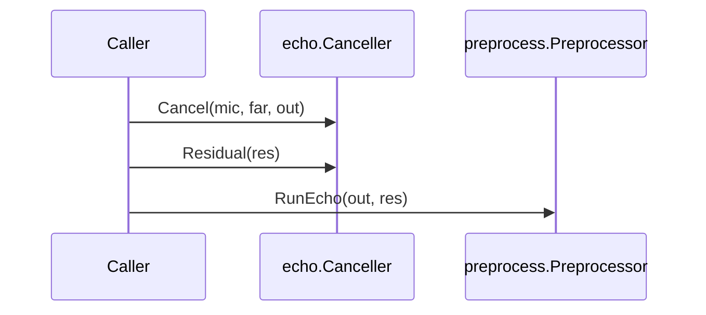

# Cross-package contracts

These are the conventions and interfaces every work package follows. The spec
is [requirements.md](requirements.md); this file says how to meet it the same
way everywhere.

**Editing rule:** append-only. Add new sections at the end, marked with the
work package that adds them. To change an existing contract, propose it under
"Open questions" in [status.md](status.md).

## 1. Packages and files

- Public packages: `resample`, `buffer`, `preprocess`, `echo`, `agc` (and
  `jitter` later). Low-level code lives in `internal/`.
- `internal/fixed` holds every fixed-point operation. Call it; never
  re-derive a macro locally. If an operation is missing, append it to
  `internal/fixed` with a harness test, in its own commit.
- `internal/testutil` holds shared test support (section 9).
- A package doc lives in `doc.go`.
- Fuzz seed corpora live in the package's own `testdata/fuzz/`.

## 2. Constructors, configuration and errors

Every stateful type has a `Config` struct and a constructor
`New...(cfg) (*T, error)`. Invalid configuration returns an error; nothing
panics on caller input. Example shape (not a real package):

```go
package widget

// Config configures a Widget. Every field must be set; there are no hidden
// defaults unless the field doc says so.
type Config struct {
	SampleRate int // Hz, 8000 to 48000
	FrameSize  int // samples per frame, 1 to 4096
}

// Sentinel errors. Audio-path methods return only these, never a formatted
// or wrapped error, so they do not allocate.
var (
	ErrConfig     = errors.New("widget: invalid configuration")
	ErrBufferSize = errors.New("widget: buffer too short")
)

// New validates cfg and allocates everything the Widget will ever use.
func New(cfg Config) (*Widget, error) {
	if cfg.SampleRate < 8000 || cfg.SampleRate > 48000 {
		return nil, fmt.Errorf("%w: sample rate %d Hz", ErrConfig, cfg.SampleRate)
	}
	...
}

// Process reads len(in) samples and writes them to out. It returns
// ErrBufferSize, writing nothing, if len(out) < len(in).
func (w *Widget) Process(in, out []int16) (int, error)
```

Rules:

1. Construction may allocate and may wrap errors with `fmt.Errorf("%w")`.
   Callers test with `errors.Is`.
2. Audio-path methods (requirements §16) return preallocated sentinel
   errors, and do not allocate on any path, including the error path.
3. SpeexDSP `ctl` requests become typed methods or `Config` fields; return
   codes become errors. A setting that needs reinitialisation is a `Config`
   field (make a new instance); a setting the reference changes on the fly
   is a method.
4. Extensions (requirements §4.5) are explicit `Config` fields or separate
   types. The zero value of every extension field selects the
   compatibility path.
5. Choosing an interface, registry or hook over a concrete type needs the
   owner's approval (requirements §2) before it is built.

## 3. Samples and conversion

- Samples are `int16` on the 16-bit scale `[-32768, 32767]`.
- `float32` entry points use the same scale, not `[-1, 1]`.
- `float32` input converts with `fixed.Word2IntFloat32`: saturation as
  `WORD2INT` (`arch.h:104`), then truncation toward zero. NaN becomes 0, a
  documented deviation (C is undefined); `±Inf` saturates. Every `float32`
  entry point tests NaN, `±Inf`, `±0` and the saturation boundaries.
- `float32` output is an exact copy of the `int16` result.
- Saturation happens inside the arithmetic where the reference does it, never
  as an extra clamp.

## 4. Buffers, chunking, aliasing and retention

- Streaming methods take caller-provided slices and never allocate output.
- A method never retains a caller slice after it returns, unless its doc
  says so.
- Input and output must not overlap, unless the method doc says they may;
  a method that allows it has a test for exact aliasing. Overlap that is not
  allowed is documented as unsupported, not detected.
- A view returned to the caller (for example a ring-buffer segment) states
  exactly when it expires, and a test proves the component never writes into
  a live view.
- Chunking: each type states its frame-size rule. A type with arbitrary
  chunk sizes has a test, and a fuzz test, that every partition of the same
  input stream gives identical output. A type with a fixed frame size
  returns `ErrBufferSize` (or its own sentinel) for any other length.
- Methods report how much they consumed and produced when that can be less
  than offered (as `speex_resampler_process_*` does), and document what
  happens when the output is too short.

## 5. Reset

- `Reset()` returns the instance to the state `New` produced with the same
  configuration, without allocating. After `Reset`, output equals that of a
  fresh instance fed the same input; test this.
- `Reset` does not reallocate or move buffers, so views stay valid unless the
  type documents that they expire at `Reset`.
- Where the reference has a reset with different semantics (for example
  `speex_resampler_reset_mem` keeps the rate state), the method matches the
  reference and its doc says what is kept.

## 6. Documentation of each stateful type

The package or type doc states every item in requirements §3 "API rules":
supported rates and frame sizes, chunking, buffer ownership, aliasing,
retention, output exhaustion, `Reset`, concurrency, which settings need a new
instance, latency, and allocation. Use these phrasings so they are easy to
find:

- **Concurrency:** "A T is not safe for concurrent use. Use one per
  stream." Or state exactly what is safe.
- **Allocation:** "New allocates; no other method allocates." Or name the
  exceptions.
- **Parity:** "Bit-exact with SpeexDSP 1.2.1 `<function>` (FIXED_POINT) for
  <configurations>." Or "Own design; contains no SpeexDSP code."

## 7. Derived-file header

Every Go file ported or adapted from SpeexDSP starts with this header, filled
in (requirements §11). List each upstream file it derives from and that
file's own copyright lines:

```go
// Derived from SpeexDSP 1.2.1 (https://github.com/xiph/speexdsp, commit
// 1b28a0f61bc31162979e1f26f3981fc3637095c8): libspeexdsp/<file>.
//
// Copyright (C) <years> <holder>
//
// Use of this source is governed by the BSD-3-Clause licence in
// LICENSES/SpeexDSP-COPYING. Changes: <one line, for example "ported to Go">.

package resample
```

Files derived from KISS FFT point to `LICENSES/kissfft-COPYING` instead (or
as well, for files derived from both). Each derived file or package also gets
an entry in `THIRD_PARTY_NOTICES.md`.

## 8. Porting

- Follow requirements §4.3. Types: `spx_word16_t` and `spx_int16_t` are
  `int16`, `spx_word32_t` and `spx_int32_t` are `int32`, `spx_uint32_t` is
  `uint32`, C `int` is `int` (or `int32` where width matters), `float` is
  `float32`, `double` is `float64`.
- `internal/fixed` functions return the C expression type after integer
  promotion (see its package doc). Where C assigns an `int` result to
  `spx_word16_t`, write `int16(...)` explicitly.
- Floating-point initialisation: reproduce the C expression types, and wrap
  every product that feeds an addition in an explicit `float64(...)` or
  `float32(...)` so the Go compiler cannot fuse a multiply-add (it does on
  arm64). `math.Sin`, `math.Exp` and friends are not libm; any table built
  with them needs an entry-by-entry harness comparison.
- On a mismatch, find the first differing sample and the first differing
  state variable. Never add a tolerance.
- Division by zero is undefined in C. On the canonical arm64 reference it
  yields 0 without trapping; on amd64 it traps; the `internal/fixed`
  divisions panic. For every division a port makes, show from the upstream
  code that the divisor cannot be zero for any input, and test the boundary
  that comes closest. If a zero divisor is reachable, do not add a guard
  silently: record it under "Open questions" in `docs/status.md`, because
  the reference itself has no defined result there.

## 9. Tests, benchmarks and shared helpers

Names:

| Kind | Name |
|---|---|
| Harness comparison | `TestReference<What>` |
| Harness input writer | `TestHarnessInputs` (see section 10) |
| Zero allocation | `TestNoAllocs<What>`, using `testutil.AssertNoAllocs` after warm-up |
| Chunk partition | `TestChunkInvariance<What>`, `FuzzChunks<What>` |
| Reset | `TestReset<What>` |
| Benchmark | `Benchmark<Type><Method>/<config>`, for example `BenchmarkResamplerProcess/q5_48k_16k_mono_480` |

Benchmarks use `b.Loop()`, report allocations (`b.ReportAllocs()`), and call
`testutil.ReportFrameMetrics(b, samples, rate)` to add `samples/s` and
`rt-fraction` (processing time over audio duration). `make bench` runs them
for 100 ms each.

`internal/testutil` provides:

| Helper | Purpose |
|---|---|
| `Silence`, `Impulse`, `Sine`, `Sweep`, `WhiteNoise`, `PinkNoise`, `SpeechLike`, `Clip`, `Scale`, `Add`, `ToFloat32` | Deterministic signals, bit-identical on every platform |
| `SplitMix64`, `Seed` | The generator shared with the C harness, and per-case seeds |
| `RMS`, `DBFS`, `SNR`, `SegmentalSNR`, `ERLE`, `SpectralFlatness` | Signal metrics for reported sanity tests |
| `AssertNoAllocs` | Zero-allocation assertion |
| `ReportFrameMetrics` | Benchmark metrics |
| `LoadManifest`, `ReadFile`, `Compare`, `NewStreamChecker`, `EncodeLE`, `DecodeLE` | Fixture loading and comparison |
| `SpeechFiles`, `LoadSpeech` | LibriSpeech files from `make speech`; skip when absent |

Do not call `math.Sin`, `math.Exp` or `math.Log` to generate inputs that are
compared bit for bit: those can differ between architectures. Use the
`testutil` generators, or write the inputs once and commit or hash them.

Under `-race` or `-short`, a test may reduce work only by comparing a leading
part of a stream (for example the first chunk hash); it must still run the
same code paths. Say so in the test.

## 10. Fixtures and the reference harness

Layout: `testdata/speexdsp/<component>/manifest.json` plus raw files. The
harness is described in `reference/README.md`; this section is the contract
between drivers and Go tests.

### Manifest

```json
{
  "schema": 1,
  "component": "fixed",
  "driver": "reference/drivers/fixed.c",
  "reference": {"repository": "...", "tag": "SpeexDSP-1.2.1", "commit": "1b28a0f6..."},
  "build": {"mode": "container", "image": "...", "compiler": "...", "cflags": "...",
            "os": "Linux", "arch": "aarch64", "config_h_sha256": "..."},
  "cases": [
    {
      "name": "mult16_16_q15",
      "params": {"...": "driver-defined JSON object"},
      "streams": [
        {"name": "out", "type": "int32", "count": 10000225, "chunk": 1048576,
         "chunks": ["<sha256 of elements [0, 1048576)>", "..."],
         "file": {"path": "mult16_16_q15.out.raw", "count": 4096, "sha256": "..."}}
      ]
    }
  ]
}
```

- A stream is a sequence of little-endian elements of type `int16`, `int32`,
  `float32` or `float64`. Requirements §4.2 names `int16`; the other types
  are for intermediate values, tables and `float32` entry points.
- `chunks` holds the SHA-256 of each run of `chunk` elements (the last may be
  shorter). It covers the whole stream, committed or not.
- `file`, if present, is the committed prefix: the first `count` elements.
  A short stream is committed whole (`file.count == count`).
- `params` is free-form per component, and is where a driver records the
  configuration, seeds and anything it observed.

### Go side

```go
m := testutil.LoadManifest(t, "../testdata/speexdsp/resample")
c := m.Case(t, "q5_48000_16000_mono")
c.DecodeParams(t, &params)
want := testutil.ReadFile[int16](t, m, c.Stream(t, "out")) // prefix, hash-checked
testutil.Compare(t, "out", want, got)

// Or stream a long output through the chunk hashes:
k := testutil.NewStreamChecker[int16](t, m, c, c.Stream(t, "out"), false)
for ... { k.Put(sample) }
k.Done()
```

A failure reports the first differing element with context, or the first
differing chunk. For the exact element beyond the committed prefix, run the
driver with `HARNESS_FULL_OUT=<dir>` and the test with
`GOVOIP_REFERENCE_FULL=<dir>`.

### Inputs

- Integer inputs may be generated on both sides from SplitMix64 and a seed
  (`testutil.Seed(caseName)` is the convention). Commit or hash the input
  stream too, so a generator mismatch shows as an input mismatch.
- Inputs that need floating-point maths are generated in Go only. The
  driver's `harness-inputs: ./<package>` directive makes
  `reference/fixtures.sh` run `go test ./<package> -run '^TestHarnessInputs$'
  -args -harness-inputs=<dir>` first; the test writes files there and skips
  when the flag is empty. The driver reads them from its input directory
  (`argv[2]`) and records them as a stream.

### Size and provenance

- Files ≲ 1 MB each; all committed fixtures ≲ 20 MB in total
  (requirements §4.2). Commit prefixes; let chunk hashes cover long runs.
- Canonical fixtures come from the pinned container (`make fixtures`).
  `make fixtures-host` cross-checks with the host clang; record the result,
  and any difference, in `docs/testing.md`.
- Never edit a fixture by hand, and never generate one from Go output.

## 11. Portable path and build tags

- The build tag `purego` and the environment variable `GOVOIP_DSP_PUREGO=1`
  force the portable path (requirements §6). Only `internal/kernels` (stretch
  S3) reads them; until it exists every path is portable.
- CPU detection uses `golang.org/x/sys/cpu`, the only pre-approved
  dependency (ADR `docs/decisions/wp0-dependencies.md`).

## 12. Echo to preprocess residual-echo coupling

In the reference, `speex_preprocess_ctl(st, SPEEX_PREPROCESS_SET_ECHO_STATE,
echo_state)` stores a pointer to the echo canceller. Every
`speex_preprocess_run` then calls `speex_echo_get_residual(echo_state,
st->residual_echo, N)` (`preprocess.c:744-757`) before its analysis, and
folds the result into its echo-noise estimate:

```c
echo_noise[i] = MAX32(MULT16_32_Q15(QCONST16(.6f,15), echo_noise[i]), residual_echo[i]);  /* i < N */
```

Without an echo state it sets `echo_noise` to zero (`preprocess.c:759-761`).
`speex_echo_get_residual` (`mdf.c:1190-1220`) windows `last_y`, the echo
estimate of the most recent `speex_echo_cancellation` call, transforms it,
takes the power spectrum (`frame_size + 1` bins) and scales it by the leak
estimate. It writes only echo scratch buffers (`y`, `Y`) besides its output.

The Go contract replaces the stored pointer with an explicit hand-off of the
spectrum. Neither package imports the other, and no interface is needed:

```go
// package echo
// ResidualLen returns FrameSize()+1, the number of values Residual writes.
func (c *Canceller) ResidualLen() int

// Residual writes the residual-echo power spectrum of the most recent
// Cancel or Capture call into dst[:ResidualLen()], exactly as
// speex_echo_get_residual computes it (spx_word32_t values). It returns
// ErrBufferSize if len(dst) < ResidualLen(). It does not allocate and does
// not change any later output of c.
func (c *Canceller) Residual(dst []int32) error

// package preprocess
// Run processes one frame in place with no echo residual: the reference
// behaviour without SET_ECHO_STATE.
func (p *Preprocessor) Run(frame []int16) (bool, error)

// RunEcho processes one frame in place using residual[:FrameSize()], the
// reference behaviour with SET_ECHO_STATE. len(residual) must be at least
// FrameSize(); extra values are ignored. residual is not retained.
func (p *Preprocessor) RunEcho(frame []int16, residual []int32) (bool, error)
```

The `bool` is the VAD decision, as `speex_preprocess_run` returns it. Names
and the other methods are each work package's choice; the semantics above are
the contract.

Per-frame order, matching the reference call sequence:



1. `Cancel` (or `Capture`) processes the frame and updates the echo
   estimate.
2. `Residual` reads that estimate. Calling it twice gives the same values.
3. `RunEcho` uses the spectrum exactly where `speex_preprocess_run` would
   have called `speex_echo_get_residual`, so the output is bit-exact with the
   C pairing.

Conditions:

- Both instances use the same frame size and sampling rate. Upstream does
  not check this; `preprocess` checks `len(residual)`, and WP7 tests the
  pairing.
- Switching between `Run` and `RunEcho` from frame to frame is allowed and
  matches setting and clearing the echo state between calls in C.
- WP6 tests that calling `Residual` does not change any later echo output,
  and WP5 tests `RunEcho` against residual spectra that its driver records
  from the C pairing, until WP7 runs the real pairing.

Alternatives considered: `preprocess` holding a `*echo.Canceller` (mirrors
the C pointer, but couples the packages and stops WP5 testing without WP6),
or an interface with a `Residual` method (needs owner approval, and adds
nothing the slice does not give). The owner may still choose either; see
`docs/status.md`.

## 13. Internal FFT (WP3)

`internal/fft` replaces `spx_fft_init`, `spx_fft` and `spx_ifft` for
`echo` (WP6) and `preprocess` (WP5). It is bit-exact with them, including
what `spx_fft` leaves in its input buffer.

```go
// package fft
const MaxSize = 4096

var (
	ErrConfig     = errors.New("fft: invalid configuration")
	ErrBufferSize = errors.New("fft: buffer length differs from the transform size")
)

type Config struct {
	Size int // real samples per transform; see Supported
}

// Supported reports whether New accepts size: even, 2 to MaxSize, and
// size/2 without a prime factor above 17.
func Supported(size int) bool

// New is spx_fft_init. It returns an error wrapping ErrConfig otherwise.
func New(cfg Config) (*FFT, error)

func (f *FFT) Size() int

// Forward is spx_fft(table, in, out). It rewrites in as spx_fft does.
func (f *FFT) Forward(in, out []int16) error

// Inverse is spx_ifft(table, in, out). It does not modify in.
func (f *FFT) Inverse(in, out []int16) error
```

Rules for callers:

1. Create one `FFT` per stream at construction, with `Size` =
   `2*frame_size`, as `mdf.c:438` and `preprocess.c:522` do. Validate the
   frame size with `Supported` (or the error from `New`) so the component's
   own `New` fails, not a later call.
2. `in` and `out` must both have length `Size`; otherwise the call returns
   `ErrBufferSize` and touches nothing. With slices sized at construction
   this error cannot occur on the audio path.
3. `in` and `out` must not overlap. No upstream call site overlaps them.
4. Where the C code reuses the buffer it passed to `spx_fft` (for example
   `mdf.c` passes `st->x`, `st->e` and `st->y`), pass the same Go buffer, so
   the rewrite reaches the later code exactly as in C.
5. The layout is half-complex (`docs/algorithms.md`), the same `int16`
   array that `spx_word16_t *out` holds in C, so per-bin code ports
   index for index.
6. An `FFT` is not safe for concurrent use. Its methods do not allocate,
   block or panic; on a zero `FFT` (not made by `New`) they return
   `ErrConfig`.
