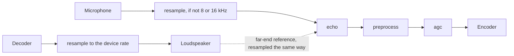
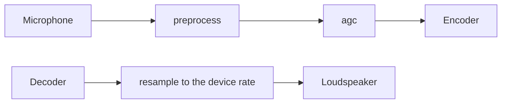
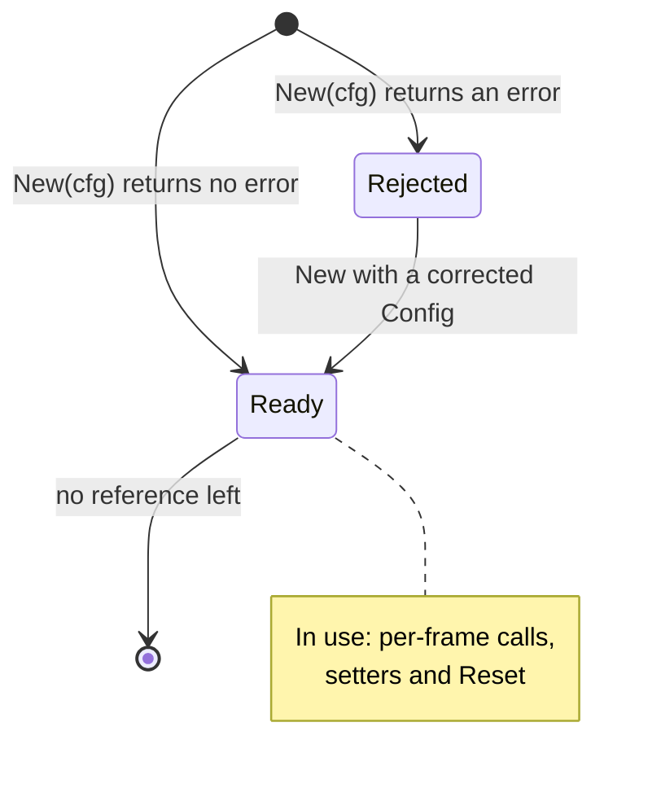
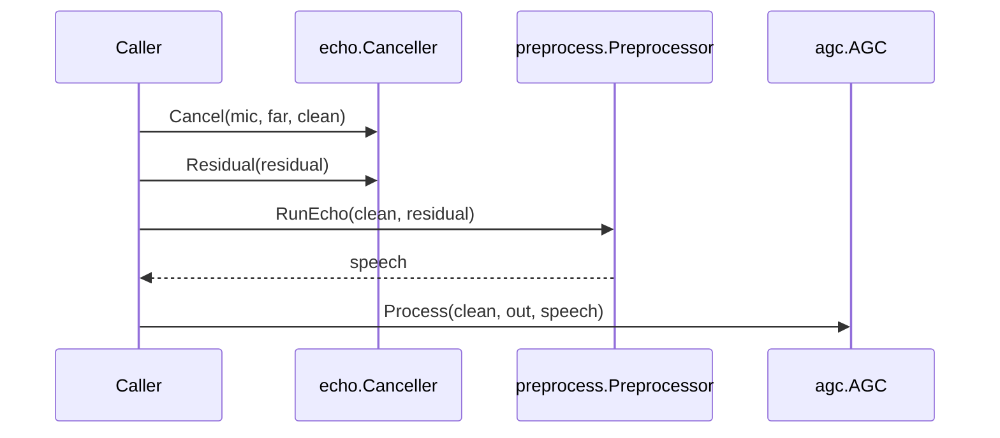
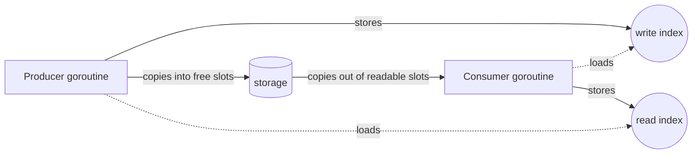
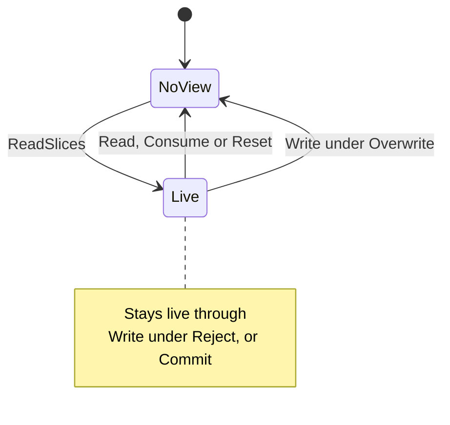

# Developer guide

This guide is for a Go developer who is new to audio processing and wants
to clean the audio of a VoIP call with govoip-dsp. It explains what each
package does, the order to call them in, who owns which buffer, and how
to hand audio between goroutines. The [glossary](glossary.md) defines
the terms it uses, and the first use of most of them is a link.
[usage.md](usage.md) builds on it with two tested recipes for wiring a
whole call.

The package docs are the reference for each type and method; read them
with `go doc`, for example
`go doc -all github.com/danieldonoghue/govoip-dsp/echo`.
The root package holds the end-to-end examples this guide cites;
`go doc github.com/danieldonoghue/govoip-dsp` prints its overview.
`go doc` does not print example code: read the examples in each
package's `example_test.go` (the root's is
[example_test.go](../example_test.go)), or run them with
`go test <package> -run Example -v`.

## Start here

Read the guide in this order to get a first call working:

1. Read [Audio basics](#audio-basics) if samples, rates and frames are
   new to you.
2. Find your application in
   [Which packages you need](#which-packages-you-need), then read
   [The pipeline](#the-pipeline) to see when each is needed and in what
   order.
3. Read [The send path, frame by frame](#the-send-path-frame-by-frame)
   and run `Example_sendChain` in the root package
   (`go test github.com/danieldonoghue/govoip-dsp -run Example_sendChain -v`).
4. Choose a recipe in [usage.md](usage.md) for where your audio comes
   from.
5. Read [Handing audio between goroutines](#handing-audio-between-goroutines)
   before you connect a network or device goroutine.
6. Check the limits in [Limitations](#limitations).

## Audio basics

The library works on sound as numbers, one frame at a time. These ideas,
in four groups, are enough to use it; the [glossary](glossary.md) has the
detail.

The packages that process audio are `resample`, which converts the sample
rate; `echo`, which removes echo; `preprocess`, which suppresses noise and
detects speech; and `agc`, which keeps the level steady. `buffer` only
stores samples. [The packages](#the-packages) lists them.

Sound as numbers:

- **Sample.** One number that gives the level of the sound at one
  instant. The packages take `int16` samples, -32768 to 32767
  ([sample](glossary.md#sample)).
- **Sample rate.** The number of samples in one second, in hertz (Hz).
  Telephone calls commonly use 8000 Hz (narrowband) or 16000 Hz
  (wideband); devices and some [codecs](glossary.md#encoder-and-decoder)
  use 48000 Hz. A stage that combines two [streams](glossary.md#stream)
  needs both at the same rate, and `resample` converts between rates
  ([sample rate](glossary.md#sample-rate)).
- **Level, gain and clipping.** The [level](glossary.md#level) of a
  signal is how large its samples are over a span, measured as
  [RMS](glossary.md#rms) in [dBFS](glossary.md#dbfs), decibels relative
  to the full scale of the digital format: 0 dBFS is full scale,
  amplitude 32768, one step above the largest `int16` sample, and
  quieter signals are negative. Levels are RMS, so by this definition a
  full-scale sine wave is about -3 dBFS. Other scales have other zero
  points.
  A [gain](glossary.md#gain) is the factor a stage multiplies a signal
  by. It is given in [dB](glossary.md#db), a logarithmic scale
  (`20·log10` of the factor): +6 dB roughly doubles the amplitude,
  +20 dB multiplies it by ten, and -6 dB about halves it. Gains in dB
  add where the factors multiply. A signal pushed past either end of the
  scale, -32768 or 32767, is cut flat, which is
  [clipping](glossary.md#clipping) and sounds distorted.
- **Channel.** One signal of the audio: the samples from one microphone,
  or for one loudspeaker. Mono audio has one channel; stereo has two, left
  and right; surround layouts such as 5.1 and 7.1 have more. `echo`,
  `preprocess` and `agc` take mono; `resample` takes 1 to 256 channels,
  [interleaved](glossary.md#interleaved) (the first sample of every
  channel, then the second of every channel) or one channel by stride
  with `ProcessChannel` ([channel](glossary.md#channel)).
- **Speech, noise and VAD.** Speech is the voice. Background
  [noise](glossary.md#noise) is any sound in the microphone signal that
  is neither speech nor echo, such as a fan or line hiss. A [VAD](glossary.md#vad) (voice
  activity detection) decides for each frame whether it is speech.

Time and frames:

- **Frame.** A fixed number of samples that `echo` and `preprocess`
  process in one call; `resample`, `agc` and `buffer` take any length,
  a [chunk](glossary.md#chunk). A frame of `ms` milliseconds at a rate
  of `rate` Hz is `rate * ms / 1000` samples: 160 samples for 20 ms at
  8 kHz ([frame](glossary.md#frame)).
- **Why 10 or 20 ms.** Codecs and [RTP](glossary.md#rtp) packets
  commonly carry 20 ms of audio. SpeexDSP, the C library that `resample`,
  `echo` and `preprocess` port, asks for frames of 10 to 20 ms for `echo`
  and `preprocess`. A frame is processed only once all of it has
  arrived, and `preprocess` holds back one more frame, so a longer
  frame adds delay to the call.
- **Latency.** The delay a stage adds between its input and its output
  ([latency](glossary.md#latency)).

A call and its streams:

- **Call and stream.** A [call](glossary.md#call) carries audio in both
  directions. A [stream](glossary.md#stream) is audio going one
  way, such as the microphone signal. The [near end](glossary.md#near-end)
  is the local side, the [far end](glossary.md#far-end) the remote side.
- **Echo.** [Echo](glossary.md#echo) is far-end sound that the
  loudspeaker plays and the microphone picks up again, so the far end
  hears itself. Removing it needs a copy of what the loudspeaker played,
  the far-end reference. [When each stage is needed](#when-each-stage-is-needed)
  says when it happens.
- **Encoder and decoder.** A [codec](glossary.md#encoder-and-decoder)
  has two halves outside this library: the encoder compresses audio
  into packets for the network, and the decoder turns received packets
  back into samples.

Processors and state:

- **Processor.** A [processor](glossary.md#processor) does one job on
  the audio: you pass it samples, one frame or chunk per method call, and it
  gives the changed samples back. There are four kinds: a resampler
  (`resample.Resampler`), an echo canceller (`echo.Canceller`), a noise
  suppressor (`preprocess.Preprocessor`) and a gain control (`agc.AGC`).
  You create each one with its package's `New` function, for example
  `echo.New`. A stage is one step on the way from the microphone to the
  encoder, or from the decoder to the loudspeaker, and a processor does
  it. The `buffer` types only store samples, so they are not processors.
- **State.** A processor remembers earlier audio: `echo` learns how the
  room echoes the loudspeaker, `preprocess` keeps an estimate of the
  background noise, `resample` keeps the recent input samples that its
  conversion still needs, and `agc` keeps its current gain. So a call
  keeps its processors for its whole life, and no processor is shared
  between calls ([The lifecycle of a processor](#the-lifecycle-of-a-processor)).

## The packages

Five public packages each do one job on the audio: four process it and
`buffer` stores it. A call uses only the ones it needs;
[Which packages you need](#which-packages-you-need) says which.

Three of them, `resample`, `echo` and `preprocess`, are ports of
SpeexDSP, a C library for the same jobs. In the Parity column,
[bit-exact](glossary.md#bit-exact) means the port gives the same output
values as SpeexDSP 1.2.1 for the same input and configuration, sample for
sample, and
[own design](glossary.md#own-design) means code with no SpeexDSP code in
it. A [chunk](glossary.md#chunk) is the samples passed to one method call,
of any length.

| Package | Does | Frame rule | Rates | Parity | SpeexDSP counterpart |
|---|---|---|---|---|---|
| `resample` | Converts between sample rates | Any [chunk](glossary.md#chunk) | Any ratio within the size limits; 1 to 256 channels | Bit-exact | [`speex_resampler.h`](https://gitlab.xiph.org/xiph/speexdsp/-/blob/1b28a0f61bc31162979e1f26f3981fc3637095c8/include/speex/speex_resampler.h) |
| `echo` | Removes the [far end](glossary.md#far-end)'s echo from the microphone signal | The frame size set in `Config`, per method call | 8 and 16 kHz; it accepts up to 48 kHz but cancels poorly there ([Limitations](#limitations)) | Bit-exact | [`speex_echo.h`](https://gitlab.xiph.org/xiph/speexdsp/-/blob/1b28a0f61bc31162979e1f26f3981fc3637095c8/include/speex/speex_echo.h) |
| `preprocess` | Noise suppression, voice activity detection ([VAD](glossary.md#vad)), suppression of [residual echo](glossary.md#residual-echo) | The frame size set in `Config`, per method call | 4 Hz to 65535 Hz | Bit-exact | [`speex_preprocess.h`](https://gitlab.xiph.org/xiph/speexdsp/-/blob/1b28a0f61bc31162979e1f26f3981fc3637095c8/include/speex/speex_preprocess.h) |
| `agc` | Automatic gain control ([AGC](glossary.md#agc)) with a [limiter](glossary.md#limiter), which stops the output from clipping | Any chunk | 8000 to 48000 Hz | Own design | None in the fixed-point build |
| `buffer` | `Ring` for one goroutine, `SPSC` ([single producer, single consumer](glossary.md#spsc)) between two | Any chunk | Any | Own design | [`buffer.c`](https://gitlab.xiph.org/xiph/speexdsp/-/blob/1b28a0f61bc31162979e1f26f3981fc3637095c8/libspeexdsp/buffer.c), design input only |

The packages under `internal/` serve these packages and are not for
callers. The public packages do not import each other: where one
package's output is another's input, the caller passes it on.

## The pipeline

The pipeline is the chain of stages that audio passes through, in
order. Which stages it has depends on the use case: whether the
microphone hears the loudspeaker, whether the audio is noisy or you need
to know when someone speaks, whether its level varies, whether two
sample rates meet, and whether audio passes between goroutines.
[Which packages you need](#which-packages-you-need) lists common cases.

A call has two directions
([send path and receive path](glossary.md#send-path-and-receive-path)).
The send path cleans what the microphone picks up before an
[encoder](glossary.md#encoder-and-decoder) compresses it and it is sent.
The receive path brings the audio that a decoder made from the received
packets to the device.

### Which packages you need

Find your application in the first column. "Needs" lists the packages
it cannot do without; "Add if you need" lists the optional ones, each
with what it gives. `preprocess` gives noise suppression, speech
detection (the [VAD](glossary.md#vad)) and, after `echo`, suppression of
the echo that is left. `agc` gives speech a steady
[level](glossary.md#level).
[When each stage is needed](#when-each-stage-is-needed) says more.

| Application | Needs | Add if you need |
|---|---|---|
| A call where the microphone can hear the loudspeaker: a speakerphone, a laptop or phone on hands-free, a conference room, a smart speaker | `echo` | `preprocess`: noise suppression, residual-echo suppression or a VAD (`SetVAD(true)`); `agc`: a steady level |
| A call with a headset, or a handset at the ear: the microphone does not hear the loudspeaker | None | `preprocess`: noise suppression or a VAD (`SetVAD(true)`); `agc`: a steady level |
| One audio stream and no call, such as a recorder or a monitor | None | `preprocess`: noise suppression, or to know when someone is speaking (`SetVAD(true)`); `agc`: a steady level |
| Rate conversion only | `resample` | |
| A hand-off of audio between goroutines | `buffer` | Any of the others |

The stages of a row run in the order listed: `echo`, then `preprocess`,
then `agc`. Each of the first three rows also needs `resample` if two
parts of the path use different sample rates, for example a 48 kHz
device and an 8 kHz codec. The first row needs it too when the audio
that reaches `echo` is not at 8 or 16 kHz, even if the device and the
codec use the same rate, because `echo` works well at those two rates
only.

Where `agc` follows `preprocess`, call `SetVAD(true)` on the preprocessor,
so that `agc` gets a real speech decision.

### When each stage is needed

Each bullet says what a send-path stage does, when you need it, and what
happens without it, in pipeline order.

- `echo` removes [echo](glossary.md#echo). Echo happens when the
  microphone picks up what the loudspeaker plays: the far end's voice
  comes out of the loudspeaker, goes into the microphone and back to the
  far end, so the far end hears itself a moment later. `echo` is needed
  whenever the microphone hears the loudspeaker. With a headset there is
  no acoustic path from the loudspeaker to the microphone, so a call
  needs no `echo` stage. Without it, where the microphone hears the
  loudspeaker, the far end hears itself.
- `preprocess` suppresses noise, finds speech (the VAD) and, after
  `echo`, suppresses the residual echo. Leave it out when the audio is
  already clean and you don't need a VAD. Without it, the output of
  `echo` keeps its residual echo. `agc` still works alone, because you
  can pass `speech` true for every chunk; then any noise above
  `GateLevel`, the [gate level](glossary.md#gate-level), is raised like
  speech.
- `agc` brings the level of speech towards a target, raising quiet
  talkers and lowering loud ones, and its [limiter](glossary.md#limiter)
  keeps the output from [clipping](glossary.md#clipping). Leave it out
  when the level is already right: the source has a known, fixed
  [gain](glossary.md#gain), or something later (a server or the
  listener's device) sets the level. Without it, no stage of this
  library sets the level: the output of `preprocess` is as loud as its
  input, less what it suppresses.
- Only `agc` uses the VAD decision inside this library, so
  `preprocess.Preprocessor.SetVAD(true)` is optional unless `agc` follows
  or you read the decision yourself. With the VAD off, `Run` reports
  every frame as speech, so an `agc` after it raises the gain on noise
  above `GateLevel` too.
- To use `preprocess` only for its VAD, call
  `preprocess.Preprocessor.SetVAD(true)` and
  `preprocess.Preprocessor.SetDenoise(false)`. The output is then close
  to the input delayed by one frame, not the same samples. This also
  turns off the residual-echo suppression.

### Every stage of a call

This diagram shows each stage a call can use, here for a call where the
microphone hears the loudspeaker. [When each stage is needed](#when-each-stage-is-needed)
says which ones a given setup needs.



1. The microphone signal holds the near end's voice and the echo of what
   the loudspeaker played.
2. `echo` removes that echo. It needs the
   [far-end](glossary.md#far-end) reference: a copy of the samples the
   loudspeaker played, at the same rate as the microphone signal and
   paired with it frame for frame (the dotted line in the diagram). If
   the microphone is resampled, resample the reference the same way.
3. `preprocess` suppresses noise and the
   [residual echo](glossary.md#residual-echo) that `echo` left, and
   decides per frame whether it is speech (the VAD).
4. `agc` sets the level last, so it sees the cleaned signal. Its `speech`
   argument is the VAD decision, so it does not raise the gain on pauses.
   The VAD also reports speech on stationary noise, so only a
   `GateLevel` above the noise stops `agc` raising it (see "Gate above
   the noise" in [the send path](#the-send-path-frame-by-frame)).
5. On the receive path, `resample` converts the decoder's rate to the
   device's. A [jitter buffer](glossary.md#jitter-buffer) between decoder
   and resampler is planned, not built.

`echo` works well at 8 and 16 kHz only. Where the device or network runs
at 48 kHz, resample both the microphone and the far-end reference to
16 kHz, each with its own `resample.Resampler` of the same
configuration, so they stay sample-aligned.

### A call without echo cancellation

A call with a headset, where the microphone does not hear the
loudspeaker, drops `echo` and the far-end reference:



1. `preprocess` takes each microphone frame with `Run` instead of
   `RunEcho`, since there is no residual echo to pass in.
2. `agc` follows it as in [every stage of a call](#every-stage-of-a-call),
   with the VAD decision of `Run`. Call `SetVAD(true)` on the preprocessor
   first: with the VAD off, `Run` reports every frame as speech.
3. The receive path is the same, and nothing links it to the send path.

`preprocess` works at the common device rates too, so the send path needs
`resample` only where the encoder's rate differs from the microphone's.
The `preprocess` package doc's Use section shows this send path in code.
A recorder or a monitor can use `preprocess`, `agc` or both on its one
stream; call `SetVAD(true)` when it uses `agc` or reads the VAD itself.

## The lifecycle of a processor

A [processor](glossary.md#processor) keeps state from one frame to the
next: `echo` learns the room's echo and `resample` keeps recent input
samples. So make a call's processors once and keep them for the whole
call, never share one between calls, give each stream that is resampled
its own `resample.Resampler`, and reuse a processor for a new stream only
through `Reset`. The four processors (`resample.Resampler`,
`echo.Canceller`, `preprocess.Preprocessor`, `agc.AGC`) have the same
life. The two buffers of `buffer` (`Ring`, `SPSC`) store samples and are
not processors, but they are made once, kept for the stream and reset in
the same way.



`Ready` is a processor that `New` made and that you can use; `Rejected` is
a `New` that returned an error and no processor. The note on `Ready` is
the processor in use; steps 2 to 4 explain its three kinds of method call. "No
reference left" means that no variable in your program holds the
processor, so the garbage collector can free it (step 5).

1. **New.** Build the `Config`, call `New`, and check the error. New
   validates every field, allocates everything the processor will use,
   and returns an error wrapping the package's `ErrConfig` for an invalid
   `Config` (`resample` also `ErrAllocFailed`, above its size limits).
   Test it with `errors.Is`; the message names the field.
   Calling `New` again with the same `Config` fails the same way: correct
   the `Config` first.
2. **Per-frame method calls.** Call the process method once per frame or chunk.
   It does not allocate, block or panic. It returns only unwrapped
   sentinel errors (for example `ErrBufferSize` for a slice of the wrong
   length), which cannot occur when the buffers are sized once from the
   processor. Treat them as programming errors. One exception:
   `resample` returns `ErrAllocFailed` from its process methods while a
   rejected rate or quality change is in force (see [Errors](#errors)).
3. **Setters.** Settings that SpeexDSP changes on the fly are methods
   (`preprocess.Preprocessor.SetVAD`, `echo.Canceller.SetSampleRate`,
   `resample.Resampler.SetRate`); call them between frames. Settings
   that need a new instance are `Config` fields.
4. **Reset.** Start a new stream on the same instance without allocating.
   What `Reset` keeps differs: `echo` keeps some learned state as
   SpeexDSP does, `preprocess` keeps its settings, `resample` keeps its
   rates. The package docs list it.
5. **End.** There is no `Close`; when no reference is left, the garbage
   collector frees the memory.

A [zero value](glossary.md#zero-value), such as `var c echo.Canceller`,
is not a processor: it was not made by `New`. No method panics on it,
but the methods with an error result return `ErrConfig`, and the others
return zero values and change nothing, except that the `preprocess`
setters store their setting and the getters of those settings return
what was stored.

## The send path, frame by frame

The send path cleans the microphone signal for the encoder, one frame
at a time. This section follows a call where the microphone hears the
loudspeaker, with `echo`. Without it, skip steps 1 and 2: `clean` is
then the microphone frame itself, which `Run(clean)` in step 3 rewrites
in place, so a caller that needs the unprocessed frame copies it first.

First make the processors, once, before the first frame. They share one
sample rate and one frame size. This code is adapted from `newSendChain`
in the root package's [example_test.go](../example_test.go), which
`Example_sendChain` runs; it uses the 200 ms filter that the filter rule
below suggests as a start.

```go
const rate, frameMs = 8000, 20
frame := rate * frameMs / 1000 // samples per frame: 160

if !preprocess.SupportedFrameSize(frame) {
	return fmt.Errorf("no preprocessor for %d-sample frames", frame)
}
ec, err := echo.New(echo.Config{
	FrameSize:    frame,
	FilterLength: rate / 5, // 200 ms to start, in samples; see "Filter length"
	SampleRate:   rate,     // 8000 or 16000
})
if err != nil {
	return err
}
pre, err := preprocess.New(preprocess.Config{SampleRate: rate, FrameSize: frame})
if err != nil {
	return err
}
pre.SetVAD(true) // the VAD decision tells the AGC which frames are speech
gc, err := agc.New(agc.DefaultConfig(rate)) // the defaults for the rate
if err != nil {
	return err
}

// Buffers, made once. The caller fills mic and far for each frame.
mic := make([]int16, frame)                 // one microphone frame
far := make([]int16, frame)                 // the loudspeaker frame played meanwhile
clean := make([]int16, frame)               // Cancel writes it; RunEcho cleans it in place
residual := make([]int32, ec.ResidualLen()) // the residual-echo spectrum
out := make([]int16, frame)                 // the frame to encode and send
```

For each 20 ms frame, the full send path calls four methods in a fixed
order, because each call uses what the one before it produced.



1. `Cancel(mic, far, clean)` removes the echo of `far` from `mic` and
   writes `clean`. `far` is the loudspeaker frame played while `mic` was
   captured. The filter models echo that reaches `mic` up to about the
   filter length after `far`.
2. `Residual(residual)` reads the spectrum of the echo that `Cancel` left
   in this frame. Read it before the next `Cancel`, which replaces it.
3. `RunEcho(clean, residual)` suppresses noise and that echo in `clean`,
   in place, and returns the VAD decision. Without an echo canceller, call
   `Run(clean)` instead.
4. `Process(clean, out, speech)` applies the AGC gain. It raises the gain
   only when `speech` is true.

In code, with the processors and buffers above, one frame is (from the
`step` method of `sendChain` in `Example_sendChain`'s file):

```go
if err := ec.Cancel(mic, far, clean); err != nil {
	return err
}
if err := ec.Residual(residual); err != nil {
	return err
}
speech, err := pre.RunEcho(clean, residual)
if err != nil {
	return err
}
if err := gc.Process(clean, out, speech); err != nil {
	return err
}
```

Rules for this path:

- **One frame size.** `echo` and `preprocess` use the same `FrameSize`
  and sample rate. A frame is `rate * ms / 1000` samples: 160 for 20 ms
  at 8 kHz, 320 at 16 kHz. `preprocess.SupportedFrameSize` accepts 1 to
  2048 samples with no prime factor above 17, which includes 10 and 20 ms
  at 8, 16, 32 and 48 kHz; check it before `New`.
- **Buffers made once.** Make `clean` (`FrameSize` samples), `residual`
  (`ResidualLen()` values) and `out` before the call starts. The
  per-frame path then never allocates. The
  [residual-echo spectrum](glossary.md#residual-echo-spectrum) has one
  value per frequency [bin](glossary.md#bin) from 0 Hz to half the rate,
  `FrameSize + 1`; `RunEcho` uses the first `FrameSize` of them, as
  SpeexDSP does.
- **No copy needed.** `RunEcho` can work in place on `Cancel`'s output.
  The recipes in [usage.md](usage.md) copy it first because they keep
  the canceller's output; a chain that does not need it can skip the
  copy.
- **Filter length.** `echo.Config.FilterLength` must cover the largest
  [echo delay](glossary.md#echo-delay) plus the
  [echo tail](glossary.md#echo-tail), and no more: a longer
  [filter](glossary.md#filter-length) costs more and adapts more slowly.
  The echo delay is the time from a far-end sample being passed to
  `Cancel` to its echo first arriving in the microphone signal,
  including device and network buffering; the echo tail is how long the
  echo of one sample keeps arriving.
  Without a measured delay, start with 200 ms
  (`rate/5` samples), which the `call` wiring of [usage.md](usage.md)
  uses, and shorten it once the delay of the calls is known.
- **Latency.** The delays of the stages add up: `echo` adds none,
  `preprocess` one frame, `agc` 2 ms. With 20 ms frames the stages
  delay the audio by about 22 ms, on top of the 20 ms it takes to
  collect a frame, plus any `resample` delay ([latency](glossary.md#latency)).
- **VAD on.** Call `SetVAD(true)` on the preprocessor; with the VAD off,
  `RunEcho` reports every frame as speech.
- **Gate above the noise.** The VAD reports speech on stationary noise,
  so set `agc.Config.GateLevel`, the [gate level](glossary.md#gate-level)
  under which the AGC does not raise the gain, above the noise of the
  line; see the `agc` package doc. To find that level, record the
  preprocessor's output during a stretch where nobody talks and compute
  its [RMS](glossary.md#rms) in [dBFS](glossary.md#dbfs),
  `20·log10(rms/32768)`, a negative number; set the gate a few dB above
  it, for example -55 for noise at -60. The `dBFS` helper in
  [example_test.go](../example_test.go) computes it, rounded to whole dB,
  for a non-silent `[]int16`.

`Example_sendChain` in the root package runs this path on a synthetic
call, and [usage.md](usage.md) has the full recipes, with their tests.
The tests check the echo and preprocess steps bit for bit against the
same steps in C; the AGC has no C counterpart.

## The receive path

The receive path plays the far end's voice on the device. The decoder
often runs at another rate than the device, for example 8 kHz into a
48 kHz device, so the receive path resamples decoded frames to the
device rate. A `resample.Resampler` accepts any chunk size and keeps its
filter history between calls, so it needs no framing. Size its output
with `OutLen` on the new `Resampler`:

```go
r, err := resample.New(resample.Config{Channels: 1, InRate: 8000, OutRate: 48000, Quality: resample.QualityVoIP})
if err != nil {
	return err
}
out := make([]int16, r.OutLen(160))        // 961: room for one 20 ms frame's output
_, written, err := r.Process(decoded, out) // reads all of decoded: out is sized by OutLen
if err != nil {
	return err
}
play(out[:written]) // hand the output to the device
```

With `OutLen(n)` samples of room (times `Channels()` for interleaved input), a
call of `n` frames always consumes its whole input. A size from `OutLen(n)` on a
new `Resampler` covers every call of up to `n` frames while `SkipZeros` and the
setters are not used. After `SkipZeros` or any setter, call `OutLen` before each
call (it does not allocate). A smaller output gives no error: the call can
leave input unread. The output per call can vary by one sample at fractional
ratios, so pass on `out[:written]`, not a fixed length. The resampler delays
the signal by `OutputLatency()` output samples. `Example_receiveChain` in the
root package runs this path.

## Handing audio between goroutines

Audio often arrives on one goroutine (a network reader, a device
callback) and is processed on another. Every processor is
[single-owner](glossary.md#single-owner), so only a `buffer.SPSC` crosses
between goroutines. It has exactly one
[producer](glossary.md#producer-and-consumer) goroutine, which writes, and
one consumer goroutine, which reads.

An SPSC is a [ring buffer](glossary.md#ring-buffer): fixed storage
of [slots](glossary.md#slot-and-index), one per sample, used as a circle,
so that after the last slot it continues at the first. An index is the
name of a slot (the slot number is the index modulo the capacity): the
write index is where the next sample is written, and the read index is
where the next one is read.



In the diagram, solid arrows are stores and copies, and dotted arrows
are loads.

1. Each side owns one index and is the only goroutine that stores it:
   the producer the write index, the consumer the read index.
2. Each side only loads the other's index, to learn how much it may
   write (`Free`) or read (`Len`).
3. The producer copies samples into free slots, then stores the write
   index, which publishes them. The consumer copies samples out, then
   stores the read index, which frees the slots.

So neither side ever waits for the other, and no lock is needed: every
method is [wait-free](glossary.md#wait-free). The memory-ordering argument is in
[algorithms.md](algorithms.md#spsc-memory-ordering).

Producer methods are `Write`, `WriteSlices`, `Commit` and `Free`.
Consumer methods are `Read`, `ReadSlices`, `Consume` and `Len`. `Cap` is
for either side. `Reset` needs both sides stopped.

Rules for frames through an SPSC:

- **The consumer's schedule.** An SPSC has no blocking read, and the
  library never waits. Run the consumer on a schedule, for example from
  a ticker or the device callback once per frame period, and process the
  whole frames that are there each time. How it waits between runs is
  the application's choice, outside the library's methods.
- **Pairs of frames.** Where each received frame must stay paired with
  the far-end frame sent at the same time, follow the tested wiring of
  [usage.md](usage.md#sources-that-deliver-the-pairing): its `drain`
  keeps each pair together, also when it drops a backlog.
- **Whole frames.** `Write` stores as much as fits. The producer checks
  `Free() >= len(frame)` and writes a whole frame or drops it; a partial
  frame would shift every later frame boundary. The consumer reads only
  while `Len() >= frameSize`.
- **Size for the longest stall.** A capacity of `rate/5` samples holds
  200 ms: ten 20 ms frames. When it is full, the producer drops frames.
- **Drop the backlog.** The SPSC never overwrites unread audio. After a
  stall of the consumer, old frames are stale for a live call:
  `Consume(Len() - frameSize)` drops all but the newest frame.

`Example_handoff` in the root package shows a stall and the drop, and
[usage.md](usage.md) uses SPSCs in both recipes.

## Buffer ownership and views

Slices carry the audio into and out of every method. These rules say
who may change a slice and for how long, so that no code reads samples
that another call has already replaced. The caller owns every slice it
passes. No method keeps a caller's slice after it returns: input is read
during the call, output is written during the call. Input and output
must not overlap, except where a method says so: `preprocess` rewrites
its frame in place, and `agc.AGC.Process` accepts the same slice as `in`
and `out`.

The buffers also return views: slices into their own storage, from
`ReadSlices` and `WriteSlices`, for reading or writing without a copy.
A view is valid only until a documented call.

`Reject` and `Overwrite` are the two
[overflow policies](glossary.md#overflow-policy) of a `Ring`: what a
write does when the buffer is full. `Reject` keeps the stored samples and
stores only what fits; `Overwrite` discards the oldest unread samples.
The diagram shows the view from `ReadSlices` of a `buffer.Ring`:



These are its steps:

1. `ReadSlices` returns the unread samples as two segments; the second
   is empty unless they wrap around the end of the storage.
2. While the view is live, writes under `Reject` and commits do not
   touch it, and it does not grow to include their samples.
3. `Read`, `Consume` or `Reset` expire it, and so does a write under
   `Overwrite`, which may replace the samples it shows. Do not use the
   segments after that.

The other views follow the same pattern, with their own expiry:

| View | Valid until |
|---|---|
| `Ring` read view | the next `Read`, `Consume` or `Reset`, or a `Write` under `Overwrite` |
| `Ring` write view | the next `Write`, `WriteSlices` or `Reset`; after `Commit(n)` only the rest is a write view |
| `SPSC` read view (consumer) | the consumer's next `Read`, `Consume` or `Reset`; the producer never writes into it |
| `SPSC` write view (producer) | the producer's next `Write`, `WriteSlices` or `Reset`, with `Commit` as for `Ring` |

Each segment's capacity equals its length, so `append` on a view cannot
write into the buffer. Do not pass a view to `Write` or `Read` of the
same buffer.

## Errors

This table lists every error the packages return and what to do about
it. Methods return errors instead of panicking. Most errors come from a
mistake in the calling code, such as a slice of the wrong size, and do
not occur once the code is right.

| Package | Error | When | What to do |
|---|---|---|---|
| all | `ErrConfig`, wrapped | `New` with an invalid `Config` | Fix the `Config`; the message names the field |
| all but `buffer` | `ErrConfig`, unwrapped | A method of a zero value; `echo.SetSampleRate` or a `resample` setter with an invalid argument | Make the processor with `New`; pass a valid argument |
| `echo`, `preprocess` | `ErrBufferSize` | A frame that is not `FrameSize` samples, or a too-short `Residual`, `ImpulseResponse`, `PSD` or `NoisePSD` slice | Size the slices from `FrameSize`, `ResidualLen`, `ImpulseResponseLen` or `PSDLen` |
| `agc` | `ErrBufferSize` | `out` shorter than `in` | Make `out` at least as long as `in` |
| `resample` | `ErrBufferSize` | An interleaved length that is not a multiple of `Channels()` | Pass whole frames |
| `resample` | `ErrChannel`, `ErrStride` | A channel index out of range, a stride below 1 | Pass a valid index and stride |
| `resample` | `ErrAllocFailed` | A filter too large for the size limits, from `New` or a setter. A setter change rejected by the reference's limits also makes every process call return it, outputting zeros, until a later change succeeds; one rejected by a Go-only check (the cap, or a filter length that would wrap to 0) changes nothing | Choose a smaller ratio, quality or channel count |
| `resample` | `ErrOverflow` | A `SetRateFrac` that would overflow the stream position | The resampler is unchanged; choose another ratio |

`buffer` methods other than `New` and `NewSPSC` return no errors: a
full or empty buffer shows in the counts they return.

## Limitations

These are the things the library does not do, so a design can allow for
them from the start.

- `echo` and `preprocess` are mono.
- `echo` works well at 8 and 16 kHz only: it accepts rates up to 48 kHz
  but cancels poorly there, so resample higher rates down.
- `echo` does not estimate the echo delay or correct clock drift: the
  caller keeps the far-end reference aligned with the microphone. Echo
  outside the filter length is not cancelled.
- The VAD reports speech on stationary noise and on residual echo, so the
  AGC's gate level is its only noise protection.
- Go is not a hard real-time platform: tail latencies are measured
  ([performance.md](performance.md)), not guaranteed.

The [README](../README.md#limitations) has the measured limits of the
recipes.

## SpeexDSP documentation and sources

Three packages, `resample`, `echo` and `preprocess`, are ports of
SpeexDSP, a C library for the same jobs. Its documentation helps where
these docs are short, or when you move C code to Go. The ported packages
follow SpeexDSP 1.2.1, and its own documentation explains the same
functions from the C side:

- The Speex manual, ["Programming with Speex"](https://www.speex.org/docs/manual/speex-manual/node7.html):
  the [preprocessor](https://www.speex.org/docs/manual/speex-manual/node7.html#SECTION00730000000000000000),
  [echo cancellation](https://www.speex.org/docs/manual/speex-manual/node7.html#SECTION00740000000000000000)
  with its [troubleshooting](https://www.speex.org/docs/manual/speex-manual/node7.html#SECTION00741000000000000000)
  advice, the [resampler](https://www.speex.org/docs/manual/speex-manual/node7.html#SECTION00760000000000000000)
  and the [preprocessor options](https://www.speex.org/docs/manual/speex-manual/node7.html#SECTION00790000000000000000).
  The manual is for version 1.2 beta 2 of Speex, from before SpeexDSP was
  split out; these sections still describe the same API.
- The Speex manual's [codec description](https://www.speex.org/docs/manual/speex-manual/node4.html#SECTION00430000000000000000)
  introduces the preprocessor and the acoustic echo canceller.
- The headers, which document every function and request, at the pinned
  commit:
  [`speex_resampler.h`](https://gitlab.xiph.org/xiph/speexdsp/-/blob/1b28a0f61bc31162979e1f26f3981fc3637095c8/include/speex/speex_resampler.h),
  [`speex_echo.h`](https://gitlab.xiph.org/xiph/speexdsp/-/blob/1b28a0f61bc31162979e1f26f3981fc3637095c8/include/speex/speex_echo.h),
  [`speex_preprocess.h`](https://gitlab.xiph.org/xiph/speexdsp/-/blob/1b28a0f61bc31162979e1f26f3981fc3637095c8/include/speex/speex_preprocess.h).
- The sources the ports follow:
  [`resample.c`](https://gitlab.xiph.org/xiph/speexdsp/-/blob/1b28a0f61bc31162979e1f26f3981fc3637095c8/libspeexdsp/resample.c),
  [`mdf.c`](https://gitlab.xiph.org/xiph/speexdsp/-/blob/1b28a0f61bc31162979e1f26f3981fc3637095c8/libspeexdsp/mdf.c),
  [`preprocess.c`](https://gitlab.xiph.org/xiph/speexdsp/-/blob/1b28a0f61bc31162979e1f26f3981fc3637095c8/libspeexdsp/preprocess.c),
  [`filterbank.c`](https://gitlab.xiph.org/xiph/speexdsp/-/blob/1b28a0f61bc31162979e1f26f3981fc3637095c8/libspeexdsp/filterbank.c).

No API reference exists for SpeexDSP 1.2.1. The Speex API reference on
speex.org is for Speex 1.2 beta 2, so the headers above are the
reference for this version.

### C functions and their Go equivalents

For a reader who knows the SpeexDSP C API, these tables give the Go
name of each C function and request.

`resample`:

| SpeexDSP | Go |
|---|---|
| `speex_resampler_init` | `New` with `InRate` and `OutRate` |
| `speex_resampler_init_frac` | `New` with `RatioNum` and `RatioDen` |
| `speex_resampler_process_int`, `_float` | `ProcessChannel`, `ProcessChannelFloat` |
| `speex_resampler_process_interleaved_int`, `_float` | `Process`, `ProcessFloat` |
| `speex_resampler_set_rate`, `_get_rate` | `SetRate`, `Rate` |
| `speex_resampler_set_rate_frac`, `_get_ratio` | `SetRateFrac`, `Ratio` |
| `speex_resampler_set_quality`, `_get_quality` | `SetQuality`, `Quality` |
| `speex_resampler_set_input_stride`, `_set_output_stride` and their getters | the stride arguments of `ProcessChannel` |
| `speex_resampler_get_input_latency`, `_get_output_latency` | `InputLatency`, `OutputLatency` |
| `speex_resampler_skip_zeros` | `SkipZeros` |
| `speex_resampler_reset_mem` | `Reset` |
| `speex_resampler_strerror` | the error values' messages |
| `speex_resampler_destroy` | none; the garbage collector frees it |
| none | `OutLen`, an extension |

`echo`:

| SpeexDSP | Go |
|---|---|
| `speex_echo_state_init` and `SPEEX_ECHO_SET_SAMPLING_RATE` | `New` |
| `speex_echo_cancellation` | `Cancel` |
| `speex_echo_capture`, `speex_echo_playback` | `Capture`, `Playback` |
| `speex_echo_state_reset` | `Reset` |
| `speex_echo_get_residual` (called by the preprocessor in C) | `Residual`, `ResidualLen` |
| `SPEEX_ECHO_GET_FRAME_SIZE` | `FrameSize` |
| `SPEEX_ECHO_SET_SAMPLING_RATE`, `_GET_SAMPLING_RATE` | `SetSampleRate`, `SampleRate` |
| `SPEEX_ECHO_GET_IMPULSE_RESPONSE_SIZE` | `FilterLength`, `ImpulseResponseLen` |
| `SPEEX_ECHO_GET_IMPULSE_RESPONSE` | `ImpulseResponse` |
| `speex_echo_state_init_mc` | not ported (multichannel is planned) |
| `speex_echo_cancel` | not ported; it is the deprecated form of `speex_echo_cancellation` |
| `speex_decorrelate_*` | not ported |

`preprocess`:

| SpeexDSP | Go |
|---|---|
| `speex_preprocess_state_init` | `New` |
| `speex_preprocess_run` | `Run` without an echo state, `RunEcho` with one |
| `SPEEX_PREPROCESS_SET_ECHO_STATE` | the `residual` argument of `RunEcho` |
| `speex_preprocess_estimate_update` | `EstimateUpdate` |
| `SPEEX_PREPROCESS_SET_DENOISE`, `_GET_DENOISE` | `SetDenoise`, `Denoise` |
| `SPEEX_PREPROCESS_SET_VAD`, `_GET_VAD` | `SetVAD`, `VAD` |
| `SPEEX_PREPROCESS_SET_PROB_START`, `_GET_PROB_START` | `SetProbStart`, `ProbStart` |
| `SPEEX_PREPROCESS_SET_PROB_CONTINUE`, `_GET_PROB_CONTINUE` | `SetProbContinue`, `ProbContinue` |
| `SPEEX_PREPROCESS_SET_NOISE_SUPPRESS`, `_GET_NOISE_SUPPRESS` | `SetNoiseSuppress`, `NoiseSuppress` |
| `SPEEX_PREPROCESS_SET_ECHO_SUPPRESS`, `_GET_ECHO_SUPPRESS` | `SetEchoSuppress`, `EchoSuppress` |
| `SPEEX_PREPROCESS_SET_ECHO_SUPPRESS_ACTIVE`, `_GET_ECHO_SUPPRESS_ACTIVE` | `SetEchoSuppressActive`, `EchoSuppressActive` |
| `SPEEX_PREPROCESS_GET_PROB` | `SpeechProb` |
| `SPEEX_PREPROCESS_GET_PSD_SIZE`, `_GET_NOISE_PSD_SIZE` | `PSDLen` |
| `SPEEX_PREPROCESS_GET_PSD`, `_GET_NOISE_PSD` | `PSD`, `NoisePSD` |
| The AGC requests | not in the fixed-point build; use package `agc` |
| The dereverb requests | not ported: upstream's level and decay setters are commented out |
| `SPEEX_PREPROCESS_GET_ECHO_STATE` | not ported: there is no stored echo state |
| `speex_preprocess` | not ported; it is the deprecated form of `speex_preprocess_run` |
