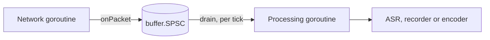

# Wiring one VoIP call

This is a recipe for the send path of one call with 20 ms frames, for
example an Asterisk integration through
[AudioSocket](https://docs.asterisk.org/Configuration/Channel-Drivers/AudioSocket/)
or external media. The audio the application receives from Asterisk is
the "microphone" signal; the audio it sends back to Asterisk is the far
end, whose echo may return in the received audio. The recipe cleans the
received audio: echo cancellation, noise suppression with voice activity
detection (VAD), then automatic gain control.

Every Go block on this page is copied from the tests in `integration/`
(`call_test.go` and `usage_test.go`), and `TestUsageCodeIsTested` fails if
one is not. Each section names the tests that back it.

## Before the recipe

- **Samples.** The packages take `[]int16` samples on the 16-bit scale.
  AudioSocket audio messages carry 16-bit signed linear mono samples,
  little-endian, at 8 kHz in the classic format; other formats and rates
  depend on the Asterisk version and channel setup. Converting payload
  bytes to `[]int16` is the application's job and is not part of this
  library.
- **Rates.** The echo canceller supports 8 and 16 kHz only
  ([ADR `wp6-rates-and-shifts`](decisions/wp6-rates-and-shifts.md)). At any
  other network rate the recipe resamples to 16 kHz first.
- **One call, one goroutine.** Every processor is single-owner: make one
  set per call and use it from one goroutine. Only `buffer.SPSC` is shared,
  between exactly two goroutines.

## Threads



The network goroutine reads packets from the socket and hands each frame
to the SPSC ring buffer. The processing goroutine wakes on its own clock,
for example a 20 ms ticker, and processes every whole frame waiting. The
SPSC is wait-free on both sides, so neither goroutine can block the other
(requirements §16). Audio sent back to the network can use a second SPSC
the same way.

## 1. Make the processors and size the buffers

```go
func newCall(netRate, frameMs int) (*call, error) {
	rate := netRate
	if rate != 8000 && rate != 16000 {
		rate = 16000 // the echo canceller supports 8 and 16 kHz only
	}
	c := &call{
		netRate: netRate, rate: rate,
		netFrame: netRate * frameMs / 1000, frame: rate * frameMs / 1000,
	}
	if !preprocess.SupportedFrameSize(c.frame) {
		return nil, fmt.Errorf("call: no preprocessor for %d-sample frames", c.frame)
	}

	var err error
	c.ec, err = echo.New(echo.Config{
		FrameSize:    c.frame,
		FilterLength: rate / 5, // models echo delays up to 200 ms
		SampleRate:   rate,
	})
	if err != nil {
		return nil, err
	}
	c.pre, err = preprocess.New(preprocess.Config{SampleRate: rate, FrameSize: c.frame})
	if err != nil {
		return nil, err
	}
	c.pre.SetVAD(true) // denoise is on by default
	c.gc, err = agc.New(agc.DefaultConfig(rate))
	if err != nil {
		return nil, err
	}
	c.clean = make([]int16, c.frame)
	c.residual = make([]int32, c.ec.ResidualLen())

	if rate != netRate {
		rs := resample.Config{Channels: 1, InRate: netRate, OutRate: rate, Quality: resample.QualityVoIP}
		if c.micRS, err = resample.New(rs); err != nil {
			return nil, err
		}
		if c.farRS, err = resample.New(rs); err != nil {
			return nil, err
		}
		c.rsOut = make([]int16, c.micRS.OutLen(c.netFrame))
		// Less than one frame waits between calls, plus one call's output.
		q := buffer.Config{Capacity: c.frame + len(c.rsOut), Overflow: buffer.Reject}
		if c.micQ, err = buffer.New(q); err != nil {
			return nil, err
		}
		if c.farQ, err = buffer.New(q); err != nil {
			return nil, err
		}
		c.micBuf = make([]int16, c.frame)
		c.farBuf = make([]int16, c.frame)
	}
	return c, nil
}
```

Every size comes from the rate and the frame duration:

| Buffer | Size | At 8 kHz | At 48 kHz (processed at 16 kHz) |
|---|---|---|---|
| Network frame | `netRate * frameMs / 1000` | 160 | 960 |
| Processing frame | `rate * frameMs / 1000`, checked with `preprocess.SupportedFrameSize` | 160 | 320 |
| Echo filter | `rate / 5` samples (200 ms) | 1600 | 3200 |
| Residual spectrum | `echo.Canceller.ResidualLen()`, frame + 1 | 161 | 321 |
| Resampler output | `resample.Resampler.OutLen(netFrame)` | none | 321 |
| Resampled queues (`buffer.Ring`) | frame + resampler output | none | 641 |
| SPSC hand-off | 200 ms of network audio | 1600 | 9600 |
| Output | 2 × frame (one frame per call in practice) | 320 | 640 |

`New` allocates everything here once. Nothing on the per-frame path
allocates (`TestNoAllocsRecipe`). `Example_call` prints the sizes for 8,
16 and 48 kHz.

The 200 ms filter is the echo delay the canceller can model, from the far
frame passed to it to the echo in the received frame. A network round trip
longer than that is not cancelled: the canceller does no delay estimation
(see the `echo` package doc, "Stream alignment"). A longer filter costs
more per frame; `docs/performance.md` has the figures.

## 2. Hand frames from the network goroutine

```go
func newRx(c *call) (*buffer.SPSC, error) {
	return buffer.NewSPSC(buffer.SPSCConfig{Capacity: c.netRate / 5})
}
```

```go
func onPacket(rx *buffer.SPSC, p []int16) bool {
	if rx.Free() < len(p) {
		return false // the processor is behind: drop this packet
	}
	rx.Write(p)
	return true
}
```

`onPacket` stores a whole frame or none of it. The SPSC never overwrites
unread samples (ADR `wp2-spsc-overflow`), and a partial frame would shift
every later frame boundary.

## 3. Process every waiting frame

```go
func (c *call) drain(rx *buffer.SPSC, maxBacklog int, mic, out []int16,
	far func() []int16, deliver func([]int16)) error {
	if rx.Len() > maxBacklog {
		rx.Consume(rx.Len() - c.netFrame) // after a stall, keep the newest frame
	}
	for rx.Len() >= c.netFrame {
		rx.Read(mic)
		n, err := c.process(mic, far(), out)
		if err != nil {
			return err
		}
		deliver(out[:n])
	}
	return nil
}
```

- `far` returns the far-end frame that the application sends to the
  network with each received frame. The canceller needs it exactly as it
  was sent.
- After a stall the SPSC holds a backlog of old audio. `drain` drops all
  but the newest frame (`buffer.SPSC.Consume`, "Dropping a backlog" in the
  `buffer` package doc). Dropping received frames moves the far end
  relative to its echo, so the canceller must re-adapt and some echo can
  pass for a moment.

`TestRecipeThroughSPSC` runs this with a network goroutine writing at
irregular times, at 8, 16 and 48 kHz, under `-race` in `make race`, and
checks that the output equals the same processors run frame by frame in
one goroutine. `TestDrainDropsBacklog` checks the backlog drop.

## 4. The per-frame order

```go
func (c *call) step(mic, far, out []int16) error {
	if err := c.ec.Cancel(mic, far, c.clean); err != nil {
		return err
	}
	if err := c.ec.Residual(c.residual); err != nil {
		return err
	}
	speech, err := c.pre.RunEcho(c.clean, c.residual)
	if err != nil {
		return err
	}
	return c.gc.Process(c.clean, out, speech)
}
```

1. `Cancel` removes the echo of `far` from `mic`.
2. `Residual` reads the residual echo spectrum of that same frame.
3. `RunEcho` suppresses noise and residual echo in place and returns the
   VAD decision. This is the pairing of `docs/contracts.md` section 12.
   `TestReferencePairing` checks it bit for bit against the C chain, in
   which the preprocessor holds the echo state.
4. `Process` applies the AGC, with the VAD decision as `speech`.

At 48 kHz, `process` first resamples the received frame and the far frame
to 16 kHz, each through its own resampler, and runs `step` once per whole
16 kHz frame:

```go
func (c *call) process(mic, far, out []int16) (int, error) {
	if c.micRS == nil {
		return c.frame, c.step(mic, far, out[:c.frame])
	}
	if err := c.resampleInto(c.micRS, c.micQ, mic); err != nil {
		return 0, err
	}
	if err := c.resampleInto(c.farRS, c.farQ, far); err != nil {
		return 0, err
	}
	n := 0
	for c.micQ.Len() >= c.frame && n+c.frame <= len(out) {
		c.micQ.Read(c.micBuf)
		c.farQ.Read(c.farBuf)
		if err := c.step(c.micBuf, c.farBuf, out[n:n+c.frame]); err != nil {
			return n, err
		}
		n += c.frame
	}
	return n, nil
}
```

With 8, 16 and 48 kHz and 10 or 20 ms frames the ratio divides the frame,
so each call writes exactly one frame (`runDirect` in the tests checks
this on every call); the queues cover ratios that do not.
`TestReceivePath` checks that a 20 ms frame per call with an
`OutLen` buffer always consumes the whole frame.

## What the measurements show

`docs/testing.md`, section "`integration`", has the figures. In short:

- At 8 and 16 kHz the recipe passes every pipeline criterion of
  `docs/acceptance/integration.md` on the synthetic call and on
  LibriSpeech speech.
- The VAD reports speech on stationary noise and on residual echo, so
  `GateLevel` is the AGC's only protection. With the default gate of
  -50 dBFS, white noise from about -40 dBFS and pink noise from about
  -52 dBFS at the input are raised by 16 to 23 dB. Set `GateLevel` above
  the residual noise of the line.
- On the chain resampled from 48 kHz the echo canceller cancelled less
  (16 dB) and the AGC held the near end lower (-33 dBFS), a reported
  finding.
- On an Apple M1 Pro the 99th percentile of the whole chain is 0.4% to
  2.5% of the frame duration, and the slowest of 30000 to 60000 frames
  took 14% to 24% at 48 kHz with 20 ms frames and at quality 10
  (`docs/performance.md`).
