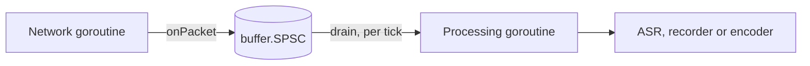
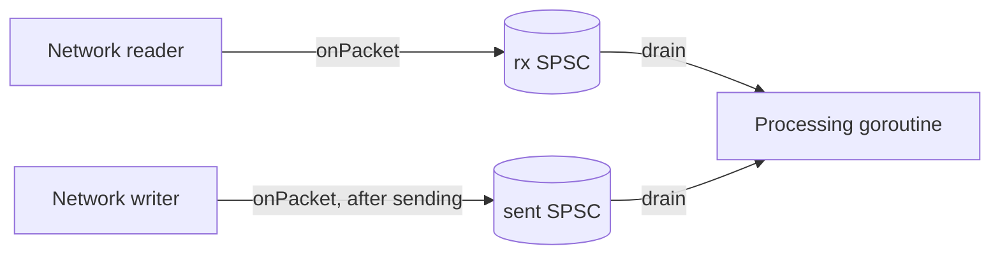

# Wiring one VoIP call

This page gives two recipes for the send path of one call with 20 ms
frames: echo cancellation, noise suppression with voice activity
detection (VAD), then automatic gain control. The audio the application
receives is the "microphone" signal; the audio it sends is the far end,
whose echo may return in the received audio.

| Recipe | Sent and received frames | Echo canceller calls |
|---|---|---|
| [A, in step](#recipe-a-sent-and-received-frames-in-step) | one sent frame for every received frame, at the same time | `Cancel` |
| [B, not in step](#recipe-b-sent-and-received-frames-not-in-step) | sent whenever there is audio to send, received on the network's clock | `Playback` and `Capture` |

Each recipe opens with the situations it fits and does not fit, then its
caveats, then the code. Every Go block on this page is copied from the
tests in `integration/` (`call_test.go`, `usage_test.go` and
`buffered_test.go`), and `TestUsageCodeIsTested` fails if one is not. Each
section names the tests that back it.

## Before either recipe

- **Samples.** The packages take `[]int16` samples on the 16-bit scale.
  AudioSocket audio messages carry 16-bit signed linear mono samples,
  little-endian, at 8 kHz in the classic format; other formats and rates
  depend on the Asterisk version and channel setup. Converting payload
  bytes to `[]int16` is the application's job and is not part of this
  library.
- **Rates.** The echo canceller supports 8 and 16 kHz only
  ([ADR `wp6-rates-and-shifts`](decisions/wp6-rates-and-shifts.md)). At any
  other network rate recipe A resamples to 16 kHz first; recipe B takes 8
  or 16 kHz only.
- **One call, one goroutine.** Every processor is single-owner: make one
  set per call and use it from one goroutine. Only `buffer.SPSC` is shared,
  between exactly two goroutines.
- **Receive only.** An application that only receives, such as a recorder
  or a monitor, sends nothing whose echo could return. Neither recipe is
  needed there: `preprocess.Preprocessor.Run` and `agc.AGC.Process` alone
  clean the audio.

## Recipe A: sent and received frames in step

### Use cases

Fits:

- A softphone or a device whose sound card drives capture and playback
  in step: each period delivers one captured frame and takes one frame to
  play.
- A network application that sends exactly one frame, audio or silence,
  for each frame it receives, and can hand both to the processing
  goroutine together.
- Network rates other than 8 and 16 kHz: the recipe resamples to 16 kHz.

Does not fit:

- An Asterisk AudioSocket or external-media application that sends audio
  only when it has some (TTS prompts, a bridged leg), so that there is not
  always a sent frame for a received one: use recipe B.
- A recorder or monitor that only receives: see "Receive only" above.

### Caveats

- Each received frame must reach `Cancel` with the frame sent at the same
  time. The recipe pairs them by order: the n-th processed received frame
  takes the n-th sent frame from `far`.
- A received frame that is dropped before processing shifts that pairing
  by one frame for good, and nothing reports it. `onPacket` drops a frame
  when the SPSC is full, which any stall longer than its capacity (200 ms)
  causes. The canceller does no delay estimation, so each shift moves the
  echo by a frame within its 200 ms filter, and once the echo leaves it,
  no echo is cancelled.
- After a backlog drop in `drain` the pairing holds, because `drain` takes
  one far frame for each frame it drops; that needs `far` to return the
  sent frames in order.
- The caller keeps aligned: the order of the sent frames given to `far`,
  one per received frame, including for every received frame that was
  dropped anywhere before `drain`.

### Threads (recipe A)



The network goroutine reads packets from the socket and hands each frame
to the SPSC ring buffer. The processing goroutine wakes on its own clock,
for example a 20 ms ticker, and processes every whole frame waiting. The
SPSC is wait-free on both sides, so neither goroutine can block the other
(requirements §16). Audio sent back to the network can use a second SPSC
the same way.

### A1. Make the processors and size the buffers

```go
func newCall(netRate, frameMs int) (*call, error) {
	rate := netRate
	if rate != 8000 && rate != 16000 {
		rate = 16000 // the echo canceller supports 8 and 16 kHz only
	}
	c := &call{
		netRate: netRate, rate: rate,
		netFrame: netRate * frameMs / 1000, frame: rate * frameMs / 1000,
	}
	if !preprocess.SupportedFrameSize(c.frame) {
		return nil, fmt.Errorf("call: no preprocessor for %d-sample frames", c.frame)
	}

	var err error
	c.ec, err = echo.New(echo.Config{
		FrameSize:    c.frame,
		FilterLength: rate / 5, // models echo delays up to 200 ms
		SampleRate:   rate,
	})
	if err != nil {
		return nil, err
	}
	c.pre, err = preprocess.New(preprocess.Config{SampleRate: rate, FrameSize: c.frame})
	if err != nil {
		return nil, err
	}
	c.pre.SetVAD(true) // denoise is on by default
	c.gc, err = agc.New(agc.DefaultConfig(rate))
	if err != nil {
		return nil, err
	}
	c.clean = make([]int16, c.frame)
	c.residual = make([]int32, c.ec.ResidualLen())

	if rate != netRate {
		rs := resample.Config{Channels: 1, InRate: netRate, OutRate: rate, Quality: resample.QualityVoIP}
		if c.micRS, err = resample.New(rs); err != nil {
			return nil, err
		}
		if c.farRS, err = resample.New(rs); err != nil {
			return nil, err
		}
		c.rsOut = make([]int16, c.micRS.OutLen(c.netFrame))
		// Less than one frame waits between calls, plus one call's output.
		q := buffer.Config{Capacity: c.frame + len(c.rsOut), Overflow: buffer.Reject}
		if c.micQ, err = buffer.New(q); err != nil {
			return nil, err
		}
		if c.farQ, err = buffer.New(q); err != nil {
			return nil, err
		}
		c.micBuf = make([]int16, c.frame)
		c.farBuf = make([]int16, c.frame)
	}
	return c, nil
}
```

Every size comes from the rate and the frame duration:

| Buffer | Size | At 8 kHz | At 48 kHz (processed at 16 kHz) |
|---|---|---|---|
| Network frame | `netRate * frameMs / 1000` | 160 | 960 |
| Processing frame | `rate * frameMs / 1000`, checked with `preprocess.SupportedFrameSize` | 160 | 320 |
| Echo filter | `rate / 5` samples (200 ms) | 1600 | 3200 |
| Residual spectrum | `echo.Canceller.ResidualLen()`, frame + 1 | 161 | 321 |
| Resampler output | `resample.Resampler.OutLen(netFrame)` | none | 321 |
| Resampled queues (`buffer.Ring`) | frame + resampler output | none | 641 |
| SPSC hand-off | 200 ms of network audio | 1600 | 9600 |
| Output | 2 × frame (one frame per call in practice) | 320 | 640 |

`newCall` allocates everything here once. Nothing on the per-frame path
allocates (`TestNoAllocsRecipe`). `Example_call` prints the sizes for 8,
16 and 48 kHz.

The 200 ms filter is the echo delay the canceller can model, from the far
frame passed to it to the echo in the received frame. A network round trip
longer than that is not cancelled: the canceller does no delay estimation
(see the `echo` package doc, "Stream alignment"). A longer filter costs
more per frame; `docs/performance.md` has the figures.

### A2. Hand frames from the network goroutine

```go
func newRx(c *call) (*buffer.SPSC, error) {
	return buffer.NewSPSC(buffer.SPSCConfig{Capacity: c.netRate / 5})
}
```

```go
func onPacket(rx *buffer.SPSC, p []int16) bool {
	if rx.Free() < len(p) {
		return false // the processor is behind: drop this packet
	}
	rx.Write(p)
	return true
}
```

`onPacket` stores a whole frame or none of it. The SPSC never overwrites
unread samples (ADR `wp2-spsc-overflow`), and a partial frame would shift
every later frame boundary.

### A3. Process every waiting frame

```go
func (c *call) drain(rx *buffer.SPSC, maxBacklog int, mic, out []int16,
	far func() []int16, deliver func([]int16)) error {
	if rx.Len() > maxBacklog {
		// After a stall keep the newest frame, and skip the far frames of
		// the dropped ones so that each frame keeps its far frame.
		for range rx.Consume(rx.Len()-c.netFrame) / c.netFrame {
			far()
		}
	}
	for rx.Len() >= c.netFrame {
		rx.Read(mic)
		n, err := c.process(mic, far(), out)
		if err != nil {
			return err
		}
		deliver(out[:n])
	}
	return nil
}
```

- `far` returns the far-end frame that the application sends to the
  network with each received frame. The canceller needs it exactly as it
  was sent.
- After a stall the SPSC holds a backlog of old audio. `drain` drops all
  but the newest frame (`buffer.SPSC.Consume`, "Dropping a backlog" in the
  `buffer` package doc), and takes and discards one far frame for each
  dropped frame, so that if `far` returns the sent frames in order, every
  processed frame keeps the far frame sent with it. The far end played
  during the stall then has no echo reference, and the canceller does no
  delay estimation, so keeping this pairing is the caller's job.
- A packet that `onPacket` drops has no processed frame, so its far frame
  must be skipped too; the recipe does not do that (see "Caveats").

`TestRecipeThroughSPSC` runs this with a network goroutine writing at
irregular times, at 8, 16 and 48 kHz, under `-race` in `make race`, and
checks that the output equals the same processors run frame by frame in
one goroutine. `TestDrainDropsBacklog` checks the backlog drop and the far
frames it skips.

### A4. The per-frame order

```go
func (c *call) step(mic, far, out []int16) error {
	if err := c.ec.Cancel(mic, far, c.clean); err != nil {
		return err
	}
	if err := c.ec.Residual(c.residual); err != nil {
		return err
	}
	speech, err := c.pre.RunEcho(c.clean, c.residual)
	if err != nil {
		return err
	}
	return c.gc.Process(c.clean, out, speech)
}
```

1. `Cancel` removes the echo of `far` from `mic`.
2. `Residual` reads the residual echo spectrum of that same frame.
3. `RunEcho` suppresses noise and residual echo in place and returns the
   VAD decision. This is the pairing of `docs/contracts.md` section 12.
   `TestReferencePairing` checks it bit for bit against the C chain, in
   which the preprocessor holds the echo state.
4. `Process` applies the AGC, with the VAD decision as `speech`.

At 48 kHz, `process` first resamples the received frame and the far frame
to 16 kHz, each through its own resampler, and runs `step` once per whole
16 kHz frame:

```go
func (c *call) process(mic, far, out []int16) (int, error) {
	if c.micRS == nil {
		return c.frame, c.step(mic, far, out[:c.frame])
	}
	if err := c.resampleInto(c.micRS, c.micQ, mic); err != nil {
		return 0, err
	}
	if err := c.resampleInto(c.farRS, c.farQ, far); err != nil {
		return 0, err
	}
	n := 0
	for c.micQ.Len() >= c.frame && n+c.frame <= len(out) {
		c.micQ.Read(c.micBuf)
		c.farQ.Read(c.farBuf)
		if err := c.step(c.micBuf, c.farBuf, out[n:n+c.frame]); err != nil {
			return n, err
		}
		n += c.frame
	}
	return n, nil
}
```

`resampleInto` checks that each resampler consumed the whole frame and
that its queue took every sample; the sizes of `newCall` rule out both
errors:

```go
func (c *call) resampleInto(r *resample.Resampler, q *buffer.Ring, x []int16) error {
	read, written, err := r.Process(x, c.rsOut)
	if err != nil {
		return err
	}
	if read != len(x) {
		return errShortRead
	}
	if q.Write(c.rsOut[:written]) != written {
		return errQueueFull
	}
	return nil
}
```

With 8, 16 and 48 kHz and 10 or 20 ms frames the ratio divides the frame,
so each call writes exactly one frame; the tests check this on every call
at 8, 16 and 48 kHz with 10 and 20 ms frames. The queues are there for
ratios that do not divide the frame, such as 44.1 kHz; no such rate is
tested. `TestReceivePath` checks that a 20 ms frame per call with an
`OutLen` buffer always consumes the whole frame.

## Recipe B: sent and received frames not in step

### Use cases

Fits:

- An Asterisk application through AudioSocket or external media that
  sends audio when it has some (TTS prompts, a bridged leg, hold music)
  and receives the caller's audio on the network's clock, so that a sent
  frame is not always there when a frame is received, or the reverse.
- Any source where the sent and the received frames reach the processing
  goroutine from two different goroutines, with jitter between them.

Does not fit:

- Network rates other than 8 and 16 kHz: the recipe has no resampler.
  Resample both streams first, as recipe A does.
- A sender that stops for longer than the canceller's queue covers and
  then sends a burst, or a sent stream that drifts against the received
  one for good: the queue then discards or runs dry (see "Caveats").
- A recorder or monitor that only receives: see "Receive only" above.

### Caveats

- **Silence when there is nothing to send.** The sending goroutine should
  still send a frame of silence every 20 ms and queue it with `Playback`.
  If it queues nothing, `Capture` finds the queue empty and passes the
  received frame through without cancellation, so the echo tail of the
  last real audio is not removed (criterion U7, `TestBufferedIdleSender`).
- **The canceller's queue.** It follows `speex_echo_playback` and
  `speex_echo_capture` (the `echo` package doc, "Stream alignment"): it
  starts with two frames of silence; it holds at most three frames, and a
  `Playback` into a full queue is discarded; a `Capture` with an empty
  queue passes the frame through and empties the queue; `Playback` calls
  before the first `Capture` are discarded. Each `Capture` cancels against
  the oldest queued frame, about one or two frame periods before it, so
  the canceller models echo delays from there to about 200 ms later.
- **Single owner.** `played` and `received` call one canceller, so both
  run on the processing goroutine. The sent frames reach it through their
  own SPSC, written by the goroutine that writes them to the network.
- **Drops.** A sent frame that `onPacket` drops is never queued, and a
  received frame that it drops is never processed; either moves the far
  end against its echo by a frame until the queue under- or overflows.
  Nothing reports it.
- **Measured behaviour.** Criteria U6 to U10 of
  `docs/acceptance/integration.md` cover this recipe. Their results are
  not measured yet.

### Threads (recipe B)



The network reader hands each received frame to the rx SPSC. The goroutine
that writes frames to the network hands each frame it has sent, silence
included, to the sent SPSC. The processing goroutine drains both on its
own clock.

### B1. Make the processors and the hand-offs

```go
func newBufferedCall(rate, frameMs int) (*bufferedCall, error) {
	if rate != 8000 && rate != 16000 {
		return nil, fmt.Errorf("call: %d Hz; the echo canceller supports 8 and 16 kHz only", rate)
	}
	b := &bufferedCall{rate: rate, frame: rate * frameMs / 1000}
	if !preprocess.SupportedFrameSize(b.frame) {
		return nil, fmt.Errorf("call: no preprocessor for %d-sample frames", b.frame)
	}
	var err error
	b.ec, err = echo.New(echo.Config{FrameSize: b.frame, FilterLength: rate / 5, SampleRate: rate})
	if err != nil {
		return nil, err
	}
	b.pre, err = preprocess.New(preprocess.Config{SampleRate: rate, FrameSize: b.frame})
	if err != nil {
		return nil, err
	}
	b.pre.SetVAD(true)
	b.gc, err = agc.New(agc.DefaultConfig(rate))
	if err != nil {
		return nil, err
	}
	b.clean = make([]int16, b.frame)
	b.residual = make([]int32, b.ec.ResidualLen())
	return b, nil
}
```

```go
func newBufferedRx(b *bufferedCall) (sent, rx *buffer.SPSC, err error) {
	if sent, err = buffer.NewSPSC(buffer.SPSCConfig{Capacity: b.rate / 5}); err != nil {
		return nil, nil, err
	}
	rx, err = buffer.NewSPSC(buffer.SPSCConfig{Capacity: b.rate / 5})
	return sent, rx, err
}
```

Both goroutines that feed the SPSCs use `onPacket` from recipe A, which
stores a whole frame or none of it.

### B2. Queue sent frames and clean received ones

```go
func (b *bufferedCall) played(far []int16) error { return b.ec.Playback(far) }
```

```go
func (b *bufferedCall) received(mic, out []int16) error {
	if err := b.ec.Capture(mic, b.clean); err != nil {
		return err
	}
	if err := b.ec.Residual(b.residual); err != nil {
		return err
	}
	speech, err := b.pre.RunEcho(b.clean, b.residual)
	if err != nil {
		return err
	}
	return b.gc.Process(b.clean, out, speech)
}
```

The per-frame order after `Capture` is that of recipe A: `Residual`,
`RunEcho`, then the AGC with the VAD decision.

### B3. Drain both hand-offs

```go
func (b *bufferedCall) drain(sent, rx *buffer.SPSC, far, mic, out []int16, deliver func([]int16)) error {
	ns, nr := sent.Len()/b.frame, rx.Len()/b.frame // bounds the work of this call
	for i := 0; i < max(ns, nr); i++ {
		if i < ns {
			sent.Read(far)
			if err := b.played(far); err != nil {
				return err
			}
		}
		if i < nr {
			rx.Read(mic)
			if err := b.received(mic, out); err != nil {
				return err
			}
			deliver(out)
		}
	}
	return nil
}
```

`drain` alternates one sent and one received frame, so a tick with a
frame of each keeps the queue as the calls arrive, and does at most the
frames waiting when it starts.

Tests (none run yet):

- `TestBufferedUnevenTiming`: each frame of both streams is up to 30 ms
  late, independently; the echo stage must reach 15 dB (U6). It also
  reports a 100 ms sender pause followed by a burst.
- `TestBufferedIdleSender`: queuing silence against queuing nothing after
  the far end stops (U7).
- `TestBufferedTwoGoroutines`: two producer goroutines and the processing
  goroutine, compared with a replay of the observed order (U8).
- `TestNoAllocsBuffered`: a tick allocates nothing (U9).

## What the measurements show

`docs/testing.md`, section "`integration`", has the figures. In short:

- At 8 and 16 kHz recipe A passes every pipeline criterion of
  `docs/acceptance/integration.md` on the synthetic call and on
  LibriSpeech speech.
- The VAD reports speech on stationary noise and on residual echo, so
  `GateLevel` is the AGC's only protection. With the default gate of
  -50 dBFS, white noise from about -40 dBFS and pink noise from about
  -52 dBFS at the input are raised by 16 to 23 dB. Set `GateLevel` above
  the residual noise of the line.
- On the chain resampled from 48 kHz the echo canceller cancelled less
  (16 dB) and the AGC held the near end lower (-33 dBFS), a reported
  finding.
- On an Apple M1 Pro the 99th percentile of the whole chain is 0.4% to
  2.5% of the frame duration. The slowest single frame of a 10-minute run
  varied between runs, up to 65% of a 10 ms frame
  (`docs/performance.md`).
- Recipe B is not measured yet.
