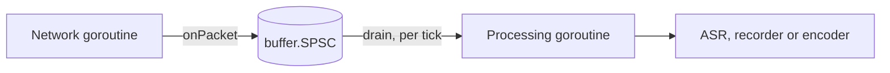
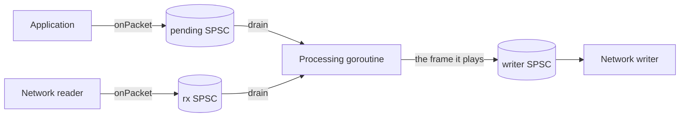

# Wiring one VoIP call

This page gives two recipes for the send path of one call with 20 ms
frames: echo cancellation, noise suppression with voice activity
detection (VAD), then automatic gain control. The audio the application
receives is the "microphone" signal; the audio it sends is the far end,
whose echo may return in the received audio.

| Recipe | Sent and received frames | Echo canceller calls |
|---|---|---|
| [A, in step](#recipe-a-sent-and-received-frames-in-step) | one sent frame for every received frame, at the same time | `Cancel` |
| [B, paced by the received frames](#recipe-b-sending-paced-by-the-received-frames) | sent when there is audio, queued one per received frame | `Playback` and `Capture` |

Each recipe opens with the situations it fits and does not fit, then its
caveats, then the code. Every Go block on this page is copied from the
tests in `integration/` (`call_test.go`, `usage_test.go` and
`buffered_test.go`), and `TestUsageCodeIsTested` fails if one is not. Each
section names the tests that back it.

## Before either recipe

- **Samples.** The packages take `[]int16` samples on the 16-bit scale.
  AudioSocket audio messages carry 16-bit signed linear mono samples,
  little-endian, at 8 kHz in the classic format; other formats and rates
  depend on the Asterisk version and channel setup. Converting payload
  bytes to `[]int16` is the application's job and is not part of this
  library.
- **Rates.** The echo canceller supports 8 and 16 kHz only
  ([ADR `wp6-rates-and-shifts`](decisions/wp6-rates-and-shifts.md)). At any
  other network rate recipe A resamples to 16 kHz first; recipe B takes 8
  or 16 kHz only.
- **One call, one goroutine.** Every processor is single-owner: make one
  set per call and use it from one goroutine. Only `buffer.SPSC` is shared,
  between exactly two goroutines.
- **Receive only.** An application that only receives, such as a recorder
  or a monitor, sends nothing whose echo could return. Neither recipe is
  needed there: `preprocess.Preprocessor.Run` and `agc.AGC.Process` alone
  clean the audio.

## Recipe A: sent and received frames in step

### Use cases

Fits:

- A softphone or a device whose sound card drives capture and playback
  in step: each period delivers one captured frame and takes one frame to
  play.
- A network application that sends exactly one frame, audio or silence,
  for each frame it receives, and can hand both to the processing
  goroutine together.
- Network rates other than 8 and 16 kHz: the recipe resamples to 16 kHz.

Does not fit:

- An Asterisk AudioSocket or external-media application that sends audio
  only when it has some (TTS prompts, a bridged leg), so that there is not
  always a sent frame for a received one: use recipe B.
- A recorder or monitor that only receives: see "Receive only" above.

### Caveats

- Each received frame must reach `Cancel` with the frame sent at the same
  time. The recipe pairs them by order: the n-th processed received frame
  takes the n-th sent frame from `far`.
- A received frame that is dropped before processing shifts that pairing
  by one frame for good, and nothing reports it. `onPacket` drops a frame
  when the SPSC is full, which any stall longer than its capacity (200 ms)
  causes. The canceller does no delay estimation, so each shift moves the
  echo by a frame within its 200 ms filter, and once the echo leaves it,
  no echo is cancelled.
- After a backlog drop in `drain` the pairing holds, because `drain` takes
  one far frame for each frame it drops; that needs `far` to return the
  sent frames in order.
- The caller keeps aligned: the order of the sent frames given to `far`,
  one per received frame, including for every received frame that was
  dropped anywhere before `drain`.

### Threads (recipe A)



The network goroutine reads packets from the socket and hands each frame
to the SPSC ring buffer. The processing goroutine wakes on its own clock,
for example a 20 ms ticker, and processes every whole frame waiting. The
SPSC is wait-free on both sides, so neither goroutine can block the other
(requirements §16). Audio sent back to the network can use a second SPSC
the same way.

### A1. Make the processors and size the buffers

```go
func newCall(netRate, frameMs int) (*call, error) {
	rate := netRate
	if rate != 8000 && rate != 16000 {
		rate = 16000 // the echo canceller supports 8 and 16 kHz only
	}
	c := &call{
		netRate: netRate, rate: rate,
		netFrame: netRate * frameMs / 1000, frame: rate * frameMs / 1000,
	}
	if !preprocess.SupportedFrameSize(c.frame) {
		return nil, fmt.Errorf("call: no preprocessor for %d-sample frames", c.frame)
	}

	var err error
	c.ec, err = echo.New(echo.Config{
		FrameSize:    c.frame,
		FilterLength: rate / 5, // models echo delays up to 200 ms
		SampleRate:   rate,
	})
	if err != nil {
		return nil, err
	}
	c.pre, err = preprocess.New(preprocess.Config{SampleRate: rate, FrameSize: c.frame})
	if err != nil {
		return nil, err
	}
	c.pre.SetVAD(true) // denoise is on by default
	c.gc, err = agc.New(agc.DefaultConfig(rate))
	if err != nil {
		return nil, err
	}
	c.clean = make([]int16, c.frame)
	c.residual = make([]int32, c.ec.ResidualLen())

	if rate != netRate {
		rs := resample.Config{Channels: 1, InRate: netRate, OutRate: rate, Quality: resample.QualityVoIP}
		if c.micRS, err = resample.New(rs); err != nil {
			return nil, err
		}
		if c.farRS, err = resample.New(rs); err != nil {
			return nil, err
		}
		c.rsOut = make([]int16, c.micRS.OutLen(c.netFrame))
		// Less than one frame waits between calls, plus one call's output.
		q := buffer.Config{Capacity: c.frame + len(c.rsOut), Overflow: buffer.Reject}
		if c.micQ, err = buffer.New(q); err != nil {
			return nil, err
		}
		if c.farQ, err = buffer.New(q); err != nil {
			return nil, err
		}
		c.micBuf = make([]int16, c.frame)
		c.farBuf = make([]int16, c.frame)
	}
	return c, nil
}
```

Every size comes from the rate and the frame duration:

| Buffer | Size | At 8 kHz | At 48 kHz (processed at 16 kHz) |
|---|---|---|---|
| Network frame | `netRate * frameMs / 1000` | 160 | 960 |
| Processing frame | `rate * frameMs / 1000`, checked with `preprocess.SupportedFrameSize` | 160 | 320 |
| Echo filter | `rate / 5` samples (200 ms) | 1600 | 3200 |
| Residual spectrum | `echo.Canceller.ResidualLen()`, frame + 1 | 161 | 321 |
| Resampler output | `resample.Resampler.OutLen(netFrame)` | none | 321 |
| Resampled queues (`buffer.Ring`) | frame + resampler output | none | 641 |
| SPSC hand-off | 200 ms of network audio | 1600 | 9600 |
| Output | 2 × frame (one frame per call in practice) | 320 | 640 |

`newCall` allocates everything here once. Nothing on the per-frame path
allocates (`TestNoAllocsRecipe`). `Example_call` prints every size in the
table for 8, 16 and 48 kHz and checks them against its expected output.

The 200 ms filter is the echo delay the canceller can model, from the far
frame passed to it to the echo in the received frame. A network round trip
longer than that is not cancelled: the canceller does no delay estimation
(see the `echo` package doc, "Stream alignment"). A longer filter costs
more per frame; `docs/performance.md` has the figures.

### A2. Hand frames from the network goroutine

```go
func newRx(c *call) (*buffer.SPSC, error) {
	return buffer.NewSPSC(buffer.SPSCConfig{Capacity: c.netRate / 5})
}
```

```go
func onPacket(rx *buffer.SPSC, p []int16) bool {
	if rx.Free() < len(p) {
		return false // the processor is behind: drop this packet
	}
	rx.Write(p)
	return true
}
```

`onPacket` stores a whole frame or none of it. The SPSC never overwrites
unread samples (ADR `wp2-spsc-overflow`), and a partial frame would shift
every later frame boundary.

### A3. Process every waiting frame

```go
func (c *call) drain(rx *buffer.SPSC, maxBacklog int, mic, out []int16,
	far func() []int16, deliver func([]int16)) error {
	if rx.Len() > maxBacklog {
		// After a stall keep the newest frame, and skip the far frames of
		// the dropped ones so that each frame keeps its far frame.
		for range rx.Consume(rx.Len()-c.netFrame) / c.netFrame {
			far()
		}
	}
	for rx.Len() >= c.netFrame {
		rx.Read(mic)
		n, err := c.process(mic, far(), out)
		if err != nil {
			return err
		}
		deliver(out[:n])
	}
	return nil
}
```

- `far` returns the far-end frame that the application sends to the
  network with each received frame. The canceller needs it exactly as it
  was sent.
- After a stall the SPSC holds a backlog of old audio. `drain` drops all
  but the newest frame (`buffer.SPSC.Consume`, "Dropping a backlog" in the
  `buffer` package doc), and takes and discards one far frame for each
  dropped frame, so that if `far` returns the sent frames in order, every
  processed frame keeps the far frame sent with it. The far end played
  during the stall then has no echo reference, and the canceller does no
  delay estimation, so keeping this pairing is the caller's job.
- A packet that `onPacket` drops has no processed frame, so its far frame
  must be skipped too; the recipe does not do that (see "Caveats").

`TestRecipeThroughSPSC` runs this with a network goroutine writing at
irregular times, at 8, 16 and 48 kHz, under `-race` in `make race`, and
checks that the output equals the same processors run frame by frame in
one goroutine. `TestDrainDropsBacklog` checks the backlog drop and the far
frames it skips.

### A4. The per-frame order

```go
func (c *call) step(mic, far, out []int16) error {
	if err := c.ec.Cancel(mic, far, c.clean); err != nil {
		return err
	}
	if err := c.ec.Residual(c.residual); err != nil {
		return err
	}
	speech, err := c.pre.RunEcho(c.clean, c.residual)
	if err != nil {
		return err
	}
	return c.gc.Process(c.clean, out, speech)
}
```

1. `Cancel` removes the echo of `far` from `mic`.
2. `Residual` reads the residual echo spectrum of that same frame.
3. `RunEcho` suppresses noise and residual echo in place and returns the
   VAD decision. This is the pairing of `docs/contracts.md` section 12.
   `TestReferencePairing` checks the pairing bit for bit against the C
   chain, in which the preprocessor holds the echo state, through its own
   loop (`runPairing`); `step` itself runs in `TestRecipeThroughSPSC` and
   the pipeline tests.
4. `Process` applies the AGC, with the VAD decision as `speech`.

At 48 kHz, `process` first resamples the received frame and the far frame
to 16 kHz, each through its own resampler, and runs `step` once per whole
16 kHz frame:

```go
func (c *call) process(mic, far, out []int16) (int, error) {
	if c.micRS == nil {
		return c.frame, c.step(mic, far, out[:c.frame])
	}
	if err := c.resampleInto(c.micRS, c.micQ, mic); err != nil {
		return 0, err
	}
	if err := c.resampleInto(c.farRS, c.farQ, far); err != nil {
		return 0, err
	}
	n := 0
	for c.micQ.Len() >= c.frame && n+c.frame <= len(out) {
		c.micQ.Read(c.micBuf)
		c.farQ.Read(c.farBuf)
		if err := c.step(c.micBuf, c.farBuf, out[n:n+c.frame]); err != nil {
			return n, err
		}
		n += c.frame
	}
	return n, nil
}
```

`resampleInto` checks that each resampler consumed the whole frame and
that its queue took every sample; the sizes of `newCall` rule out both
errors:

```go
func (c *call) resampleInto(r *resample.Resampler, q *buffer.Ring, x []int16) error {
	read, written, err := r.Process(x, c.rsOut)
	if err != nil {
		return err
	}
	if read != len(x) {
		return errShortRead
	}
	if q.Write(c.rsOut[:written]) != written {
		return errQueueFull
	}
	return nil
}
```

With 8, 16 and 48 kHz and 10 or 20 ms frames the ratio divides the frame,
so each call writes exactly one frame; the tests check this on every call
at 8, 16 and 48 kHz with 10 and 20 ms frames. The queues are there for
ratios that do not divide the frame, such as 44.1 kHz; no such rate is
tested. `TestReceivePath` checks that a 20 ms frame per call with an
`OutLen` buffer always consumes the whole frame.

## Recipe B: sending paced by the received frames

### Use cases

Fits:

- An application on Asterisk AudioSocket or external media that sends
  audio only when it has some (TTS prompts, a bridged leg, hold music),
  possibly in bursts. In the Asterisk sources (`apps/app_audiosocket.c`
  and `channels/chan_audiosocket.c`), Asterisk forwards the call's frames
  to the application on the call's own clock and writes the
  application's audio to the call as it arrives, without re-timing it or
  adding silence. So the application has to pace what it sends. Recipe B
  paces it off the received frames: the application writes the audio it
  wants to send, any amount at any time, into a pending SPSC; for each
  received frame the processing goroutine takes at most one pending
  frame, or silence, hands that frame to the network writer and passes
  the same frame to `Playback`. What is sent and what the canceller sees
  are the same frames.

Does not fit:

- Network rates other than 8 and 16 kHz: the recipe has no resampler.
  Resample both streams first, as recipe A does.
- An echo that returns within about one frame period of the slot it was
  sent in: `Playback` before `Capture` lags the far end by one frame (see
  "Caveats"). Measured without jitter with a 32 ms echo: 7.6 dB at 8 kHz
  and 11.9 dB at 16 kHz; why a one-frame lag loses at 32 ms is not
  traced.
- A recorder or monitor that only receives: see "Receive only" above.

### Caveats

- **What is sent.** One frame is sent for each received frame: the
  oldest pending frame, or silence when none is waiting. Audio the
  application writes faster waits in the pending SPSC (sized by
  `pendingMs`; `onPacket` refuses a frame when it is full); audio it
  writes late goes out in a later slot, after silence. So a burst is sent
  at the call's pace, one frame per received frame (U12).
- **A full writer.** When the writer's SPSC has no room, `drain` sends
  nothing for that received frame, passes silence to `Playback`, and the
  pending frame waits. The canceller then sees silence where nothing was
  sent, and the far end the call hears has a gap.
- **The far end's lag.** With `Playback` before each `Capture`, received
  frame k is cancelled against the frame sent with received frame k-1:
  one frame of lag (`TestBufferedLagIsOneFrame` checks it bit for bit
  against `Cancel`). The SpeexDSP header (`speex_echo.h`) speaks of two
  frames: the queue starts with two frames of silence (`mdf.c:517`,
  `PLAYBACK_DELAY`), but a `Playback` before the first `Capture` is
  discarded (`mdf.c:656`), so after the first `Capture` takes one silence
  frame (`mdf.c:635-640`) each `Capture` finds the frame queued one call
  earlier; the lag is two frames when `Capture` comes before `Playback`.
  The first sent frame is lost the same way. The lag is fixed: jitter in
  the received frames does not change it.
- **Echo delay.** The canceller models echo delays from that lag to the
  end of its filter (the `echo` package doc, "Stream alignment"). In the
  simulated calls (`docs/testing.md`, "Recipe B"), echo delays of 40 to
  200 ms were cancelled by 15.1 to 26.6 dB under up to 30 ms of jitter.
  U6, at 32 ms with that jitter, is a delay recipe B does not cancel; at
  that delay part of the echo would come from frames not yet sent, so
  the case is not a physical call.
- **`Cancel` instead.** Because the sent frame and the received frame are
  handled in one step, `Cancel(mic, sent, out)` with the frame just sent
  is also possible, and the Speex manual prefers it in that case. It
  avoids the one-frame lag. Measured both ways (`docs/testing.md`), it
  was not clearly better at the echo delays above, so the recipe keeps
  `Playback` and `Capture`.
- **Filter length.** Choose the shortest `filterMs` that covers the
  largest echo delay expected plus the echo's tail, not the longest
  available. A longer filter costs more per frame
  (`docs/performance.md`) and adapts more slowly; the Speex manual's
  echo-cancellation chapter
  ([node7](https://www.speex.org/docs/manual/speex-manual/node7.html))
  says so and names an over-long tail as a common reason no echo is
  cancelled. U11 uses 256 ms because its longest case, a 200 ms delay
  with a 48 ms tail, needs 248 ms, and 256 ms is the longest length the
  `echo` fixtures test; it keeps that one length for its 100 ms case too,
  so the two cases differ only in the delay.
- **Changing echo delay.** The delay differs between calls and can change
  within one, for example when a jitter buffer resizes, a route changes,
  clocks drift or the caller moves. The canceller does not estimate the
  delay; after each sudden change it re-converges, and cancellation is
  lost for a while: after a step from 100 to 140 ms, 3.5 s at 8 kHz and
  2.5 s at 16 kHz before the echo stage was at 10 dB again (U11).
- **No resync, no drift correction.** Recipe B never corrects the
  alignment of the far end against its echo, and a slow drift between
  the clocks over a long call is not corrected. For comparison,
  PulseAudio's echo cancellation module (`module-echo-cancel.c` in the
  PulseAudio sources) resynchronises after a large misalignment and
  corrects slow drift within watermarks. Drift correction here would
  come from the planned clock-drift controller, stretch item S2 in
  `docs/architecture.md`, "Work packages".
- **Typical delays.** Vendor and trade sources (not standards) put the
  delay that VoIP adds at 50 to 80 ms or more, size network echo
  cancellers for 64 ms, up to 128 ms on long paths, and note that the
  network or the phone often removes much of the echo already. These are
  typical figures, not guarantees; measure the calls the application
  handles.
- **Single owner.** `played` and `received` call one canceller, so both
  run on the processing goroutine. Each SPSC has one producer and one
  consumer: the application writes pending, the network reader writes
  rx, the processing goroutine writes the writer's SPSC, and the writer
  reads it.
- **Drops.** A received frame that `onPacket` drops is never processed
  and gets no sent frame, so the call hears a gap there. Nothing reports
  it.

### Threads (recipe B)



The application hands the audio it wants to send to the pending SPSC.
The network reader hands each received frame to the rx SPSC. For each
received frame, the processing goroutine moves one pending frame, or
silence, to the writer SPSC and to `Playback`, then cleans the received
frame. The network writer sends only what it is handed, so sending is
paced by the received frames. This diagram changed with this version of
the recipe.

### B1. Make the processors and the hand-offs

```go
func newBufferedCall(rate, frameMs, filterMs int) (*bufferedCall, error) {
	if rate != 8000 && rate != 16000 {
		return nil, fmt.Errorf("call: %d Hz; the echo canceller supports 8 and 16 kHz only", rate)
	}
	b := &bufferedCall{rate: rate, frame: rate * frameMs / 1000}
	if !preprocess.SupportedFrameSize(b.frame) {
		return nil, fmt.Errorf("call: no preprocessor for %d-sample frames", b.frame)
	}
	var err error
	b.ec, err = echo.New(echo.Config{FrameSize: b.frame, FilterLength: rate * filterMs / 1000, SampleRate: rate})
	if err != nil {
		return nil, err
	}
	b.pre, err = preprocess.New(preprocess.Config{SampleRate: rate, FrameSize: b.frame})
	if err != nil {
		return nil, err
	}
	b.pre.SetVAD(true)
	b.gc, err = agc.New(agc.DefaultConfig(rate))
	if err != nil {
		return nil, err
	}
	b.echoed = make([]int16, b.frame)
	b.clean = make([]int16, b.frame)
	b.residual = make([]int32, b.ec.ResidualLen())
	return b, nil
}
```

```go
func newBufferedHandoffs(b *bufferedCall, pendingMs int) (pending, rx, toWriter *buffer.SPSC, err error) {
	if pending, err = buffer.NewSPSC(buffer.SPSCConfig{Capacity: b.rate * pendingMs / 1000}); err != nil {
		return nil, nil, nil, err
	}
	if rx, err = buffer.NewSPSC(buffer.SPSCConfig{Capacity: b.rate / 5}); err != nil {
		return nil, nil, nil, err
	}
	toWriter, err = buffer.NewSPSC(buffer.SPSCConfig{Capacity: b.rate / 5})
	return pending, rx, toWriter, err
}
```

The application and the network reader feed their SPSCs with `onPacket`
from recipe A, which stores a whole frame or none of it.

### B2. Queue sent frames and clean received ones

```go
func (b *bufferedCall) played(far []int16) error { return b.ec.Playback(far) }
```

```go
func (b *bufferedCall) received(mic, out []int16) error {
	if err := b.ec.Capture(mic, b.echoed); err != nil {
		return err
	}
	return b.finish(out)
}
```

```go
func (b *bufferedCall) finish(out []int16) error {
	copy(b.clean, b.echoed)
	if err := b.ec.Residual(b.residual); err != nil {
		return err
	}
	speech, err := b.pre.RunEcho(b.clean, b.residual)
	if err != nil {
		return err
	}
	return b.gc.Process(b.clean, out, speech)
}
```

The per-frame order after `Capture` is that of recipe A: `Residual`,
`RunEcho`, then the AGC with the VAD decision. `received` keeps the
canceller's output in `echoed`, which the tests measure.

### B3. Drain the received frames, one sent frame each

```go
func (b *bufferedCall) drain(pending, rx, toWriter *buffer.SPSC, far, mic, out []int16, deliver func([]int16)) error {
	for range rx.Len() / b.frame { // bounds the work of this call
		switch {
		case toWriter.Free() < b.frame:
			clear(far) // the writer is behind: send nothing, keep the pending frame
		case pending.Len() >= b.frame:
			pending.Read(far)
			toWriter.Write(far)
		default:
			clear(far) // nothing to send: send silence
			toWriter.Write(far)
		}
		if err := b.played(far); err != nil {
			return err
		}
		rx.Read(mic)
		if err := b.received(mic, out); err != nil {
			return err
		}
		deliver(out)
	}
	return nil
}
```

Tests:

- `TestBufferedUnevenTiming`: application and received frames each up to
  30 ms late; the echo stage must reach 15 dB with a 32 ms echo (U6), and
  does not (a reported finding). It also reports a 100 ms application
  pause followed by a burst (U10).
- `TestBufferedBurstSender`: 12 s of audio written at once; the frames
  sent equal the frames passed to `Playback`, checked by a bit-exact
  replay, and the echo stage must reach 15 dB with a 100 ms echo (U12).
- `TestBufferedLongDelay`: echo delays of 100 and 200 ms with a 256 ms
  filter must reach 15 dB (U11); it also reports the recovery after a
  step from 100 to 140 ms.
- `TestBufferedIdleSender`: silence is sent and queued after the
  application stops, against captures with nothing queued (U7).
- `TestBufferedTwoGoroutines`: the application, the network reader, the
  writer and the processing goroutine run concurrently; the writer's
  frames equal the frames passed to `Playback`, one application frame
  per received frame in order, and a replay gives the same output (U8).
- `TestBufferedLagIsOneFrame`, `TestBufferedLagAndDelay` and
  `TestNoAllocsBuffered` (U9).

The tests run every case twice: with `drain` as above, and with a
variant that calls `Cancel` with the frame just sent (`drainWith`), for
the comparison under "Caveats".

## What the measurements show

`docs/testing.md`, section "`integration`", has the figures. In short:

- At 8 and 16 kHz recipe A passes every pipeline criterion of
  `docs/acceptance/integration.md` on the synthetic call and on
  LibriSpeech speech.
- The VAD reports speech on stationary noise and on residual echo, so
  `GateLevel` is the AGC's only protection. With the default gate of
  -50 dBFS, white noise from about -40 dBFS and pink noise from about
  -52 dBFS at the input are raised by 16 to 23 dB. Set `GateLevel` above
  the residual noise of the line.
- On the chain resampled from 48 kHz the echo canceller cancelled less
  (16 dB) and the AGC held the near end lower (-33 dBFS), a reported
  finding.
- On an Apple M1 Pro the 99th percentile of the whole chain is 0.4% to
  2.5% of the frame duration. The slowest single frame of a 10-minute run
  varied between runs, up to 65% of a 10 ms frame
  (`docs/performance.md`).
- Recipe B sends what it plays, one frame per received frame, also when
  the application writes in bursts. In simulated calls with up to 30 ms
  of jitter it cancelled echo delays of 40 to 200 ms by 15.1 to 26.6 dB
  (U11, U12). With a 32 ms echo it does not (U6, a reported finding).
