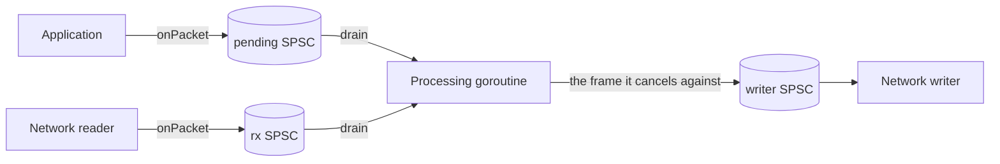
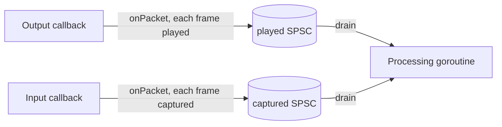

# Wiring one VoIP call

This page gives two recipes for the send path of one call with 20 ms
frames: echo cancellation, noise suppression with voice activity
detection (VAD), then automatic gain control. The audio the application
receives is the "microphone" signal; the audio it sends is the far end,
whose echo may return in the received audio.

| Recipe | Where the far end comes from | Echo canceller call |
|---|---|---|
| [A, paced sending](#recipe-a-sending-paced-by-the-received-frames) | the application chooses the frame to send for each received frame | `Cancel` |
| [B, separate callbacks](#recipe-b-separate-capture-and-playback-callbacks) | playback and capture are delivered apart, each on its own timing | `Playback` and `Capture` |

Each recipe opens with the situations it fits and does not fit, then its
caveats, then the code. Every Go code block on this page is copied from
the tests in `integration/` (`paced_test.go`, `buffered_test.go`,
`call_test.go` and `usage_test.go`), and `TestUsageCodeIsTested` fails if
one is not. Each section names the tests that back it.

New to these packages? The [developer guide](guide.md) explains each
package, the per-frame call order and the goroutine hand-off first, and
the [glossary](glossary.md) defines the terms this page uses.

## Before either recipe

- **Samples.** The packages take `[]int16` samples on the 16-bit scale.
  AudioSocket audio messages carry 16-bit signed linear mono samples,
  little-endian, at 8 kHz in the classic format; other formats and rates
  depend on the Asterisk version and channel setup. Converting payload
  bytes to `[]int16` is the application's job and is not part of this
  library.
- **Rates.** The echo canceller supports 8 and 16 kHz only
  ([ADR `wp6-rates-and-shifts`](decisions/wp6-rates-and-shifts.md)). At any
  other network rate, resample both streams to 16 kHz first, as
  `newCall` does in "Sources that deliver the pairing".
- **One call, one goroutine.** Every processor is single-owner: make one
  set per call and use it from one goroutine. Only `buffer.SPSC` is shared,
  between exactly two goroutines.
- **Receive only.** An application that only receives, such as a recorder
  or a monitor, sends nothing whose echo could return. Neither recipe is
  needed there: `preprocess.Preprocessor.Run` and `agc.AGC.Process` alone
  clean the audio.

## Recipe A: sending paced by the received frames

### Use cases

Fits:

- An application on Asterisk AudioSocket or external media that sends
  audio only when it has some (TTS prompts, a bridged leg, hold music),
  possibly in bursts. In the Asterisk sources (`apps/app_audiosocket.c`
  and `channels/chan_audiosocket.c`), Asterisk forwards the call's frames
  to the application on the call's own clock and writes the
  application's audio to the call as it arrives, without re-timing it or
  adding silence, so the application has to pace what it sends.
- Any application that can choose what to send for each received frame.

The application writes the audio it wants to send, any amount at any
time, into a pending SPSC. For each received frame the processing
goroutine takes at most one pending frame, or silence, hands that frame
to the network writer, and cancels the received frame against that same
frame with `Cancel`. What is sent and what the canceller sees are the
same frames, and they are handled in one step, the case for which the
Speex manual advises `speex_echo_cancellation`.

Does not fit:

- Network rates other than 8 and 16 kHz: the recipe has no resampler.
  Resample both streams first, as `newCall` does in "Sources that
  deliver the pairing".
- Playback and capture that arrive on separate callbacks with their own
  timing: use recipe B.
- A recorder or monitor that only receives: see "Receive only" above.

### Caveats

- **What is sent.** At most one frame is sent for each received frame:
  the oldest pending frame, or silence when none is waiting. Audio the
  application writes faster waits in the pending SPSC (sized by
  `pendingMs`; `onPacket` refuses a frame when it is full); audio it
  writes late goes out in a later slot, after silence. So a burst is sent
  at the call's pace (U12).
- **A full writer.** When the writer's SPSC has no room, `drain` sends
  nothing for that received frame, cancels against silence, and the
  pending frame waits. The call then hears a gap, and the frames the
  writer gets later are sent after the slots `Cancel` assumed for them,
  so the echo shifts against what the canceller saw.
- **Echo delay.** The echo delay counts from the slot of the received frame that
  a sent frame goes with, so it includes the time until that frame is sent. In
  simulated calls with up to 30 ms of jitter, echo delays of 40 to 100 ms
  (`TestPacedDelaySweep`) and of 100 and 200 ms (U11, U12) were cancelled by
  17.1 to 27.2 dB (`docs/testing.md`, "Recipe A"); at 40 and 50 ms, 16 received
  frames lack part of their echo, because it would come from frames not yet
  sent. U6, a 32 ms echo with that jitter, fails (11.1 and 10.7 dB at 8 and 16
  kHz): at that delay part of the echo would come from frames not yet sent, so
  the case is not a physical call. Without jitter a 32 ms echo is cancelled by
  23.9 and 20.3 dB.
- **Filter length.** Choose the shortest `filterMs` that covers the
  largest echo delay expected plus the echo's tail, not the longest
  available. A longer filter costs more per frame
  (`docs/performance.md`) and adapts more slowly; the Speex manual's
  echo-cancellation chapter
  ([node7](https://www.speex.org/docs/manual/speex-manual/node7.html))
  says so and names an over-long tail as a common reason no echo is
  cancelled. U11 uses 256 ms because its longest case, a 200 ms delay
  with a 48 ms tail, needs 248 ms, and 256 ms is the longest length the
  `echo` fixtures test; it keeps that one length for its 100 ms case too,
  so the two cases differ only in the delay.
- **Changing echo delay.** The delay differs between calls and can change
  within one, for example when a jitter buffer resizes, a route changes,
  clocks drift or the caller moves. The canceller does not estimate the
  delay; after each sudden change it re-converges, and cancellation is
  lost for a while: after a step from 100 to 140 ms, 3.5 s at 8 kHz and
  2.5 s at 16 kHz before the echo stage was at 10 dB again (U11).
- **No resync, no drift correction.** The recipe never corrects the
  alignment of the far end against its echo, and a slow drift between
  the clocks over a long call is not corrected. For comparison,
  PulseAudio's echo cancellation module (`module-echo-cancel.c` in the
  PulseAudio sources) resynchronises after a large misalignment and
  corrects slow drift within watermarks. Drift correction here would
  come from the planned clock-drift controller, stretch item S2 in
  `docs/architecture.md`, "Work packages".
- **Typical delays.** Vendor and trade sources (not standards) put the
  delay that VoIP adds at 50 to 80 ms or more, size network echo
  cancellers for 64 ms, up to 128 ms on long paths, and note that the
  network or the phone often removes much of the echo already. These are
  typical figures, not guarantees; measure the calls the application
  handles.
- **Single owner.** `drain` and `received` call one canceller, on the
  processing goroutine. Each SPSC has one producer and one consumer: the
  application writes pending, the network reader writes rx, the
  processing goroutine writes the writer's SPSC, and the writer reads it.
- **Drops.** A received frame that `onPacket` drops is never processed
  and gets no sent frame, so the call hears a gap there. Nothing reports
  it.
- **A stalled processing goroutine.** After a stall, `drain` processes
  all the waiting received frames at once and hands the writer a burst of
  sent frames, which Asterisk plays as they arrive, later than the slots
  `Cancel` assumed for them, so the echo shifts against what the
  canceller saw. Recipe A has no backlog drop.

### Threads (recipe A)



The application hands the audio it wants to send to the pending SPSC.
The network reader hands each received frame to the rx SPSC. For each
received frame, the processing goroutine moves one pending frame, or
silence, to the writer SPSC and cancels the received frame against it.
The network writer sends only what it is handed, so sending is paced by
the received frames.

### Recipe A, step 1: make the processors and the hand-offs

```go
func newPacedCall(rate, frameMs, filterMs int) (*pacedCall, error) {
	// No resampler here: the echo canceller supports 8 and 16 kHz, so the
	// network must run at one of them.
	if rate != 8000 && rate != 16000 {
		return nil, fmt.Errorf("call: %d Hz; the echo canceller supports 8 and 16 kHz only", rate)
	}
	// One frame is the same duration on the network and here (20 ms: 160
	// samples at 8 kHz, 320 at 16 kHz).
	b := &pacedCall{rate: rate, frame: rate * frameMs / 1000}
	if !preprocess.SupportedFrameSize(b.frame) {
		return nil, fmt.Errorf("call: no preprocessor for %d-sample frames", b.frame)
	}
	var err error
	// The filter must cover the largest echo delay plus its tail; a longer
	// one costs more and adapts more slowly, so filterMs is the caller's.
	b.ec, err = echo.New(echo.Config{FrameSize: b.frame, FilterLength: rate * filterMs / 1000, SampleRate: rate})
	if err != nil {
		return nil, err
	}
	b.pre, err = preprocess.New(preprocess.Config{SampleRate: rate, FrameSize: b.frame})
	if err != nil {
		return nil, err
	}
	b.pre.SetVAD(true) // the VAD decision tells the AGC which frames are speech
	b.gc, err = agc.New(agc.DefaultConfig(rate))
	if err != nil {
		return nil, err
	}
	// Scratch buffers, made once so the per-frame path never allocates.
	b.echoed = make([]int16, b.frame)
	b.clean = make([]int16, b.frame)
	b.residual = make([]int32, b.ec.ResidualLen())
	return b, nil
}
```

```go
func newPacedHandoffs(b *pacedCall, pendingMs int) (pending, rx, toWriter *buffer.SPSC, err error) {
	// pending holds what the application wants to send, so its size is the
	// longest burst it may write at once (rate*ms/1000 samples).
	if pending, err = buffer.NewSPSC(buffer.SPSCConfig{Capacity: b.rate * pendingMs / 1000}); err != nil {
		return nil, nil, nil, err
	}
	// rx and toWriter each hold 200 ms (rate/5 samples): room for a stall
	// of the processing goroutine or of the writer.
	if rx, err = buffer.NewSPSC(buffer.SPSCConfig{Capacity: b.rate / 5}); err != nil {
		return nil, nil, nil, err
	}
	toWriter, err = buffer.NewSPSC(buffer.SPSCConfig{Capacity: b.rate / 5})
	return pending, rx, toWriter, err
}
```

The application and the network reader feed their SPSCs with `onPacket`,
which stores a whole frame or none of it:

```go
func onPacket(rx *buffer.SPSC, p []int16) bool {
	// SPSC.Write stores as much as fits. A partial frame would shift every
	// later frame boundary, so store the whole frame or nothing.
	if rx.Free() < len(p) {
		return false // the processor is behind: drop this packet
	}
	rx.Write(p)
	return true
}
```

### Recipe A, step 2: send one frame and clean the received frame

```go
func (b *pacedCall) drain(pending, rx, toWriter *buffer.SPSC, far, mic, out []int16, deliver func([]int16)) error {
	// One step per received frame waiting now; frames that arrive while
	// this runs wait for the next call, so the work is bounded.
	for range rx.Len() / b.frame {
		// At most one frame is sent per received frame, so sending runs at
		// the call's own pace, whatever the application writes.
		switch {
		case toWriter.Free() < b.frame:
			// The writer is behind: send nothing, keep the pending frame,
			// and assume silence plays in this slot.
			clear(far)
		case pending.Len() >= b.frame:
			pending.Read(far)
			toWriter.Write(far)
		default:
			// Nothing to send: send silence, so the call keeps a steady
			// stream and the canceller keeps a far end for this slot.
			clear(far)
			toWriter.Write(far)
		}
		rx.Read(mic)
		// Cancel against exactly the frame just handed to the writer (or
		// silence when none was): the far end it sees is what was sent.
		if err := b.received(mic, far, out); err != nil {
			return err
		}
		deliver(out)
	}
	return nil
}
```

```go
func (b *pacedCall) received(mic, sent, out []int16) error {
	// Cancel models the echo of the frames sent so far, the one sent with
	// this received frame included, and removes it from mic.
	if err := b.ec.Cancel(mic, sent, b.echoed); err != nil {
		return err
	}
	return b.finish(out)
}
```

```go
func (b *pacedCall) finish(out []int16) error {
	// Keep the canceller's output in echoed and work on a copy, because the
	// preprocessor rewrites its frame in place.
	copy(b.clean, b.echoed)
	// The residual is the echo the canceller left in this frame; read it
	// now, before the next frame replaces it.
	if err := b.ec.Residual(b.residual); err != nil {
		return err
	}
	speech, err := b.pre.RunEcho(b.clean, b.residual)
	if err != nil {
		return err
	}
	b.speech = speech
	// The AGC raises the gain only on speech frames.
	return b.gc.Process(b.clean, out, speech)
}
```

For each received frame:

1. `drain` chooses the frame to send: the oldest pending frame, silence
   when none is waiting, or nothing when the writer is behind.
2. It hands that frame to the writer.
3. `Cancel` removes the echo of the frames sent so far, this one
   included, from the received frame.
4. `Residual` reads the echo `Cancel` left in this frame, and `RunEcho`
   suppresses it with the noise, in place, and returns the VAD decision.
   This is the pairing of `docs/contracts.md` section 12.
   `TestReferenceRecipes` checks steps 3 and 4 bit for bit against the C
   chain, in which the preprocessor holds the echo state.
5. The AGC applies its gain, raising it only on speech frames.

Tests:

- `TestPacedUnevenTiming`: application and received frames each up to
  30 ms late; the echo stage must reach 15 dB with a 32 ms echo (U6), and
  does not (a reported finding). It also reports a 100 ms application
  pause followed by a burst (U10, with `-report`).
- `TestPacedBurstSender`: 12 s of audio written at once; the frames sent
  are the frames the canceller got, checked by a bit-exact replay, the
  non-silent frames sent equal the application's in order, and the echo
  stage must reach 15 dB with a 100 ms echo (U12).
- `TestPacedLongDelay`: echo delays of 100 and 200 ms with a 256 ms
  filter must reach 15 dB (U11); it also reports the recovery after a
  step from 100 to 140 ms (with `-report`).
- `TestPacedIdleSender`: one frame is sent per received frame, silence
  after the application stops, against captures with nothing queued
  (U7).
- `TestPacedFourGoroutines`: the application, the network reader, the
  writer and the processing goroutine run concurrently; the writer's
  frames are the canceller's, at most one application frame per received
  frame, in order, silence otherwise, and a replay gives the same
  canceller and chain output (U8).
- `TestPacedWriterFull`: with the writer's SPSC full, nothing is sent,
  silence is cancelled against, and the pending frame goes out with the
  next received frame.
- `TestReferenceRecipes`: recipe A's `received` on the reference
  pairing's `cancel_*_20ms` inputs gives the C chain's canceller output,
  residual, preprocess output and VAD decision bit for bit.
- `TestNoAllocsPaced` (U9), and `TestPacedDelaySweep`, which only
  reports figures and runs with `-report` (`docs/testing.md`).

### Sources that deliver the pairing

A source that already delivers each received frame together with the
frame sent at the same time, such as one sound card driving both, needs
no pending SPSC: it is the same `Cancel` call with the pairing given by
the source. The tests keep that wiring as `call` (`call_test.go`): one
`step` per frame, and resampling to 16 kHz where the source runs at
another rate. `newCall` sizes every buffer from the rate and the frame
duration, with `preprocess.SupportedFrameSize` and `resample.OutLen`:

```go
func newCall(netRate, frameMs int) (*call, error) {
	// Process at the network rate when the echo canceller supports it, so
	// nothing is resampled; otherwise resample to 16 kHz.
	rate := netRate
	if rate != 8000 && rate != 16000 {
		rate = 16000 // the echo canceller supports 8 and 16 kHz only
	}
	// A frame is the same duration at both rates, so one network frame
	// becomes one processing frame (20 ms: 160 samples at 8 kHz).
	c := &call{
		netRate: netRate, rate: rate,
		netFrame: netRate * frameMs / 1000, frame: rate * frameMs / 1000,
	}
	// The preprocessor's FFT needs a supported frame size; check it before
	// building anything, so a bad frame duration fails here, not mid-call.
	if !preprocess.SupportedFrameSize(c.frame) {
		return nil, fmt.Errorf("call: no preprocessor for %d-sample frames", c.frame)
	}

	var err error
	c.ec, err = echo.New(echo.Config{
		FrameSize:    c.frame,
		FilterLength: rate / 5, // models echo delays up to 200 ms
		SampleRate:   rate,
	})
	if err != nil {
		return nil, err
	}
	c.pre, err = preprocess.New(preprocess.Config{SampleRate: rate, FrameSize: c.frame})
	if err != nil {
		return nil, err
	}
	// The VAD decision is what tells the AGC which frames are speech.
	c.pre.SetVAD(true) // denoise is on by default
	c.gc, err = agc.New(agc.DefaultConfig(rate))
	if err != nil {
		return nil, err
	}
	// Scratch buffers, made once so the per-frame path never allocates; the
	// residual spectrum has one value more than the frame (ResidualLen).
	c.clean = make([]int16, c.frame)
	c.residual = make([]int32, c.ec.ResidualLen())

	// Resampling only where the network rate is not 8 or 16 kHz: one
	// resampler per stream, because each keeps its own filter history.
	if rate != netRate {
		rs := resample.Config{Channels: 1, InRate: netRate, OutRate: rate, Quality: resample.QualityVoIP}
		if c.micRS, err = resample.New(rs); err != nil {
			return nil, err
		}
		if c.farRS, err = resample.New(rs); err != nil {
			return nil, err
		}
		// OutLen gives the output space one call needs to consume a whole
		// network frame, so no input is ever left behind.
		c.rsOut = make([]int16, c.micRS.OutLen(c.netFrame))
		// Less than one frame waits between calls, plus one call's output.
		q := buffer.Config{Capacity: c.frame + len(c.rsOut), Overflow: buffer.Reject}
		if c.micQ, err = buffer.New(q); err != nil {
			return nil, err
		}
		if c.farQ, err = buffer.New(q); err != nil {
			return nil, err
		}
		c.micBuf = make([]int16, c.frame)
		c.farBuf = make([]int16, c.frame)
	}
	return c, nil
}
```

Where the source runs at another rate, `process` resamples both streams
into queues sized from `OutLen`, `resampleInto` reports a resampler that
leaves input unread or a queue without room, and `outLen` sizes the
output:

```go
func (c *call) process(mic, far, out []int16) (int, error) {
	// Without resampling a network frame is a processing frame.
	if c.micRS == nil {
		return c.frame, c.step(mic, far, out[:c.frame])
	}
	// Resample both streams the same way, so that they stay paired sample
	// for sample, and queue the results until a whole frame is there.
	if err := c.resampleInto(c.micRS, c.micQ, mic); err != nil {
		return 0, err
	}
	if err := c.resampleInto(c.farRS, c.farQ, far); err != nil {
		return 0, err
	}
	// The echo canceller and the preprocessor take whole frames only. Both
	// queues hold the same number of samples, so checking one is enough.
	n := 0
	for c.micQ.Len() >= c.frame && n+c.frame <= len(out) {
		c.micQ.Read(c.micBuf)
		c.farQ.Read(c.farBuf)
		if err := c.step(c.micBuf, c.farBuf, out[n:n+c.frame]); err != nil {
			return n, err
		}
		n += c.frame
	}
	return n, nil
}
```

```go
func (c *call) resampleInto(r *resample.Resampler, q *buffer.Ring, x []int16) error {
	// A resampler may leave input unread when its output is full; with
	// rsOut sized by OutLen that cannot happen, so it is reported as an error.
	read, written, err := r.Process(x, c.rsOut)
	if err != nil {
		return err
	}
	if read != len(x) {
		return errShortRead
	}
	// The queue is sized so that it always has room; a short write would
	// drop samples and unpair the two streams, so it is reported too.
	if q.Write(c.rsOut[:written]) != written {
		return errQueueFull
	}
	return nil
}
```

```go
func (c *call) outLen() int { return 2 * c.frame }
```

The source's frames reach the processing goroutine through one SPSC with
room for 200 ms; `drain` drops a backlog after a stall and keeps each
frame paired. The tests pass `maxBacklog` `3*c.netFrame` (three frames)
where they test the drop (`TestDrainDropsBacklog`, `TestNoAllocsRecipe`,
`TestRecipeDropsUnderRace`) and `math.MaxInt` where no drop may happen
(`TestRecipeThroughSPSC`):

```go
func newRx(c *call) (*buffer.SPSC, error) {
	// netRate/5 samples is 200 ms of network audio: room for a stall of
	// about ten 20 ms frames before onPacket has to drop.
	return buffer.NewSPSC(buffer.SPSCConfig{Capacity: c.netRate / 5})
}
```

```go
func (c *call) drain(rx *buffer.SPSC, maxBacklog int, mic, out []int16,
	far func() []int16, deliver func([]int16)) error {
	// After a stall, old audio is useless for a live call: keep only the
	// newest frame, and skip the far frames of the dropped ones so that
	// each frame keeps its far frame.
	if rx.Len() > maxBacklog {
		for range rx.Consume(rx.Len()-c.netFrame) / c.netFrame {
			far()
		}
	}
	// Each received frame is processed with the frame sent at the same
	// time, which far returns in order.
	for rx.Len() >= c.netFrame {
		rx.Read(mic)
		n, err := c.process(mic, far(), out)
		if err != nil {
			return err
		}
		deliver(out[:n])
	}
	return nil
}
```

```go
func (c *call) step(mic, far, out []int16) error {
	// Remove the echo of far, the frame sent at the same time, from mic.
	if err := c.ec.Cancel(mic, far, c.clean); err != nil {
		return err
	}
	// The residual is the echo that Cancel could not remove from this very
	// frame, so it must be read after Cancel and before the next one.
	if err := c.ec.Residual(c.residual); err != nil {
		return err
	}
	// The preprocessor suppresses noise and that residual echo in place,
	// and decides whether the frame is speech.
	speech, err := c.pre.RunEcho(c.clean, c.residual)
	if err != nil {
		return err
	}
	// The AGC raises the gain only on speech frames, so the VAD decision
	// keeps it from turning up pauses.
	return c.gc.Process(c.clean, out, speech)
}
```

`TestReferencePairing`, `TestRecipeThroughSPSC`,
`TestRecipeDropsUnderRace`, `TestDrainDropsBacklog`,
`TestQueueFullIsReported`, `TestPipelineCall`, `TestPipelineSpeech` and
`TestNoAllocsRecipe` back it, and `Example_call` prints the sizes of its
buffers at 8, 16 and 48 kHz.

## Recipe B: separate capture and playback callbacks

### Use cases

Fits:

- An audio API that delivers capture and playback on separate callbacks
  or threads, each with its own timing: the output callback reports each
  frame it played, the input callback each frame it captured, and one
  processing goroutine gets both through SPSCs.

Does not fit:

- Applications that choose what to send for each received frame: recipe
  A cancels against exactly that frame, without a lag.
- Rates other than 8 and 16 kHz: the recipe has no resampler.
- An echo that returns within about two frame periods of the frame that
  caused it (32 ms failed, 40 ms passed without jitter, 20 ms frames), or,
  with up to 30 ms of jitter between the callbacks, within 50 ms (see
  "Caveats").
- A recorder or monitor that only receives: see "Receive only" above.

### Caveats

- **One played frame per captured frame.** For each captured frame,
  `drain` queues one played frame with `Playback`, or silence when none
  has arrived, then calls `Capture`; a late played frame waits for the
  next captured frame. The canceller's queue then never runs dry or
  overflows.
- **The far end's lag.** With `Playback` before each `Capture`, captured
  frame k is cancelled against the frame queued with captured frame k-1:
  one frame of lag (`TestBufferedLagIsOneFrame` checks it bit for bit
  against `Cancel`). The SpeexDSP header (`speex_echo.h`) speaks of two
  frames: the queue starts with two frames of silence (`mdf.c:517`,
  `PLAYBACK_DELAY`), but a `Playback` before the first `Capture` is
  discarded (`mdf.c:656`), so after the first `Capture` takes one silence
  frame (`mdf.c:635-640`) each `Capture` finds the frame queued one call
  earlier; the lag is two frames when `Capture` comes before `Playback`.
  The first played frame is lost the same way.
- **The far end's shift.** On top of that one frame, the far end lags by
  the number of played frames waiting in their SPSC when a captured frame
  is processed. It rises by one when a captured frame finds no played
  frame (silence is queued, and the late frame then waits), falls when
  fewer frames are played than captured, and is capped by the SPSC
  (200 ms), where `onPacket` drops played frames. Reasoning from the
  code, not measured: while one frame is played per captured frame, it
  stays at most the largest delay of a played frame behind its captured
  frame, rounded up to whole frames.
- **Echo delay.** The canceller models echo delays from that lag to the
  end of its filter (the `echo` package doc, "Stream alignment").
  Measured with up to 30 ms of jitter between the callbacks
  (`docs/testing.md`, "Recipe B"): delays of 60 to 200 ms were cancelled
  by 19.2 to 31.4 dB, 50 ms and less were not (0.3 to 1.2 dB); U6, at
  32 ms, fails (0.7 and 0.3 dB). Without jitter 40 ms is cancelled, but
  32 ms gives only 7.6 and 11.9 dB at 8 and 16 kHz; why a one-frame lag
  loses there is not traced.
- **Silence when nothing was played.** Queuing silence keeps the
  canceller cancelling the echo tail of what was played before (U7,
  `TestBufferedIdleSender`); captures that find the queue empty would
  pass the captured frames through.
- **Filter length, changing delay, no drift correction.** As for recipe
  A: choose the shortest filter that covers the largest delay plus its
  tail; after a step from 100 to 140 ms the echo stage was at 10 dB again
  after 3.5 s at 8 kHz and 3.0 s at 16 kHz (U11); the far end is never
  realigned and clock drift between the callbacks is not corrected
  (stretch item S2).
- **Single owner.** `played` and `received` call one canceller, so both
  run on the processing goroutine. Each callback writes its own SPSC.
- **Drops.** A played frame that `onPacket` drops is never queued, and a
  captured frame that it drops is never processed; either moves the far
  end against its echo. Nothing reports it.

### Threads (recipe B)



Each callback hands its frames to its own SPSC. The processing goroutine
drains both on its own clock, one played frame per captured frame.

### Recipe B, step 1: make the processors and the hand-offs

```go
func newBufferedCall(rate, frameMs, filterMs int) (*bufferedCall, error) {
	// No resampler here: the echo canceller supports 8 and 16 kHz, so run
	// the device at one of them, or resample both streams first.
	if rate != 8000 && rate != 16000 {
		return nil, fmt.Errorf("call: %d Hz; the echo canceller supports 8 and 16 kHz only", rate)
	}
	b := &bufferedCall{rate: rate, frame: rate * frameMs / 1000}
	if !preprocess.SupportedFrameSize(b.frame) {
		return nil, fmt.Errorf("call: no preprocessor for %d-sample frames", b.frame)
	}
	var err error
	// The filter must cover the largest echo delay plus its tail; a longer
	// one costs more and adapts more slowly, so filterMs is the caller's.
	b.ec, err = echo.New(echo.Config{FrameSize: b.frame, FilterLength: rate * filterMs / 1000, SampleRate: rate})
	if err != nil {
		return nil, err
	}
	b.pre, err = preprocess.New(preprocess.Config{SampleRate: rate, FrameSize: b.frame})
	if err != nil {
		return nil, err
	}
	b.pre.SetVAD(true) // the VAD decision tells the AGC which frames are speech
	b.gc, err = agc.New(agc.DefaultConfig(rate))
	if err != nil {
		return nil, err
	}
	// Scratch buffers, made once so the per-frame path never allocates.
	b.echoed = make([]int16, b.frame)
	b.clean = make([]int16, b.frame)
	b.residual = make([]int32, b.ec.ResidualLen())
	return b, nil
}
```

```go
func newBufferedRx(b *bufferedCall) (sent, rx *buffer.SPSC, err error) {
	// 200 ms each (rate/5 samples): room for the processing goroutine to
	// stall while both callbacks keep delivering.
	if sent, err = buffer.NewSPSC(buffer.SPSCConfig{Capacity: b.rate / 5}); err != nil {
		return nil, nil, err
	}
	rx, err = buffer.NewSPSC(buffer.SPSCConfig{Capacity: b.rate / 5})
	return sent, rx, err
}
```

### Recipe B, step 2: queue played frames and clean captured ones

```go
func (b *bufferedCall) played(far []int16) error { return b.ec.Playback(far) }
```

```go
func (b *bufferedCall) received(mic, out []int16) error {
	// Capture cancels mic against the oldest frame Playback queued: the one
	// played with the previous captured frame.
	if err := b.ec.Capture(mic, b.echoed); err != nil {
		return err
	}
	// Keep the canceller's output in echoed and work on a copy, because the
	// preprocessor rewrites its frame in place.
	copy(b.clean, b.echoed)
	// The residual is the echo the canceller left in this frame; read it
	// now, before the next frame replaces it.
	if err := b.ec.Residual(b.residual); err != nil {
		return err
	}
	speech, err := b.pre.RunEcho(b.clean, b.residual)
	if err != nil {
		return err
	}
	b.speech = speech
	// The AGC raises the gain only on speech frames.
	return b.gc.Process(b.clean, out, speech)
}
```

```go
func (b *bufferedCall) drain(sent, rx *buffer.SPSC, far, mic, out []int16, deliver func([]int16)) error {
	// One step per captured frame waiting now; frames that arrive while
	// this runs wait for the next call, so the work is bounded.
	for range rx.Len() / b.frame {
		// Queue exactly one played frame per captured frame. More would
		// overflow the canceller's queue of three frames, none would empty
		// it; either breaks the alignment it cancels against.
		if sent.Len() >= b.frame {
			sent.Read(far)
		} else {
			// No played frame has arrived yet: queue silence in its place;
			// the late frame then waits for the next captured frame.
			clear(far)
		}
		if err := b.played(far); err != nil {
			return err
		}
		rx.Read(mic)
		if err := b.received(mic, out); err != nil {
			return err
		}
		deliver(out)
	}
	return nil
}
```

Tests:

- `TestBufferedUnevenTiming`: both callbacks' frames up to 30 ms late;
  the echo stage must reach 15 dB with a 32 ms echo (U6), and does not
  (a reported finding). It also reports a 100 ms output pause followed
  by a burst (U10, with `-report`).
- `TestBufferedLongDelay`: echo delays of 100 and 200 ms with a 256 ms
  filter must reach 15 dB (U11); it also reports the recovery after a
  step from 100 to 140 ms (with `-report`).
- `TestBufferedIdleSender`: silence queued after the output stops,
  against captures with nothing queued (U7).
- `TestBufferedTwoGoroutines`: both callbacks as goroutines, compared with
  a replay of the observed order (U8).
- `TestReferenceRecipes`: recipe B's `played` and `received` on the
  reference pairing's `capture_*_20ms` inputs give the C chain's output
  bit for bit.
- `TestBufferedLagIsOneFrame`, `TestNoAllocsBuffered` (U9), and
  `TestBufferedLagAndDelay`, which only reports figures and runs with
  `-report`.

## What the measurements show

`docs/testing.md`, section "Whole-chain measurements", has the figures.
In short:

- At 8 and 16 kHz the in-step wiring passes every pipeline criterion of
  `docs/acceptance/integration.md` on the synthetic call and on
  LibriSpeech speech.
- The VAD reports speech on stationary noise and on residual echo, so
  `GateLevel` is the AGC's only protection. With the default gate of
  -50 dBFS, the AGC raises what noise suppression leaves of white noise
  from about -40 dBFS and pink noise from about -52 dBFS at the input by
  16 to 23 dB, so that noise leaves the chain 3.5 to 18.6 dB louder than
  it entered. Set `GateLevel` above the residual noise of the line.
- On the chain resampled from 48 kHz the echo canceller cancelled less
  (16 dB) and the AGC held the near end lower (-33 dBFS), a reported
  finding.
- On an Apple M1 Pro the 99th percentile of the whole chain is 0.4% to
  2.5% of the frame duration. The slowest single frame of a 10-minute run
  varied between runs, up to 65% of a 10 ms frame
  (`docs/performance.md`).
- Recipe A sends what it cancels against, one frame per received frame,
  also when the application writes in bursts. In simulated calls with up
  to 30 ms of jitter it cancelled echo delays of 40 to 200 ms by 17.1 to
  27.2 dB (U11, U12 and the reported sweep; at 40 and 50 ms some frames
  lack part of their echo); with a 32 ms echo it does not (U6, a reported
  finding).
- Recipe B cancels with one frame of lag; with up to 30 ms of jitter it
  cancelled echo delays of 60 to 200 ms, not 50 ms and less (U6 fails).
